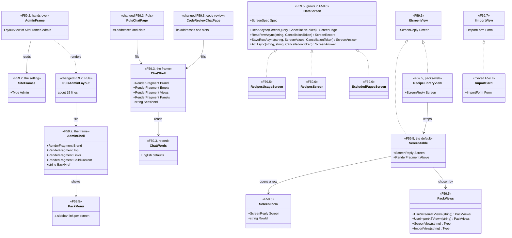
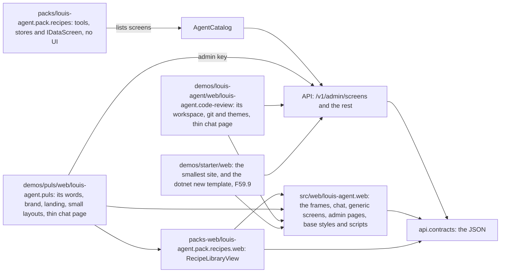
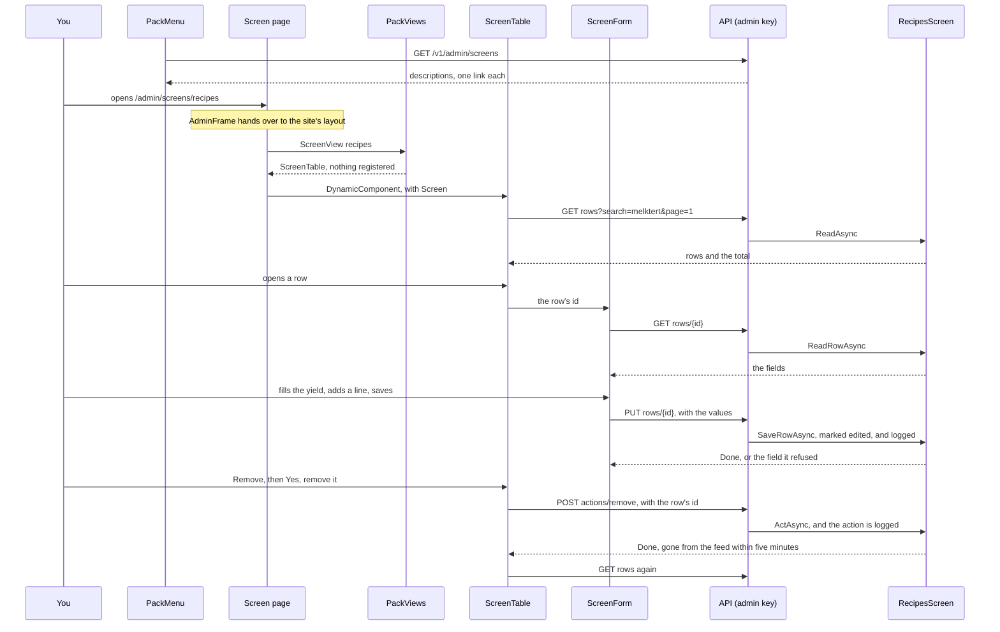
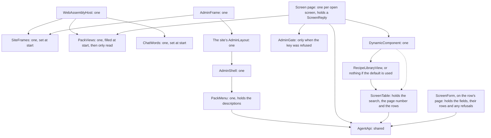

# F59 The framework's web

> **Plan, for your review. Replaces the earlier versions, which were called "Pack web controls".** `web.shared` becomes
> `louis-agent.web`, the framework's web: everything that would be the same on any site. A site is a small program on top of it,
> and a pack's screens work one way. All twelve decisions are in. No code until you say go.
> **Elsewhere:** the split it extends in [ADR 0074](../adr/0074-the-folders-say-what-ships.md); the seam it follows in
> [ADR 0083](../adr/0083-packs-keep-reports-behind-the-admin-key.md); what gets amended in
> [ADR 0082](../../../packs/docs/adr/0082-the-recipe-library-is-an-open-feed.md).

## The goal, in Louis's words

"why don't packs have their own project, where the web controls live?", "should be overrideable and customised", "also add a
recipe management screen, which is driven from the pack", "all our pack controls will work like that", "move the puls layout to
shared and do the same as with admin, then we can spawn new sites, make a rule", and "the shared library becomes a framework web".

## In one paragraph

`louis-agent.web` holds what every site shares: the admin and chat frames with empty slots, the working parts, the generic pack
screens, and a base stylesheet. A site holds only what makes it that site: its words, brand, colours, addresses, landing page and
any pages of its own. A pack describes a screen as plain data, and a generic screen draws it. When a description can't say what's
wanted, a real component replaces it by name, and a demo's beats a pack's. It's the split the engine already has, now on the web.

## The rule, for your wording

> **A web file that would be the same on every site belongs in `louis-agent.web`. A site holds only its words, its brand and colours,
> its addresses, its own pages, and which packs and views it uses. The framework names no site.**

**Where it lives:** a new ADR, one line in `src/docs/CLAUDE.md`, and the how in `.claude/rules/razor.md`.

**What holds it,** so it isn't only words: a test that `louis-agent.web` has no site's name in its code, styles or scripts, and a
test that a site's layouts stay small, about 40 lines each.

## What others do, and where we differ

| Approach | Who does it | How it works |
|---|---|---|
| **The look and frame are a library the app picks** | [ABP themes](https://abp.io/docs/latest/framework/ui/blazor/theming) | A theme is a Razor Class Library holding layouts and global styles. Modules don't depend on a theme, and the app can override parts |
| **The plugin ships real pages** | [Microsoft](https://learn.microsoft.com/en-us/aspnet/core/blazor/components/class-libraries?view=aspnetcore-10.0), [Backstage](https://backstage.io/docs/frontend-system/architecture/extensions), [Grafana](https://grafana.com/developers/plugin-tools/key-concepts/plugin-types-usage) | The plugin holds the pages, and the app adds them to its router and menu |
| **The plugin describes the screen** | [Django admin](https://docs.djangoproject.com/en/5.2/ref/contrib/admin/), [Filament](https://filamentphp.com/docs/4.x/resources/overview) | The plugin lists columns, search, actions and forms; one generic screen draws them; custom templates or pages cover the rest |
| **A new project comes from a template** | [`dotnet new`, Microsoft](https://learn.microsoft.com/en-us/dotnet/core/tools/templates) | An ordinary project plus a small config file becomes a template |
| **The formal spec: MCP Apps** | [MCP](https://modelcontextprotocol.io/docs/extensions/apps) | The server ships HTML that runs in a sandboxed frame inside a chat, and it acts only through the server's tools |

**Where we go against them:** a screen's description crosses the wire as JSON, whereas Django and Filament draw on the server. I
found no strong source on doing this for an admin. The risk is the vocabulary growing without end, so **a new kind of column, field
or control enters only when a second screen needs it; until then it's a custom component.** The edit form is the one exception,
which you chose knowingly, and it stays small: text, number, link and rows.

## Context: what we have today

- **Puls's web app is about 13,100 lines and `web.shared` about 2,200,** so most of the sorting is still to do.
- **Puls's `MainLayout` is only `@Body`.** The real chat frame is `ChatPage` and `Components/Chat`, about 1,500 lines. So the chat
  frame moves as a component, not a layout.
- **The chat's addresses are words:** `/gesels` and `/verken` in Puls, `/chat/{id}` in the code-review app. So a chat page stays a
  thin page in each site, whereas the admin's pages can be shared.
- **Puls's admin is about 10,600 lines, not the 4,000 I told you.** It calls only the framework API's `/v1/admin` routes. "Puls" appears
  in it mostly as page titles and the `pulsUi` script's name, so it looks movable.
- **The code-review app has its own chat page,** so it's a second real user of the chat frame, which tests the slots honestly.
- **`web.shared` has no stylesheet and no routable pages.** Puls's chat, frame and admin styles are about 1,600 lines. Its landing's
  341 lines stay.
- **The code-review app already has the colour contract we need.** Its `base/page.css` uses only variables that a theme sets (`--bg`,
  `--panel`, `--accent` and so on), with two themes, `retro` by default and `paper`. Puls has its own names (`--orange`, `--ink`).
- **Step 1 of the first plan is committed** (`AdminGate`) and holds. **Step 2 is uncommitted** (`ReportsPanel`), and goes under your
  pick on reports.
- **Recipes have no screen.** `IRecipeStore` can't remove or change a recipe, and `IExcludedPages` can't list or clear pages. The first
  copy of a page stays (`KeepAsync` only inserts), so a later read can't overwrite a hand edit.

## Decided by Louis

| # | Decision | Your pick | What it means here |
|---|---|---|---|
| | The overall shape | **C:** described first, a real component when needed | Packs' screens |
| | The name | **A:** `louis-agent.web` | The code-review app becomes `louis-agent.code-review`, with Rider's rename |
| 1 | Do reports become described screens? | **A:** yes, one seam | `IDataReport`, its route, `ReportCard` and the Reports page go, and ADR 0083 is replaced. Uncommitted step 2 is thrown away |
| 2 | Where does the generic page live? | **C:** in the framework, with the frame | A site writes no admin page |
| 3 | What draws the table? | **A:** a plain table of our own | No package |
| 4 | Removing a recipe | **A:** delete it and exclude the page | It stays gone until cleared. The answer says it may serve for five more minutes |
| 5 | What does the recipe screen do? | **C:** a full edit form | Forms enter the vocabulary. The address, the site and when it was read stay read-only |
| 6 | How do slots reach a shared frame? | **C:** a shared component, with a small layout in each site | `AdminShell` takes ordinary slots, checked at build. A site writes about fifteen lines |
| 7 | Editing lists with sections | **B:** a row per line | Each ingredient or step has a section box and buttons to add, remove and move. The vocabulary gains `Rows` |
| 8 | Does a hand edit say so? | **A:** mark it | The copy records when it was edited, and the screen shows it |
| 9 | How does a framework page get the site's admin frame? | **A:** a framework layout that hands over (Bridge) | Framework pages say `@layout AdminFrame`, which reads the site's layout from one setting and renders it with [`LayoutView`](https://learn.microsoft.com/en-us/aspnet/core/blazor/components/layouts). A forgotten setting says so plainly |
| 10 | Where does the look live? | **A:** a base stylesheet in the framework, in louis-agent's colours | Styles move to `_content/louis-agent.web/`. With no colours of its own, a site looks like louis-agent. Puls sets its own |
| 11 | Do Puls's eval pages move too? | **A:** all of them, as their own child | F59.8, whose plan starts by proving nothing in them is Puls's own |
| 12 | How is a new site spawned? | **A:** a starter site plus a `dotnet new` template | F59.9. It works inside this repo until NuGet packages exist |

## Design: what changes

**A site says everything in a few small places.** Puls's admin layout becomes:

```razor
@inherits LayoutComponentBase

<AdminShell BackHref="gesels" BackLabel="@PulsText.BackToPuls" BrandTitle="@PulsText.Home">
    <Brand><PulsLogo /></Brand>
    <Top><LiveRunStrip /></Top>
    <ChildContent>@Body</ChildContent>
</AdminShell>
```

and `Program.cs` names the rest. The labels go through the site's message enum (ADR 0009), and are plain here to read easily:

```csharp
builder.Services.AddSingleton(new SiteFrames(Admin: typeof(AdminLayout)));
builder.Services.AddSingleton(PulsText.ChatWords);                     // the chat's words; with none, English defaults

var views = new PackViews();                                           // the default: ScreenTable for every screen
RecipeWebViews.AddTo(views);                                           // the pack's own, from packs-web
views.UseScreen<OurOwnLibraryView>("recipe-library");                  // a demo's override, if it wants one: the last wins
builder.Services.AddSingleton(views);
```

**The sidebar.** `AdminShell` draws the framework's admin links (once they've moved) and `PackMenu`, which asks the API what screens
exist, so a pack's link appears with no change to the site. A site can add its own links through a slot.

**The chat frame.** `ChatShell` holds the page's frame, state and handlers, with slots for what differs: the brand, the empty chat,
extra views such as Verken, and side panels. Each site keeps a thin page with its own addresses. Words come from a `ChatWords` record
with English defaults, and Puls fills it in Afrikaans.

**Pack screens.** One seam, `IDataScreen`, one family of routes, one generic screen, and one override list. A custom view can wrap the
default: `ScreenTable` takes an optional `Above` fragment, so the recipes view adds its *Of 10 offered, 1 served* line in about 20
lines. A row comes back as fields, each with a kind and whether it's read-only or required. The pack checks what's saved, and a
refusal names the field.

**The look.** The framework's base styles use only louis-agent's colour contract, and its default theme is louis-agent's `retro`, with
`paper` beside it. A site with no colours of its own looks like louis-agent. Puls sets the same variables to its orange and charcoal,
so it looks as it does today.

**Uploads keep their own seam.** A file, a preview and a save make a process, not a table. They share the frame, the sidebar,
`AdminGate` and the override list.

**Safety.** Everything sits behind the admin key. A screen can do only what its pack named, an unknown action or row is a 404, values
travel as data, and every save and action is logged. An action that destroys something carries a `Confirm` text and takes two clicks,
never a browser dialog. Nothing here is a tool, so no model can call it.

### Interface design



```csharp
// src/web/louis-agent.web: the frames. F59.2, F59.3
public sealed record SiteFrames(Type Admin);        // the site's admin layout, read by AdminFrame
public sealed record ChatWords { /* every word the chat frame shows, each with an English default */ }

// src/engine/louis-agent.composition/Packs/Screens: what a pack implements. Plain data, no Blazor. F59.5
public interface IDataScreen
{
    ScreenSpec Spec { get; }
    Task<ScreenPage> ReadAsync(ScreenQuery query, CancellationToken cancellationToken);   // an empty page if its store is down
    // F59.6, each refusing by default, so a read-only screen writes none of them
    Task<ScreenRecord?> ReadRowAsync(string rowId, CancellationToken cancellationToken);
    Task<ScreenAnswer> SaveRowAsync(string rowId, ScreenValues values, CancellationToken cancellationToken);
    Task<ScreenAnswer> ActAsync(string action, string? rowId, CancellationToken cancellationToken);
}

public sealed record ScreenSpec(string Name, string Title, string Description, IReadOnlyList<ScreenColumn> Columns,
    bool Searchable, IReadOnlyList<ScreenAction> Actions);
public sealed record ScreenColumn(string Title, ScreenCell Kind);
public enum ScreenCell { Text, Number, Link, Date }                         // the whole vocabulary for a column
public sealed record ScreenQuery(string? Search, int Page);
public sealed record ScreenPage(IReadOnlyList<ScreenRow> Rows, long Total);
public sealed record ScreenRow(string Id, IReadOnlyList<string?> Cells);    // null is "unknown", never 0 or ""

// F59.6: what can be done, and one row as a form
public sealed record ScreenAction(string Name, string Label, ScreenActionOn On, string? Confirm);
public enum ScreenActionOn { Row, Screen }
public sealed record ScreenRecord(string Title, IReadOnlyList<ScreenField> Fields);
public sealed record ScreenField(string Name, string Label, ScreenFieldKind Kind, bool ReadOnly, bool Required,
    string? Value, IReadOnlyList<string> RowColumns, IReadOnlyList<IReadOnlyList<string>> Rows);
public enum ScreenFieldKind { Text, Number, Link, Rows }                    // the whole vocabulary for a field
public sealed record ScreenValues(IReadOnlyDictionary<string, string?> Values,
    IReadOnlyDictionary<string, IReadOnlyList<IReadOnlyList<string>>> Rows);
public sealed record ScreenAnswer(bool Done, string Message, IReadOnlyDictionary<string, string> FieldErrors);

// src/web/louis-agent.web/Components/Packs: the last one registered wins. F59.5
public interface IScreenView { ScreenReply Screen { get; set; } }
public sealed class PackViews
{
    public PackViews UseScreen<TView>(string screenName) where TView : ComponentBase, IScreenView;
    public PackViews UseImport<TView>(string importName) where TView : ComponentBase, IImportView;   // F59.7
    public Type ScreenView(string screenName);   // the registered view, else ScreenTable
    public Type ImportView(string importName);   // the registered view, else ImportCard
}
```

**The routes,** all on the admin group, so the admin key covers them:

| Route | Answers | Child |
|---|---|---|
| `GET /v1/admin/screens` | Every screen's description, for the sidebar and the page | F59.5 |
| `GET /v1/admin/screens/{name}/rows?search=&page=` | One page of rows and the total | F59.5 |
| `GET /v1/admin/screens/{name}/rows/{id}` | One row as a form | F59.6 |
| `PUT /v1/admin/screens/{name}/rows/{id}` | Saves the form, or says which field was refused | F59.6 |
| `POST /v1/admin/screens/{name}/actions/{action}` | Does it, and says what happened | F59.6 |

### Architecture



### Communication: fixing a recipe, then removing another



### Objects in one browser tab



### Folder trees

Today, with only what changes:

```
src/web/louis-agent.web.shared/                        the shared parts, no pages, no styles
src/tests/web/louis-agent.web.shared.tests/
src/engine/louis-agent.composition/Packs/Reports/      IDataReport and its records
src/hosts/louis-agent.api/Endpoints/Admin/Reports/     the route and its handler
demos/louis-agent/web/louis-agent.web/                 the code-review app
demos/puls/web/louis-agent.puls/
  Admin/, Components/Admin/, Pages/Admin/              about 10,600 lines of admin
  Components/Chat/, Pages/ChatPage                     about 1,500 lines of chat
  Layout/                                              AdminLayout, MainLayout
  wwwroot/css/                                         everything, 20 files
packs/louis-agent.pack.recipes/Library/Usage/          RecipesUsageReport
```

After all the children:

```
src/web/louis-agent.web/                               the framework's web (renamed)
  Admin/, Components/Admin/                            AdminGate, AdminShell, the eval components
  Components/Chat/                                     ChatShell and its parts
  Components/Imports/, Components/Packs/, Components/Screens/
  Layout/                                              AdminFrame
  Pages/Admin/                                         Screen, ScreenRow, Imports, Evals, Review, Studio, Prompts, BenchmarkRun
  wwwroot/css/, wwwroot/js/                            the base styles and scripts
src/tests/web/louis-agent.web.tests/                   (renamed)
src/engine/louis-agent.composition/Packs/Screens/      new (Reports goes)
src/hosts/louis-agent.api/Endpoints/Admin/Screens/     new (Reports goes)
demos/louis-agent/web/louis-agent.code-review/         (renamed)
demos/puls/web/louis-agent.puls/
  Components/Brand/, Components/Landing/               what's Puls's own
  Pages/                                               LandingPage, thin ChatPage, NotFound
  Layout/                                              AdminLayout (small), MainLayout
  wwwroot/css/                                         tokens and landing only
demos/starter/web/louis-agent.starter/                 new: the smallest site, with .template.config/
packs/louis-agent.pack.recipes/Library/Screens/        new: the three screens
packs-web/louis-agent.pack.recipes.web/                new, beside packs-evals/
packs-tests/louis-agent.pack.recipes.web.tests/        new; sees both sides, to hold the duplicated name and columns
```

### Namespace map

Today's `LouisAgent.Web.Shared.*` becomes `LouisAgent.Web.*`, and today's `LouisAgent.Web.*` becomes `LouisAgent.CodeReview.*`, so the
code-review app is renamed first.

| Type | Folder | Namespace | Child, step |
|---|---|---|---|
| The code-review app, renamed | `demos/louis-agent/web/louis-agent.code-review/` | `LouisAgent.CodeReview` | F59.1, 2 |
| `web.shared` and its tests, renamed | `src/web/louis-agent.web/`, `src/tests/web/louis-agent.web.tests/` | `LouisAgent.Web`, `LouisAgent.Web.Tests` | F59.1, 3 |
| `FrameworkWebNamesNoSiteTests`, `SiteLayoutsStaySmallTests` | `src/tests/engine/louis-agent.core.tests/Docs/` or beside `RazorHasNoCodeTests` | as the folder | F59.1, 4 |
| `SiteFrames`, `AdminShell` | `src/web/louis-agent.web/Components/Admin/` | `LouisAgent.Web.Components.Admin` | F59.2, 1 and 2 |
| `AdminFrame` | `src/web/louis-agent.web/Layout/` | `LouisAgent.Web.Layout` | F59.2, 1 |
| `ChatShell`, `ChatWords`, and what moves from `Components/Chat/` | `src/web/louis-agent.web/Components/Chat/` | `LouisAgent.Web.Components.Chat` | F59.3 |
| Base styles and scripts | `src/web/louis-agent.web/wwwroot/` | none | F59.4 |
| `IDataScreen` and its F59.5 records; `FakeScreen` | `src/engine/louis-agent.composition/Packs/Screens/`; `src/tests/shared/louis-agent.testing/` | `LouisAgent.Composition.Packs.Screens`; `LouisAgent.Testing` | F59.5, 1 |
| `ScreenEndpoints`, `ScreenHandlers` | `src/hosts/louis-agent.api/Endpoints/Admin/Screens/` | `LouisAgent.Api.Endpoints.Admin.Screens` | F59.5, 2 |
| `ScreensReply`, `ScreenReply`, `ScreenColumnReply`, `ScreenPageReply`, `ScreenRowReply` | `src/hosts/louis-agent.api.contracts/Admin/Screens/` | `LouisAgent.Api.Contracts.Admin.Screens` | F59.5, 2 |
| `ScreenTable`, `PackMenu` | `src/web/louis-agent.web/Components/Screens/` | `LouisAgent.Web.Components.Screens` | F59.5, 3 and 6 |
| `PackViews`, `IScreenView` | `src/web/louis-agent.web/Components/Packs/` | `LouisAgent.Web.Components.Packs` | F59.5, 4 |
| `Screen` (the page) | `src/web/louis-agent.web/Pages/Admin/` | `LouisAgent.Web.Pages.Admin` | F59.5, 5 |
| `RecipesUsageScreen` | `packs/louis-agent.pack.recipes/Library/Screens/` | `LouisAgent.Packs.Recipes.Library.Screens` | F59.5, 7 |
| `RecipeLibraryView`, `RecipeWebViews`, their tests | `packs-web/louis-agent.pack.recipes.web/`, `packs-tests/louis-agent.pack.recipes.web.tests/` | `LouisAgent.Packs.Recipes.Web`, `.Tests` | F59.5, 8 |
| `ScreenAction`, `ScreenActionOn`, `ScreenRecord`, `ScreenField`, `ScreenFieldKind`, `ScreenValues`, `ScreenAnswer` | `src/engine/louis-agent.composition/Packs/Screens/` | `LouisAgent.Composition.Packs.Screens` | F59.6, 1 and 2 |
| `ScreenForm`, `ScreenRowsEditor`, `ScreenRow` (the page) | `src/web/louis-agent.web/Components/Screens/`, `Pages/Admin/` | as above | F59.6, 4 and 5 |
| `IRecipeStore`, `MongoRecipeStore`, `StoredRecipeDocument`, `IExcludedPages`, `MongoExcludedPages` (changed) | `packs/louis-agent.pack.recipes/Library/Store/`, `Library/Excluded/` | as today | F59.6, 6 |
| `RecipesScreen`, `ExcludedPagesScreen` | `packs/louis-agent.pack.recipes/Library/Screens/` | `LouisAgent.Packs.Recipes.Library.Screens` | F59.6, 7 to 9 |
| `ImportCard`, `ImportForm`, `Imports`, `IImportView` | `src/web/louis-agent.web/Components/Imports/`, `Pages/Admin/`, `Components/Packs/` | as the folder | F59.7 |
| The eval pages and components | `src/web/louis-agent.web/Components/Admin/`, `Pages/Admin/` | as the folder | F59.8, its own plan |
| The starter site | `demos/starter/web/louis-agent.starter/` | `LouisAgent.Starter` | F59.9 |

## Nine children, each its own branch and pull request

Each is reviewable alone, and all are free: no model is called. Today's branch has step 1 and isn't pushed, so it becomes
`feature/F59.1-name-and-rule`. Each child ends with Puls working as it did, so we can stop after any of them. Detail for F59.8 and
F59.9 is an outline, and each gets its own plan when it starts.

### F59.1 The name and the rule (5 steps)

**Done when** the projects have their new names, every site still builds and its tests pass, and the rule is written and held by tests.

| # | Step | Its test |
|---|---|---|
| 1 | **`AdminGate` moves to the shared library.** Committed | Already green |
| 2 | **The code-review app becomes `louis-agent.code-review`,** with Rider's rename: project, namespace, solution, docker, compose | Whole suite; the image builds |
| 3 | **`web.shared` becomes `louis-agent.web`,** with its tests, the same way | Whole suite; the Puls and code-review images build |
| 4 | **The rule's tests.** The framework names no site; a site's layouts stay small | Seen failing on a throwaway `Puls` word and on a long layout. Anything already in the shared library that breaks it is fixed here |
| 5 | **The rule and its docs.** The ADR, `src/docs/CLAUDE.md`, `.claude/rules/razor.md`, the project docs, the write-up | Links and size tests |

### F59.2 The admin frame (4 steps)

**Done when** Puls's admin looks and works as it does today, from `AdminShell` in the framework and a small layout in Puls.

| # | Step | Its test |
|---|---|---|
| 1 | **`AdminFrame` and `SiteFrames`.** The handing-over layout | It renders the named layout around the page; a missing setting says so plainly; no chat layout wraps it |
| 2 | **`AdminShell`.** The frame with its slots | Each slot draws what it's given; empty slots leave no gaps; the body shows |
| 3 | **Puls fills it.** A small `AdminLayout`, and the sidebar's links in a slot for now | The same links as today, in the same order, to the same addresses; the layout is under the size rule |
| 4 | **The docs and a look.** `louis-agent.web`'s project doc | Links and size tests, then a look in the browser beside today's |

### F59.3 The chat frame (8 steps, an outline until it starts)

**Done when** Puls and the code-review app each have a thin chat page on `ChatShell`, and each behaves as it does today.

| # | Step | Its test |
|---|---|---|
| 1 | **`ChatWords`.** Each word the frame shows, English by default, and Puls's in Afrikaans | Puls's words match today's, one by one; the framework has none of them |
| 2 to 4 | **The parts move in small groups:** the sidebar, the header, then the panels, each taking its words and brand from outside | Their existing tests move and stay green |
| 5 | **`ChatShell`.** The page's frame, state and handlers, with slots | A chat runs through it with a fake API; each slot draws; a slot left empty leaves no gap |
| 6 | **Puls's page goes thin.** Its addresses and slots only | Every address still works; the page test stays green |
| 7 | **The code-review app goes on it,** the second real user | Its workspace and git panels still work |
| 8 | **The docs and a look** | Links and size tests, then each site in the browser |

### F59.4 The base styles and scripts (4 steps)

**Done when** both sites look as they do today, with the shared rules coming from `_content/louis-agent.web/`.

| # | Step | Its test |
|---|---|---|
| 1 | **One colour contract.** Puls's rules move from its names (`--orange`, `--ink`) to louis-agent's (`--accent`, `--bright`), and Puls sets those to its own values | A look beside today's; each file stays under 200 lines |
| 2 | **The move.** Frame, chat and admin styles go to the framework, with `retro` and `paper`, and `retro` is the default. The landing's stay | The byte-checked move from `.claude/rules/css.md`, and the cascade's order is kept |
| 3 | **The scripts.** `pulsUi` gets a framework name and moves | The rule's test now covers scripts; Puls's bUnit tests stay green |
| 4 | **The code-review app uses the framework's themes, then the docs and a look** | Its theme switcher still works; screenshots beside today's for both sites |

### F59.5 Described screens (10 steps)

**Done when** the Puls sidebar lists the recipes counter from the pack, it opens through the generic page with the pack's own line
above the table, a test shows a demo's override winning, and `IDataReport` is gone.

| # | Step | Its test |
|---|---|---|
| 1 | **The seam.** `IDataScreen` and its records, `IAgentPack.Screens`, and `AgentCatalog.Screens`, which refuses a repeated name | The catalogue lists a pack's screens in order and refuses a repeat |
| 2 | **The routes.** List and rows, with the contracts | No key gets 401; the list comes back; search and page reach the screen; an unknown screen gets 404; the routes snapshot |
| 3 | **`ScreenTable`.** Each kind of cell, search, paging, and the empty and unknown cases | Each kind draws right; null shows as unknown; search asks again; a screen that can't be searched has no box |
| 4 | **`PackViews`.** A name to a component, read with `DynamicComponent` | An unknown name gets the default; a registered one gets its view; the last wins |
| 5 | **The generic page,** with `AdditionalAssemblies` on each site's router | It asks for the description and renders the view; a refused key shows the gate; an unknown screen says so; no route clashes |
| 6 | **`PackMenu`** in `AdminShell`, filling again after a key is saved | A link per screen; no links on a refused key, and no error |
| 7 | **The counter becomes a screen.** `RecipesUsageScreen`, and `IDataReport`, its route, `ReportCard` and the Reports page go | The same numbers as today's report tests; a repo-wide test finds no `IDataReport` |
| 8 | **The pack's own view.** `packs-web/louis-agent.pack.recipes.web` with `RecipeLibraryView` | The line reads *Of 10 offered, 1 served*, is absent with no rows, and the table stays; a test seeing both sides holds the name and columns |
| 9 | **The rule that holds it.** Nothing under `packs/` references the web, and nothing under `packs-web/` references a pack | Seen failing on a throwaway reference |
| 10 | **The docs.** A new ADR replacing 0083, `build-a-pack.md`, the project docs, the write-up, which covers MCP Apps | Links and size tests, then the free check below |

### F59.6 Recipe management (10 steps)

**Done when** you can search the library, open a recipe, change any of its fields, remove one, and clear an excluded page, all from the
screen, with the scripts no longer needed.

| # | Step | Its test |
|---|---|---|
| 1 | **Actions.** `ScreenAction`, `ActAsync` and the `POST` route, logged | No key gets 401; an unknown action gets 404; the answer comes back; the log names the action and the row |
| 2 | **One row as a form.** `ReadRowAsync`, `SaveRowAsync` and their routes | The fields come back in order; an unknown row gets 404; a refusal names its field; a save is logged |
| 3 | **Buttons.** Action buttons, the two-click confirm, the answer line, a reload after | A destructive action does nothing on the first click; a failure shows its reason |
| 4 | **`ScreenForm`.** Text, number and link, with read-only, required and refusals, on the row's own page | Each kind draws and sends its value; a read-only field can't change; a refusal shows beside its field |
| 5 | **`ScreenRowsEditor`.** A row per line, with add, remove and move | Each button does what it says; the order sent is the order shown |
| 6 | **The stores.** `IRecipeStore.RemoveAsync` and `ReplaceAsync`, with when it was edited; `IExcludedPages.AllAsync` and `RemoveAsync` | Real-Mongo integration tests: each does what it says, a missing id says so, and an old copy with no edit date reads fine |
| 7 | **`RecipesScreen`: the list.** Title, site, yield, when read, whether edited; search | Search finds by title and by site; no yield shows as unknown; an edited recipe says so |
| 8 | **`RecipesScreen`: the form.** Every field, and the recipe's rules | A recipe with sections goes out and back unchanged; a name, an ingredient and a step are required; the address and the site can't change; a later read doesn't overwrite the edit |
| 9 | **Remove and clear.** `ExcludedPagesScreen`, and the remove action | A removed page is refused on the next read and isn't kept again; once cleared it's read and kept fresh; the answer says when it leaves the feed |
| 10 | **The docs.** ADR 0082 amended, the recipes pack's doc, the write-up | Links and size tests, then the free check below |

### F59.7 Uploads the same way (4 steps)

**Done when** Uploads works from the framework at its own address, reached from `PackMenu`, and a test shows an override winning.

| # | Step | Its test |
|---|---|---|
| 1 | **The move.** `ImportCard`, `ImportForm` and the page | The existing tests move and stay green; a card per upload; none says so; a refused key shows the gate |
| 2 | **The override.** `IImportView` and `UseImport` | An unknown name gets `ImportCard`, a registered one its view, and the last wins |
| 3 | **The sidebar.** `PackMenu` shows Uploads when a pack has one | Shown with an upload, hidden with none |
| 4 | **The docs** | Links and size tests |

### F59.8 The eval pages (its own plan, about 10 steps)

**Done when** Evals, Review, Studio, Prompts and the run pages work from the framework, and Puls's admin layout is only its brand.
It starts by proving nothing in them is Puls's own, then moves them in small groups. Page titles take the site's name from outside.

### F59.9 Spawning a site (about 4 steps)

**Done when** `dotnet new louis-site -n Example` makes a site that builds and opens with a chat and an admin, in louis-agent's colours. This child also deletes
this plan, once its lasting parts are in the ADRs and the write-up. Steps: the starter site in `demos/starter/`; `.template.config`;
a test that creates one and builds it; and `guides/spawn-a-site.md`.

## Verification

**Free, each child:** the whole unit suite and every site's image builds. **In a browser:** each child ending in a look compares a site
with how it looked before. With your admin key, the screens open from the sidebar and show the numbers, a search works, a recipe
is edited, and another is removed and comes back when cleared. I won't type your key, so that part is yours or we do it together.

**No paid run,** as nothing here calls a model. Editing or removing a recipe does change what the cook is offered, so the next long
run's numbers would reflect those changes.

**Puls isn't rebuilt while a run you want is going.**

## Concepts this teaches

- **Skill 20, extensibility:** what's framework and what's product, on the web as in the engine; a seam with an order of precedence; a
  vocabulary with a rule for growing.
- **Skill 11, protocols:** MCP Apps, what it standardises, and why it doesn't fit here, in the write-up because you asked to learn it.
- **Skill 15, safety:** a screen can do only what its pack named, destructive actions take a confirmation, and none of this is a tool
  a model could call.
- **Skill 18, testing and shipping:** a rule held by a test, and a template proved by building what it makes.
- **Metadata-driven UI, Bridge and Composition Root:** one description drawn many ways, a layout handing over to the site's, and one
  `Program.cs` naming what's used.

## Left out, on purpose

- **A landing page in the framework:** it's what makes a site itself. The starter gets a plain one.
- **`louis-agent.site`,** the agent's website: it's a server-rendered site with no chat or admin, so it stays as it is for now.
- **A NuGet package for the framework or the template:** the template works inside this repo until packages exist.
- **Serving a screen as an MCP App.** A description is plain data, so it could be drawn that way later. No plan names it (ADR 0055).
- **Bulk selection, and other field kinds such as dropdowns or dates:** not in the vocabulary until a second screen needs them.
- **Swapping a view without a rebuild:** a custom component is built in, though a description isn't.

## Sources

[ABP themes](https://abp.io/docs/latest/framework/ui/blazor/theming) ·
[ABP menu contributors](https://abp.io/docs/latest/framework/ui/blazor/navigation-menu) ·
[Razor class libraries, Microsoft](https://learn.microsoft.com/en-us/aspnet/core/blazor/components/class-libraries?view=aspnetcore-10.0) ·
[Blazor routing, Microsoft](https://learn.microsoft.com/en-us/aspnet/core/blazor/fundamentals/routing?view=aspnetcore-10.0) ·
[Blazor layouts, Microsoft](https://learn.microsoft.com/en-us/aspnet/core/blazor/components/layouts) ·
[DynamicComponent, Microsoft](https://learn.microsoft.com/en-us/aspnet/core/blazor/components/dynamiccomponent) ·
[`dotnet new` templates, Microsoft](https://learn.microsoft.com/en-us/dotnet/core/tools/templates) ·
[Django admin](https://docs.djangoproject.com/en/5.2/ref/contrib/admin/) ·
[Django admin actions](https://docs.djangoproject.com/en/5.2/ref/contrib/admin/actions/) ·
[Filament resources](https://filamentphp.com/docs/4.x/resources/overview) ·
[Backstage extensions](https://backstage.io/docs/frontend-system/architecture/extensions) ·
[Grafana plugin types](https://grafana.com/developers/plugin-tools/key-concepts/plugin-types-usage) ·
[MCP Apps](https://modelcontextprotocol.io/docs/extensions/apps) ·
[Bridge, Refactoring.Guru](https://refactoring.guru/design-patterns/bridge) ·
[Plugin, Fowler](https://martinfowler.com/eaaCatalog/plugin.html) ·
[Registry, Fowler](https://martinfowler.com/eaaCatalog/registry.html)

---
[Plans](README.md) · Related: [the TODO](../../../TODO.md)
