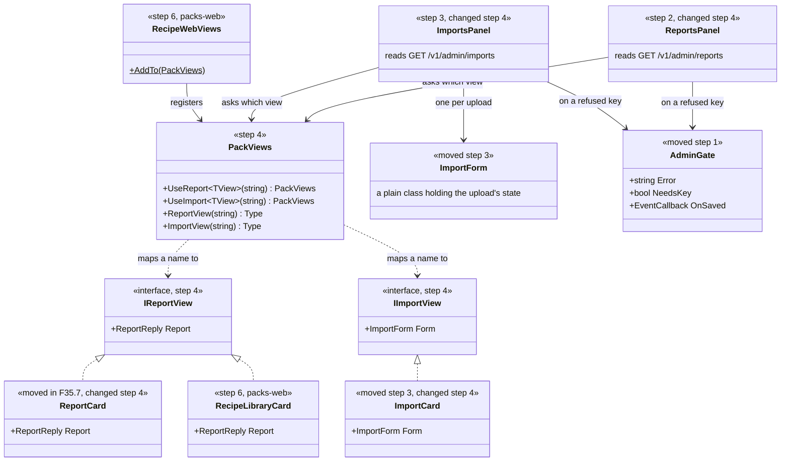
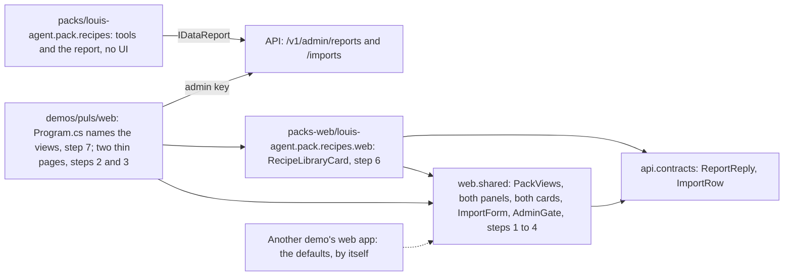
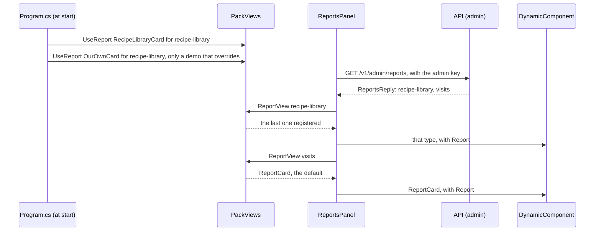
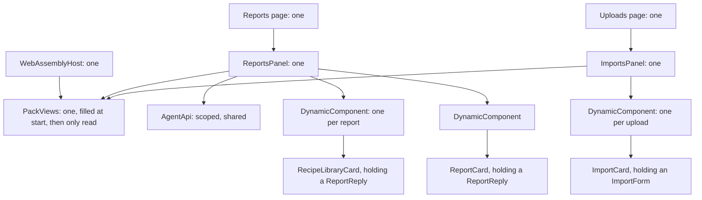

# F59 Pack web controls

> **Plan, for your review. Your pick so far: option B** (a default, a pack's own view, and a demo that can override both).
> F35.7 is in `main`. How a pack gets a screen of its own that a demo can replace, without the tools
> project knowing about the web. **Elsewhere:** the seam it follows in
> [ADR 0083](../adr/0083-packs-keep-reports-behind-the-admin-key.md); keeping tools and what surrounds them apart in
> [ADR 0073](../adr/0073-packs-reference-no-evals.md); the split in [ADR 0074](../adr/0074-the-folders-say-what-ships.md).

## The goal, in Louis's words

"why don't packs have their own project, where the web controls live?" and "should be overrideable and customised".

## Context: what we have today

- **A pack has no way to bring a screen.** No web app references a pack, only `louis-agent.web.shared` and the API's
  contracts. No ADR decided this; it never came up.
- **Our web apps are Blazor WebAssembly.** They run in the browser, and each is built with what it references. So nothing can
  plug in at run time: a demo's web app has to name what it uses when it's built. That's the same idea as host-packs
  naming the packs, on the web side.
- **`App.razor` looks for pages in the app's own assembly only**, with no `AdditionalAssemblies`.
- **F35.7 left the generic parts half moved.** `ReportCard` is in `web.shared`, but the page that loads the reports is in Puls,
  because it uses Puls's `AdminGate`. `AdminGate` is 48 lines and needs only `ChatStore`, which is already shared.
- **Uploads is all in Puls, and nothing ties it there.** `ImportCard`, `ImportForm` and the page come to 280 lines and need
  only the API's contracts and `AgentApi`, both already shared.
- **The shared library has no stylesheet.** Its components use class names, and each app's CSS styles them.
- **A precedent for where this goes:** `packs-evals/` holds what proves a pack, apart, "so someone can take the tools without
  it" (ADR 0073). The same reasoning fits a pack's web view.

## The findings

### Decided by Louis

- **Option B:** the generic control is the default, a pack can bring its own view from a sibling project, and a demo can
  override either. Not option A (generic only, CSS the only way to customise) and not option C (packs ship whole pages,
  routes and sidebar links).
- **Reports and Uploads both, now** (2026-11-06, on point 6: "do all now"), rather than Uploads as a child afterwards.

### Proposed here, for your review

| # | Proposal | What it changes | What it costs |
|---|---|---|---|
| 1 | **One registry, `PackViews`, from a report's or an upload's name to a component, read at render time with `DynamicComponent`** ([Registry, Fowler](https://martinfowler.com/eaaCatalog/registry.html)). The last one registered wins | The default, a pack's view and a demo's override are the same call in order, so "demo beats pack beats default" is just the order `Program.cs` calls them | One small class. A name is a string shared across projects, so a test holds it |
| 2 | **`packs-web/` beside `packs-evals/`**, as `packs-web/louis-agent.pack.recipes.web/` | Someone can take the tools with no UI, and it stays out of `packs/`, which the rules hold to tools only (ADR 0028) | One more top-level folder |
| 3 | **A pack's web project references the contracts and `web.shared`, never the pack** | MongoDB's driver and the browser code stay out of the browser's download; the engine split's package boundary holds | The name and the columns are duplicated, held by a test that sees both sides, as `src/docs/CLAUDE.md` allows |
| 4 | **Pages stay the app's; the panel inside is shared.** Puls's pages become `@page`, `@layout` and `<ReportsPanel />` or `<ImportsPanel />` | No router change and no route clashes, and which pages an app shows stays its own call | A demo writes a three-line page to get the screen |
| 5 | **One real pack view, not only a test's fake:** the recipes pack's card adds a line above the table, such as *Of 10 offered, 1 served* | Proves the seam with something useful, and answers "is the library being used?" at a glance | About 40 lines, and a line of arithmetic with a test. If you'd rather not, a test's fake can prove the seam |
| 6 | **No pack brings its own upload view yet.** Uploads get the same seam and the default card; a test's fake proves it can be replaced | Shop-prices' upload looks as it does today | The seam for uploads is proved by a test and not by a real view, until a pack wants one |
| 7 | **Styles stay each app's**, as every shared component's are today | No new CSS mechanism | Another demo using the card writes its own few lines. A pack can't ship its own look yet, only its own markup using the app's classes. CSS isolation is the way to add that, if a view ever needs it |

## Design: what changes

**A view is a component that takes what the panel gives it.** A report's view implements `IReportView` and takes a `Report`; an
upload's implements `IImportView` and takes a `Form`, so the registry can check at build time that it fits. Each panel asks
the registry which component to use, and an unknown name gets `ReportCard` or `ImportCard`. Nothing about this reaches the
API: it still hands back tables and takes files, and knows no view.

**Composition happens in the web app's `Program.cs`, in order:**

```csharp
var views = new PackViews();                // the defaults: ReportCard and ImportCard for everything
RecipeWebViews.AddTo(views);                // the pack's own, from packs-web
views.UseReport<OurOwnLibraryCard>("recipe-library");   // a demo's override, only if it wants one: last wins
builder.Services.AddSingleton(views);
```

**What it can't do:** swap a view without a rebuild, since WebAssembly is built with what it references. Add a page or a
sidebar link from a pack. Change what the API answers.

### Interface design



```csharp
public interface IReportView { ReportReply Report { get; set; } }   // web.shared, Components/Packs: the [Parameter]
public interface IImportView { ImportForm Form { get; set; } }      // web.shared, Components/Packs: the [Parameter]

public sealed class PackViews                    // web.shared, Components/Packs
{
    public PackViews UseReport<TView>(string reportName) where TView : ComponentBase, IReportView;   // last one wins
    public PackViews UseImport<TView>(string importName) where TView : ComponentBase, IImportView;   // last one wins
    public Type ReportView(string reportName);   // the registered view, else ReportCard
    public Type ImportView(string importName);   // the registered view, else ImportCard
}

public static class RecipeWebViews               // packs-web, the pack's one entry point
{
    public static void AddTo(PackViews views);   // views.UseReport<RecipeLibraryCard>("recipe-library")
}
```

### Architecture



### Communication: opening the page



The Uploads page goes the same way, through `ImportsPanel`, `ImportView` and a `Form`.

### Objects in one browser tab



### Folder trees

Today, with only what changes:

```
src/web/louis-agent.web.shared/Components/
  Reports/                      ReportCard (F35.7)
demos/puls/web/louis-agent.puls/
  Admin/Imports/                ImportForm
  Components/Admin/Head/        AdminGate, and what else is there today
  Components/Admin/Imports/     ImportCard
  Pages/Admin/                  Imports: the page and all its loading
  Pages/Admin/Data/             Reports: the page and all its loading
```

After:

```
src/web/louis-agent.web.shared/Components/
  Admin/                        new: AdminGate, step 1
  Reports/                      ReportCard, ReportsPanel (step 2)
  Imports/                      new: ImportCard, ImportForm, ImportsPanel, step 3
  Packs/                        new: PackViews, IReportView, IImportView, step 4
demos/puls/web/louis-agent.puls/
  Pages/Admin/Data/             Reports and Imports: each @page, @layout and its panel
packs-web/                      new, beside packs-evals/
  louis-agent.pack.recipes.web/ new: RecipeLibraryCard, RecipeWebViews, step 6
packs-tests/
  louis-agent.pack.recipes.web.tests/   new, step 6; sees both sides, to hold the duplicate
```

### Namespace map

| Type | Folder | Namespace | Step |
|---|---|---|---|
| `AdminGate` (moved) | `src/web/louis-agent.web.shared/Components/Admin/` | `LouisAgent.Web.Shared.Components.Admin` | 1 |
| `AdminGateTests` (new) | `src/tests/web/louis-agent.web.shared.tests/Components/Admin/` | `LouisAgent.Web.Shared.Tests.Components.Admin` | 1 |
| `ReportsPanel` (new, from the page) | `src/web/louis-agent.web.shared/Components/Reports/` | `LouisAgent.Web.Shared.Components.Reports` | 2 |
| `ReportsPanelTests` (new, from `ReportsPageTests`) | `src/tests/web/louis-agent.web.shared.tests/Components/Reports/` | `LouisAgent.Web.Shared.Tests.Components.Reports` | 2 |
| `Reports` (changed, thin) | `demos/puls/web/louis-agent.puls/Pages/Admin/Data/` | `LouisAgent.Puls.Pages.Admin.Data` | 2 |
| `ImportCard`, `ImportForm` (moved), `ImportsPanel` (new, from the page) | `src/web/louis-agent.web.shared/Components/Imports/` | `LouisAgent.Web.Shared.Components.Imports` | 3 |
| `ImportCardTests`, `ImportFormTests` (moved), `ImportsPanelTests` (new) | `src/tests/web/louis-agent.web.shared.tests/Components/Imports/` | `LouisAgent.Web.Shared.Tests.Components.Imports` | 3 |
| `Imports` (moved and thin, the route unchanged) | `demos/puls/web/louis-agent.puls/Pages/Admin/Data/` | `LouisAgent.Puls.Pages.Admin.Data` | 3 |
| `PackViews`, `IReportView`, `IImportView` (new) | `src/web/louis-agent.web.shared/Components/Packs/` | `LouisAgent.Web.Shared.Components.Packs` | 4 |
| `ReportCard`, `ImportCard`, both panels (changed) | as above | as above | 4 |
| `PackViewsTests` (new) | `src/tests/web/louis-agent.web.shared.tests/Components/Packs/` | `LouisAgent.Web.Shared.Tests.Components.Packs` | 4 |
| `RecipeLibraryCard`, `RecipeWebViews` (new) | `packs-web/louis-agent.pack.recipes.web/` | `LouisAgent.Packs.Recipes.Web` | 6 |
| `RecipeLibraryCardTests` (new) | `packs-tests/louis-agent.pack.recipes.web.tests/` | `LouisAgent.Packs.Recipes.Web.Tests` | 6 |
| Puls's `Program` (changed), `PulsPackViewsTests` (new) | `demos/puls/web/louis-agent.puls/`, `demos/puls/tests/louis-agent.puls.tests/Admin/` | as today, `LouisAgent.Puls.Tests.Admin` | 7 |

## Steps

One commit each, test first, with the review stop after each. All free: no model is called, since the page only reads numbers
already kept.

| # | Step | Its test |
|---|---|---|
| 1 | **`AdminGate` moves to `web.shared`.** A pure move, and Puls's pages use it from there | The gate shows the error, shows the key box only when the key was refused, and saves the key; every page test stays green |
| 2 | **`ReportsPanel`.** The loading and the states move out of Puls's page, which keeps `@page`, `@layout` and the panel | `ReportsPageTests` move with it: a card per report, an empty report says so, no reports says so, a refused key shows the gate. A thin test keeps the route |
| 3 | **Uploads move too.** `ImportCard` and `ImportForm` to `web.shared`, a new `ImportsPanel` from the page's loading, and the page thin in `Pages/Admin/Data/`. The address stays `/admin/imports` | `ImportFormTests` and `ImportCardTests` move as they are and stay green; the panel shows a card per upload, says so with none, and shows the gate on a refused key |
| 4 | **The registry.** `PackViews`, `IReportView` and `IImportView`, and both panels render through `DynamicComponent` | An unknown name gets the default; a registered name gets its view, with what it takes passed in; the last one registered wins, for reports and for uploads |
| 5 | **The rule that holds it.** A test that nothing under `packs/` references the web, and nothing under `packs-web/` references a pack | It fails on a project reference added either way, seen failing on a throwaway one |
| 6 | **The recipes pack's view.** `packs-web/louis-agent.pack.recipes.web`, added to the solution, with `RecipeLibraryCard` and `RecipeWebViews` | The line reads *Of 10 offered, 1 served*, says nothing with no rows, and keeps the table. A test seeing both projects holds the report's name and columns against `RecipesUsageReport` |
| 7 | **Puls uses it.** `Program.cs` registers the pack's views, and the image still builds | A demo's override beats the pack's, which beats the default, in the order `Program.cs` calls them |
| 8 | **The docs.** A new ADR for pack web controls, `build-a-pack.md`, the `web.shared` and pack docs, `src/docs/CLAUDE.md`'s tree, the changelog, a write-up, and this plan's lifecycle | Links and size tests, then the check below |

## Verification

**Free:** the whole unit suite; the Puls image builds with the new project; and in a browser, with your admin key, the page
shows the recipes card with its line, and Uploads still previews a file as it did.

**No paid run,** as nothing here calls a model. The numbers on the page are whatever the counter already holds, so it needs
only the earlier F35.7 chat's record.

**Done when** the Puls page shows the recipes pack's own card from its own project, Uploads works from `web.shared` at the same
address, a test shows a demo's override winning for both, the tools project is untouched by any of this, and a demo that
registers nothing still gets the defaults.

## Concepts this teaches

- **Skill 20, extensibility:** a seam with an order of precedence, and why that order lives in one place.
- **Composition Root:** on the web side, one `Program.cs` names what's used, as host-packs does on the API side.
- **Package boundaries:** what a browser download may depend on, and a tested duplicate in place of a shared reference.

## Left out, on purpose

- A pack's own upload view: the seam is there, and no pack needs one yet (proposal 6).
- Pages or sidebar links from a pack, which was option C.
- A pack's own stylesheet (proposal 7).
- Choosing a view at run time or per user: a report's name picks it, at build.
- The coding demo's web app, which has no admin pages to put this on.

## Sources

[Blazor class libraries, Microsoft](https://learn.microsoft.com/en-us/aspnet/core/blazor/components/class-libraries) ·
[DynamicComponent, Microsoft](https://learn.microsoft.com/en-us/aspnet/core/blazor/components/dynamiccomponent) ·
[Razor UI class libraries and their override rule, Microsoft](https://learn.microsoft.com/en-us/aspnet/core/razor-pages/ui-class) ·
[Plugin, Fowler](https://martinfowler.com/eaaCatalog/plugin.html) ·
[Registry, Fowler](https://martinfowler.com/eaaCatalog/registry.html)

---
[Plans](README.md) · Related: [the TODO](../../../TODO.md)
