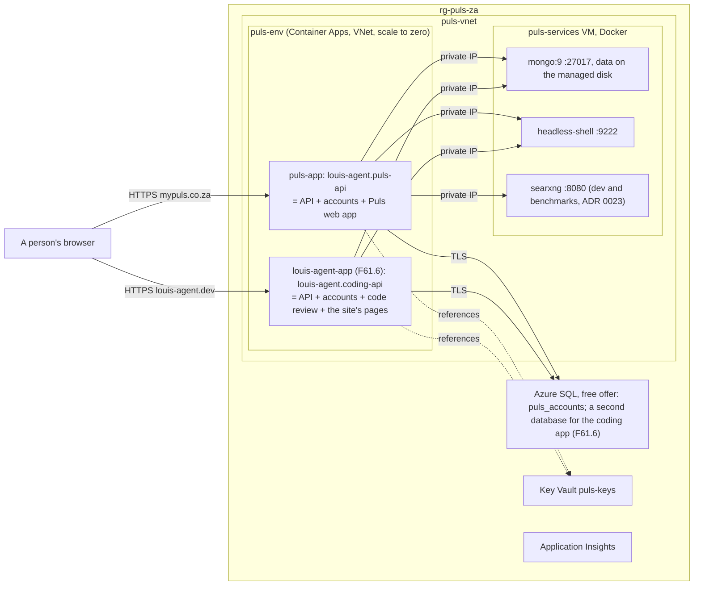

# F61 Accounts, tenants and the two sites in Azure

> **Plan** (parent; five children built, one left). How Puls got sign-in, registration and profiles on the framework's
> web, with tenants from the start, on a SQL backend, and how Puls went live from Azure with Mongo and the browser
> there too, is done (F61.1 to F61.5, 2026-11-07). What is left is the framework's site: it goes live on
> `louis-agent.dev` by merging into the louis-agent demo's web app, deployed beside Puls. Drafted 2026-11-07 in the
> thread "do i have sql on this machine"; **approved by Louis 2026-11-07**; trimmed to the last child 2026-11-07.
> Deleted when the site is live (its why moves to an ADR, its how to the deploy docs).

## Approved during the build

- **2026-11-07, the order and the way of working** (Louis: "do all unattended until you reach AZ, I will probably
  need to help with that. Keep the AZ for last"): the children are built F61.1, F61.2, F61.3, F61.5, then F61.4 with
  Louis. The first four run without the review stop after each step; a finding takes the recommended pick, recorded
  in the child's plan under this heading. Nothing is pushed, merged or run against a paid model; since nothing is
  pushed, each child's branch starts from the previous child's tip.
- **2026-11-07, F61.1 built** on `feature/F61.1-accounts-library`; its plan is deleted, its picks are in the project
  doc's *What the build decided* and in ADRs 0087 and 0088.
- **2026-11-07, F61.2 built** on `feature/F61.2-account-pages`, branched from F61.1's tip; its plan is deleted. Picks
  taken unattended: the tenant travels as a claim named in the contracts (a claim is signed with the cookie, and the
  contracts have no SQL); a refused turn's words say "sign in, or enter a key" on every site, so the chat shell knows
  nothing of accounts; the profile menu looks the account services up rather than injecting them, so a site or a
  test without them still draws the guest's menu; the two site-independent sites (the starter, the code-review app)
  got the account pages too, since they're sites on the framework.
- **2026-11-07, F61.3 built** on `feature/F61.3-social-logins`, from F61.2's tip; its plan is deleted. Picks taken
  unattended: the callback is tested on a scripted provider (a route the test host alone maps writes the external
  cookie as a handler would); the three providers sit in `External/Providers/` for the folder rule; every answer the
  callback gives a browser is a redirect to a path of ours, checked on the server as the web checks its own.
- **2026-11-07, F61.5 built** on `feature/F61.5-passkeys`, from F61.3's tip; its plan is deleted, its picks are in
  the project doc's *What the build decided*. Picks taken unattended: one migration written again under Identity's
  schema version 3 (nothing stored yet, ADR 0049); a passkey section on the profile rather than a page of its own;
  the authenticator key as text and an `otpauth://` link, the QR code a TODO; one box for the sign-in's second step,
  digits as the app's code and the rest as a recovery code; no route of ours for two-factor, Identity's does it.
- **2026-11-07, the account client gets its own library** (Louis: "A, finish step 5 first then do the move"): after
  F61.5, the account pages, client, words, styles and script move from `louis-agent.web` to
  `louis-agent.web.accounts`, a Razor class library on top of it that a site opts into, with the chat header's
  lookup of `AccountState` made a named seam; its own plan as CL30, before F61.4.
- **2026-11-07, F61.4 built** by Louis on `feature/F61.4-azure` (PR #220); its why is
  [ADR 0095](../adr/0095-puls-runs-from-azure-and-nothing-points-at-the-pc.md), its how the deploy
  [README](../../../demos/puls/deploy/azure/README.md) and [ARCHITECTURE](../../../demos/puls/deploy/azure/ARCHITECTURE.md).
  What changed on the way: one Bicep file instead of `az` calls, Key Vault references for every secret, Mongo 9 (Mongo 8
  fails on the VM's kernel, SERVER-121912), and **the framework's site is not a deployment of its own**: it merges into
  the louis-agent demo's web app and deploys beside Puls, so `rg-louis-agent-za` never existed. F105 (the app behind a
  key) was folded in: the gate takes a signed-in person or `AGENT_API_KEY`, the ingress lock went.
- **2026-11-07, F61 stays open, trimmed** (Louis's pick over closing it now): the five children are done and this plan
  keeps only what is left, the site's move (F61.6 below). The full plan as it was, with the accounts' design, its four
  diagrams, namespace map and folder trees, is in the history at commit `20f28c9f`; its lasting parts are in
  ADRs 0087 to 0089 and 0095, [louis-agent.accounts](../projects/louis-agent.accounts.md) (*What the build decided*),
  [louis-agent.web.accounts](../projects/louis-agent.web.accounts.md) and the deploy docs.

## Context

**What exists (2026-11-07):** Puls is live on `https://mypuls.co.za` from a Container Apps environment on its own
virtual network, with Mongo, the headless browser and SearXNG on a private VM, the accounts on Azure SQL's free offer
and every secret in Key Vault ([ADR 0095](../adr/0095-puls-runs-from-azure-and-nothing-points-at-the-pc.md)). The
framework's site (`demos/louis-agent/web/louis-agent.site`, [its design](../../../demos/louis-agent/docs/projects/louis-agent.site.md))
is a static Razor site with no deployment: F58's tunnel from the PC was superseded before it was needed, and
`louis-agent.dev` points nowhere yet. The louis-agent demo's web app is `louis-agent.code-review`, served by
`louis-agent.coding-api` on the framework's web (ADR 0084), with the account pages (F61.2) like every site.

**Louis's pick (2026-11-07, ADR 0095 point 5):** the site is not a deployment of its own. It merges into the
louis-agent demo's web app as its landing pages, keeping the site's theme; that app is then a second Container App on
the same environment and the same VM as Puls, declared in the same Bicep file and deployed from the same folder, to
save the cost of a second set ("we will have to deploy louis-agent to the same VM, to save money; can be split
later"). `louis-agent.dev` points at it.

**Not in this plan:** `business.mypuls.co.za` (the tenant shape is built, the business site is a later feature); rate
limits and the audit log (F42); durable sessions and the tenant on every ledger row (F43); a real mail sender;
Facebook and X sign-in; a licensed search provider for the sold endpoint (ADR 0023).

## Design

### Architecture (after F61.6)

The site's seven pages become pages of `louis-agent.code-review` under the site's theme, with the chat at `/chat`
where the site's `CHAT_ADDRESS` pointed; `louis-agent.site` and its tests go, or stay as the pages' library if the
split is cleaner (a finding for the child's plan, three options). What the two apps share (the VM, the vault, the
environment) is declared once; the second app is a second module in `main.bicep` and a second yaml beside
`puls-app.yaml`. The child's plan draws the four diagrams for the merge itself.

## Children and their steps

F61.1 to F61.5 are built (the rows in [the work log](../work-log.md)). The one left:

### F61.6 The framework's site beside Puls (`feature/F61.6-site-beside-puls`), to plan

Done when: `https://louis-agent.dev` opens with a padlock and shows the site's pages from the louis-agent demo's web
app, deployed on `puls-env` beside Puls from the same Bicep file and folder; the chat behind it signs in; nothing new
is always-on; the month's cost in the deploy README gains one line.

Steps proposed, each to approve in the child's plan:

1. **The pages move.** The site's seven pages and their Sass become the landing pages of `louis-agent.code-review`,
   under the site's theme; the code-review chat stays at `/chat`. `louis-agent.site`'s tests move with the pages.
2. **The app's deploy.** A second Container App in `main.bicep` and `louis-agent-app.yaml` beside `puls-app.yaml`:
   the same identity, vault and VM addresses, its own SQL database (the free offer allows ten), its own secrets.
3. **The domain.** `deploy.ps1 domain` for `louis-agent.dev` and `www`; the DNS lines in the README.
4. **Retire the site project**, or keep it as the pages' library (the finding above); the film export's test follows
   the pages.
5. **Docs.** The deploy README and ARCHITECTURE gain the second app; the deployment view; ADR 0095's point 5 becomes
   its own ADR if the merge changes more than it names; this plan is deleted; TODO: F54's leftovers closed.

## Verification

- **Per step:** the step's own tests; `core.tests` when a project or folder is added or removed.
- **F61.6 by hand:** from a phone on mobile data, `https://louis-agent.dev` opens with a padlock and the site's pages;
  `/chat` asks for a sign-in; a chat answers (**this spends the Anthropic key: ask first**).
- **Full suite** once before the child's PR.

## Concepts, and where they sit in GOAL.md

- **Shipping to a private network** (skill 18): a VNet environment, an NSG, a VM as a service host, managed
  certificates, DNS; why a file share can't hold a database; what a second app on the same environment costs.
- **Authentication as a boundary**, **tenancy as data**, **adapters over a storage seam**, **federated identity** and
  **passkeys** (skills 9, 11, 15, 20) were the built children's; their write-up is in
  [learning/18](../learning/18-testing-and-shipping.md) and the accounts' project doc.

## Research record (2026-11-07)

- ASP.NET Core Identity's storage is a seam: [custom storage providers](https://learn.microsoft.com/aspnet/core/security/authentication/identity-custom-storage-providers);
  Blazor WebAssembly with Identity API endpoints and cookies: [standalone with Identity](https://learn.microsoft.com/aspnet/core/blazor/security/webassembly/standalone-with-identity),
  `useCookies` on `/login`: [Identity API authorization](https://halter73.github.io/aspnetcore-security-docs/docs/identity/identity-api-authorization.html);
  `MapIdentityApi` covers register, login, confirm, reset and info, not external logins: [reference](https://learn.microsoft.com/en-us/dotnet/api/microsoft.aspnetcore.routing.identityapiendpointroutebuilderextensions.mapidentityapi).
- Passkeys in .NET 10 Identity: [Microsoft Learn](https://learn.microsoft.com/en-us/aspnet/core/security/authentication/passkeys), [Andrew Lock](https://andrewlock.net/exploring-dotnet-10-preview-features-6-passkey-support-for-aspnetcore-identity).
- Duende IdentityServer is paid; its Community Edition is self-host only, reviewed on revenue and capital: [Duende](https://duendesoftware.com/products/communityedition).
  Finbuckle.MultiTenant's source is Apache 2.0 but its releases now ask a maintenance fee for revenue use: [repo](https://github.com/finbuckle/finbuckle.multitenant). So tenants are ours.
- LinkedIn sign-in is OpenID Connect (`openid profile email`): [LinkedIn docs](https://learn.microsoft.com/en-gb/linkedin/consumer/integrations/self-serve/sign-in-with-linkedin-v2).
  Instagram's consumer login API ended 2024-12-04: [Meta](https://developers.secure.facebook.com/docs/instagram-basic-display-api).
  Facebook Login needs Meta Business Verification: [changelog](https://developers.facebook.com/docs/facebook-login/changelog), [a guide](https://singhamandeep.com/facebook-login-for-business-config-id-app-review/).
  X ended the free tier for new developers 2026-02-06; "Login with X" reported free, unconfirmed: [forum](https://devcommunity.x.com/t/no-free-plan/257026), [a guide](https://www.outstand.so/blog/x-api-pricing).
  The first-party Twitter package (OAuth 1.0a) still ships for .NET 10: [NuGet](https://packages.nuget.org/packages/Microsoft.AspNetCore.Authentication.Twitter).
- Azure SQL free offer: 100,000 vCore-seconds, 32 GB, up to 10 databases, auto-pause or billed over: [free offer](https://learn.microsoft.com/azure/azure-sql/database/free-offer);
  serverless resume and error 40613: [auto-pause and resume](https://learn.microsoft.com/en-us/azure/azure-sql/database/serverless-tier-auto-pause-resume).
- Mongo on Container Apps fails on Azure Files (SMB): [Q&A 1](https://techcommunity.microsoft.com/discussions/appsonazure/issue-with-mounting-persistent-volume-in-mongodb-container-on-azure-container-ap/4400413), [Q&A 2](https://learn.microsoft.com/en-sg/answers/questions/1483567/mongo-on-azure-container-app-crash-when-mounted-a);
  NFS mounts need a custom VNet: [storage mounts](https://learn.microsoft.com/en-us/azure/container-apps/storage-mounts); MongoDB says avoid NFS for `dbPath`: [production checklist](https://docs.mongodb.com/manual/administration/production-checklist/).
  Alternatives weighed: Azure DocumentDB free tier (32 GB, not a container, no backups) [docs](https://learn.microsoft.com/en-us/azure/cosmos-db/mongodb/vcore/free-tier); Atlas M0 (512 MB, outside Azure) [limits](https://mongodb.com/ko-kr/docs/atlas/reference/free-shared-limitations/).
  VM prices, South Africa North, to confirm in the calculator: [azurespeed](https://www.azurespeed.com/AzureVmPricing/Regions/southafricanorth), [disks](https://pcr.cloud-mercato.com/providers/azure/volumes/None:StandardSSD_LRS).
- Container Apps networking: a custom VNet gives private IPs; consumption-only needs a `/23`: [networking](https://learn.microsoft.com/en-in/azure/container-apps/networking), [custom VNets](https://learn.microsoft.com/sr-latn-rs/azure/container-apps/custom-virtual-networks).
  Custom domains and free managed certificates; a proxied (intermediate) CNAME blocks issue: [custom domains](https://learn.microsoft.com/azure/container-apps/custom-domains-managed-certificates).

None of this is legal advice: the providers' terms and Microsoft's licences are judged for a sold endpoint (the memory
*Puls's endpoint is sold*), and a qualified check is due before customers depend on them.

---
[Docs index](../README.md) · Related: [Plans](README.md) · [ADR 0095](../adr/0095-puls-runs-from-azure-and-nothing-points-at-the-pc.md) · [ADR 0084](../adr/0084-every-site-is-built-on-the-frameworks-web.md) · [Puls on Azure](../../../demos/puls/deploy/azure/README.md)
