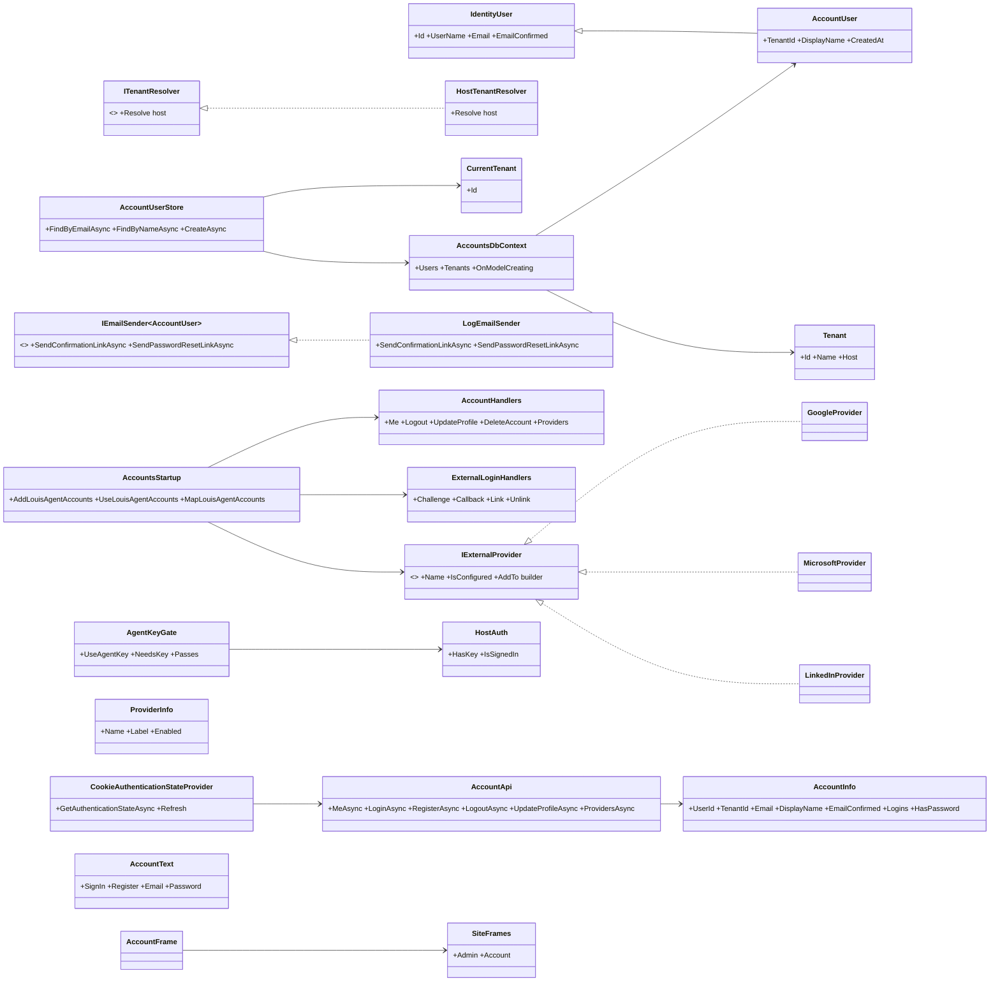
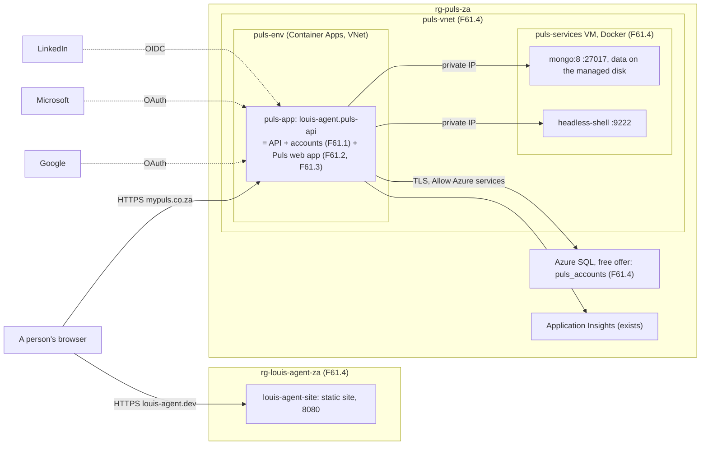
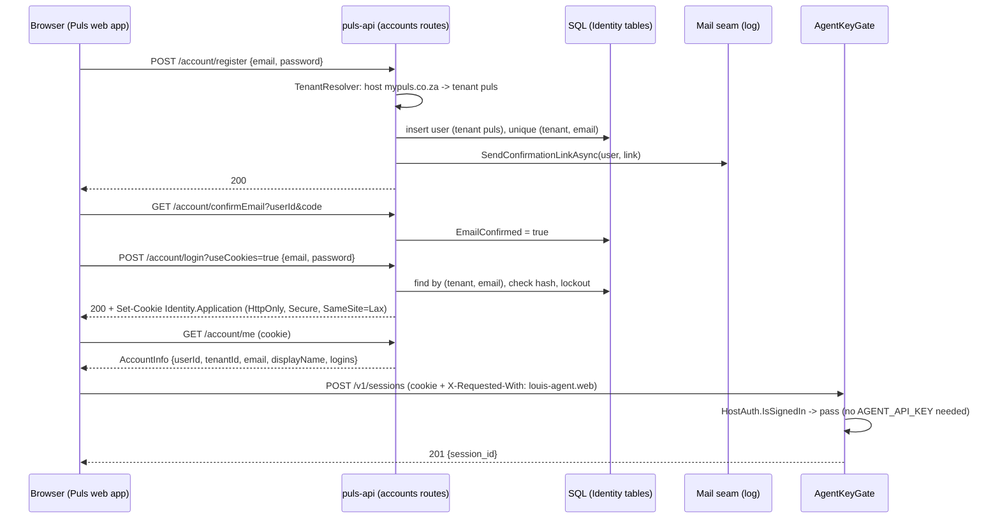
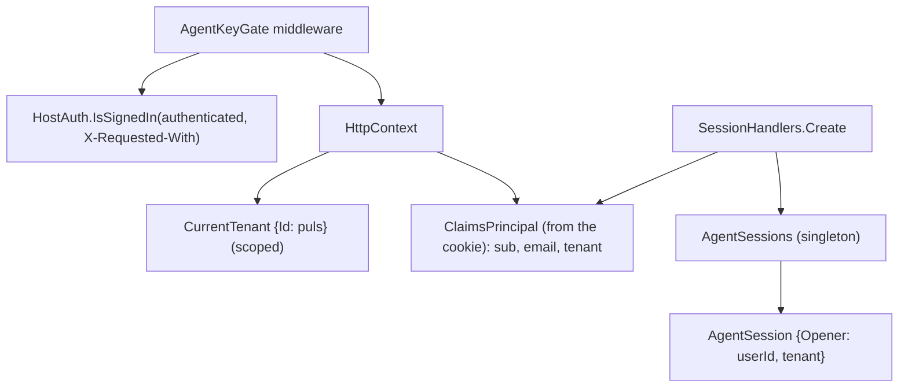

# F61 Accounts, tenants and the two sites in Azure

> **Plan** (parent, with five children). How Puls gets sign-in, registration and profiles on the framework's web, with
> tenants from the start, on a SQL backend, and how Puls and the framework's site go live on their domains from Azure,
> with Mongo and the browser in Azure too. Drafted 2026-11-07 in the thread "do i have sql on this machine";
> **approved by Louis 2026-11-07.** Each child gets its own plan file, branch and PR when it starts. Deleted when the
> work is done (its why moves to ADRs, its how to the project docs and the write-ups).

## Approved during the build

- **2026-11-07, the order and the way of working** (Louis: "do all unattended until you reach AZ, I will probably
  need to help with that. Keep the AZ for last"): the children are built F61.1, F61.2, F61.3, F61.5, then F61.4 with
  Louis. The first four run without the review stop after each step; a finding takes the recommended pick, recorded
  in the child's plan under this heading. Nothing is pushed, merged or run against a paid model; since nothing is
  pushed, each child's branch starts from the previous child's tip.

## Context

**What Louis asked (2026-11-07):** a SQL backend for Puls with an identity server, to manage logins, registrations and
profiles; Puls and louis-agent published to their domains, container-hosted in Azure; SQL, Mongo and the headless
browser in Azure; sign-in with Google, Microsoft, LinkedIn, Facebook or X; tenants taken into account (companies as
tenants on `business.mypuls.co.za`, this login for `mypuls.co.za`); a fully featured login/registration page and a
fully featured profile screen **in the framework**, which Puls then uses.

**Louis's picks during the research (2026-11-07):**

| Finding | Pick |
|---|---|
| SQL now or later | **A: SQL Server in Docker now**, Azure SQL later (a connection string change) |
| Paid products | **None.** What has no free option we build ourselves (so: no Duende IdentityServer, no Finbuckle, whose releases now carry a fee for revenue use; Microsoft's own packages, MIT, are fine) |
| Mongo in Azure | **A: a small Linux VM with Docker** (real Mongo on a managed disk; the headless Chrome beside it). Container Apps can't host Mongo: its storage is an Azure Files share, and Mongo's engine fails on it (sources below) |
| SearXNG | **Goes, for now**, until Louis has another plan for search |
| Instagram | **Removed** (Meta ended its consumer login API in December 2024) |
| Where the accounts code lives | **B: `louis-agent.accounts` + `louis-agent.accounts.contracts`**, the API stays free of SQL |
| Container Apps to the VM | **A: a new Container Apps environment on a virtual network**; nothing on the VM is public; nothing points at Louis's PC any more |
| Email (confirm, reset) | **A: a seam (`IEmailSender`) with a log sender**; the real sender is a later pick |
| Providers | **B: Google, Microsoft, LinkedIn now; Facebook and X as a TODO in the feature doc** (Facebook needs Meta Business Verification; X closed its free API tier in February 2026, "Login with X" is reported free but unconfirmed) |
| Test database | **A: the Docker SQL Server only**, skipped honestly without it; CI runs SQL Server as a service container |
| Passkeys | **A: yes, as the last child** |
| louis-agent.dev in Azure | **A: its own resource group and environment** |

**What exists:** the framework's web (`src/web/louis-agent.web`, ADR 0084) with `AdminFrame` → `SiteFrames` (Bridge),
`ChatText` for a site's words, a `ProfileMenu` that shows "Guest" and "coming soon"; the API's key gate
(`AgentKeyGate`, `HostAuth`): every `/v1` route needs `AGENT_API_KEY` unless marked open; Puls's web app is Blazor
WebAssembly served by `louis-agent.puls-api` from the same origin; Puls on Azure Container Apps (`rg-puls-za`,
`puls-app`, `puls-container-env`, `deploy.ps1`) reaching Mongo and Chrome on the home PC through a Tailscale sidecar,
with `AGENT_AUTH=off` and the ingress locked to one IP; `mypuls.co.za` and `louis-agent.dev` served from the PC through
Cloudflare tunnels (F58). The TODO already names this work in parts: F43.1 (sign-in and a tenant on every session),
F51.2 (where Puls runs), "The Azure app behind a key", F54's leftovers (where the site runs).

**Not in this plan:** `business.mypuls.co.za` itself (the tenant shape is built, the business site is a later
feature); rate limits and the audit log (F42); durable sessions and the tenant on every ledger row (F43.2, F43.3); a
real mail sender; Facebook and X; a new search provider for Puls.

## Design

### The shape, in plain words

- **ASP.NET Core Identity is the identity server.** It is Microsoft's own (MIT, in the shared framework): users,
  password hashing, lockout, email confirmation, password reset, two-factor, external logins and, in .NET 10,
  passkeys. Its *Identity API endpoints* (`MapIdentityApi`) give JSON routes for register, login, confirm, forgot and
  reset, and account info. What it lacks (logout, external logins, a profile, tenants) we add beside it. Duende
  IdentityServer would only matter if other apps needed tokens from us; it's paid, so no.
- **Cookies, same origin.** Puls's app is served by its API, so a sign-in sets an HttpOnly cookie
  (`Identity.Application`) and every call carries it by itself; no token lives in the browser's storage. A cookie on a
  cross-site form could hit `/v1/sessions`, so a cookie counts only on a request that carries the header
  `X-Requested-With: louis-agent.web` (a custom header a cross-site form can't send; the same trick as "requested
  with XMLHttpRequest").
- **The key gate learns a second key: a signed-in person.** `AgentKeyGate` passes a `/v1` call that carries
  `AGENT_API_KEY` *or* an authenticated user with the header above. The admin routes keep the admin key. That is the
  TODO's "the Puls web app must send AGENT_API_KEY (or a sign-in) before the lock can come off".
- **A tenant on every account, from the host name.** A `Tenant` row has an id, a name and a host; `AccountUser` (our
  `IdentityUser`) carries `TenantId`. `TenantResolver` reads the request's host: a row with that host wins, else the
  instance's default (`ACCOUNTS_TENANT=puls`), so `localhost` and `mypuls.co.za` are the Puls tenant today and
  `business.mypuls.co.za`'s companies are rows later. Identity's unique index on the email becomes
  (tenant, email), and our `AccountUserStore` finds by email *within the current tenant* and stamps the tenant on
  every new user. That's the whole of "take tenants into account" now: nothing in the data or the routes has to change
  to add a second tenant.
- **Pages in the framework, words from the site.** Login, register, confirm, forgot, reset and profile are framework
  pages on an `AccountFrame` (the same Bridge as `AdminFrame`): `SiteFrames` gets an `Account` layout a site sets. The
  words are an `AccountText` record, English in the framework, Afrikaans filled in by Puls. A provider button shows
  only when the API says the provider is configured (the toolsets' rule: `?` only where the instance has it).
- **Storage behind a seam.** EF Core with SQL Server (Microsoft, MIT). The `AccountsDbContext` and its migrations
  live in the accounts library; a host applies migrations at start-up. On the PC: `mcr.microsoft.com/mssql/server`
  (Developer edition, free, dev only) in the Puls compose. In Azure: Azure SQL's free offer (General Purpose
  serverless, 100,000 vCore-seconds and 32 GB a month, auto-pauses; the first call after a pause fails with error
  40613, so EF's `EnableRetryOnFailure` is on).
- **Azure: a private network, one VM, two environments.** `puls-vnet` with a subnet for a new Container Apps
  environment (the current one can't be given a network) and one for `puls-services`, an Ubuntu VM with Docker running
  `mongo:8` and `chromedp/headless-shell` on the private IP only; its NSG lets only the apps' subnet in on 27017 and
  9222. Azure SQL on its public endpoint with "Allow Azure services" and TLS (a private endpoint costs money). The
  Tailscale sidecar, the lock, `AGENT_AUTH=off` and the SearXNG app go. `louis-agent.dev` is a Container App in its
  own group `rg-louis-agent-za`. Both domains move from Cloudflare tunnels to Container Apps' free managed
  certificates (apex: an A record and a TXT `asuid`; `www`: a CNAME; Cloudflare records DNS-only, since a proxied
  record blocks certificate issue).

### Interface design



The signatures beside it (read from the code where the type exists today):

```csharp
// src/hosts/louis-agent.accounts (new, F61.1)
public sealed class AccountUser : IdentityUser { public string TenantId { get; set; } = ""; public string? DisplayName { get; set; } public DateTimeOffset CreatedAt { get; set; } }
public sealed class Tenant { public string Id { get; set; } = ""; public string Name { get; set; } = ""; public string? Host { get; set; } }
public sealed class AccountsDbContext(DbContextOptions<AccountsDbContext> options) : IdentityDbContext<AccountUser>(options) { public DbSet<Tenant> Tenants => Set<Tenant>(); }
public interface ITenantResolver { string Resolve(string host); }                       // Strategy: by host today
public sealed class CurrentTenant { public string Id { get; init; } = ""; }             // scoped per request
public sealed class AccountUserStore : UserStore<AccountUser> { /* FindByEmailAsync, FindByNameAsync filter by CurrentTenant; CreateAsync stamps it */ }
public sealed class LogEmailSender(ILogger<LogEmailSender> log) : IEmailSender<AccountUser> { … }   // the links go to the log
public interface IExternalProvider { ExternalProvider Name { get; } bool IsConfigured { get; } void AddTo(AuthenticationBuilder auth); }
public static class AccountsStartup
{
    public static WebApplicationBuilder AddLouisAgentAccounts(this WebApplicationBuilder builder, AccountsOptions options);
    public static WebApplication UseLouisAgentAccounts(this WebApplication app);          // migrations, UseAuthentication, UseAuthorization
    public static IEndpointRouteBuilder MapLouisAgentAccounts(this WebApplication app);   // /account/* (MapIdentityApi + ours)
}
// src/hosts/louis-agent.accounts.contracts (new, F61.1)
public sealed record AccountInfo(string UserId, string TenantId, string Email, string? DisplayName, bool EmailConfirmed, IReadOnlyList<string> Logins, bool HasPassword);
public sealed record ProfileBody(string? DisplayName);
public sealed record ProviderInfo(string Name, string Label, bool Enabled);
public sealed record ProvidersReply(IReadOnlyList<ProviderInfo> Providers);
public sealed record LoginBody(string Email, string Password);                            // mirrors Identity's LoginRequest; a test pins the JSON
public sealed record RegisterBody(string Email, string Password);
// src/hosts/louis-agent.api (changed, F61.2)
internal static bool Passes(PathString path, Endpoint? endpoint, HttpContext context, string apiKey);   // the key, or a signed-in user with X-Requested-With
// src/engine/louis-agent.core/Guardrails/Auth/HostAuth.cs (changed, F61.2)
public static bool IsSignedIn(bool authenticated, string? requestedWith);                  // pure, like HasKey
// src/web/louis-agent.web (new, F61.2)
public sealed class AccountApi(HttpClient http) { Task<AccountInfo?> MeAsync(); Task LoginAsync(LoginBody body); Task RegisterAsync(RegisterBody body); Task LogoutAsync(); Task UpdateProfileAsync(ProfileBody body); Task<ProvidersReply> ProvidersAsync(); … }
public sealed class CookieAuthenticationStateProvider(AccountApi api) : AuthenticationStateProvider { Task Refresh(); }
public sealed record AccountText { string SignIn = "Sign in"; string Register = "Create an account"; … }
public sealed record SiteFrames(Type Admin, Type Account);                                // today: SiteFrames(Type Admin)
```

### Architecture (after F61.4)



On the PC the same shape in `docker-compose.puls.yml`: `puls`, `puls-mongo`, `puls-browser` and a new `puls-sql`
(SQL Server Developer); SearXNG stays only in the local compose for benchmarks until Louis's search plan.

### Communication: register, sign in, open a chat



External login (F61.3): `GET /account/external/google?returnUrl=/profile` → the API challenges Google → Google calls
back `/signin-google` → `GET /account/external/callback` finds the login or creates the user in the current tenant
(email from the provider, confirmed), signs in with the cookie, redirects to `returnUrl`. Linking from the profile is
the same two routes with `?link=true`, which attaches the login to the signed-in user instead.

### Object diagram (one signed-in request to /v1/sessions)



### Namespace map

| Type | Folder | Namespace | Step |
|---|---|---|---|
| `AccountUser`, `Tenant` | `src/hosts/louis-agent.accounts/Users/` | `LouisAgent.Accounts.Users` | 1.1 new |
| `AccountsDbContext`, `Migrations/*` | `src/hosts/louis-agent.accounts/Store/` | `LouisAgent.Accounts.Store` | 1.2 new |
| `ITenantResolver`, `HostTenantResolver`, `CurrentTenant`, `TenantMiddleware` | `src/hosts/louis-agent.accounts/Tenants/` | `LouisAgent.Accounts.Tenants` | 1.3 new |
| `AccountUserStore` | `src/hosts/louis-agent.accounts/Store/` | `LouisAgent.Accounts.Store` | 1.4 new |
| `IEmailSender<AccountUser>` impl `LogEmailSender`, `EmailLogMessage` | `src/hosts/louis-agent.accounts/Mail/`, `Messages/` | `LouisAgent.Accounts.Mail`, `.Messages` | 1.5 new |
| `AccountsOptions` (`ACCOUNTS_SQL_URL`, `ACCOUNTS_TENANT`, provider keys) | `src/hosts/louis-agent.accounts/Config/` | `LouisAgent.Accounts.Config` | 1.6 new |
| `AccountsStartup` | `src/hosts/louis-agent.accounts/` | `LouisAgent.Accounts` | 1.6 new |
| `AccountHandlers`, `AccountRoutes` | `src/hosts/louis-agent.accounts/Endpoints/` | `LouisAgent.Accounts.Endpoints` | 1.7 new |
| `AccountInfo`, `ProfileBody`, `LoginBody`, `RegisterBody`, `ProvidersReply`, `ProviderInfo`, `AccountJson` | `src/hosts/louis-agent.accounts.contracts/` | `LouisAgent.Accounts.Contracts` | 1.7 new |
| `AccountUserText`, `AccountLogMessage` | `src/hosts/louis-agent.accounts/Messages/` | `LouisAgent.Accounts.Messages` | 1.7 new |
| `*Tests` (tenants, store, routes), `AccountsTestHost` | `src/tests/hosts/louis-agent.accounts.tests/`, `louis-agent.accounts.integration-tests/` | `LouisAgent.Accounts.Tests`, `.IntegrationTests` | 1.x new |
| `HostAuth.IsSignedIn` | `src/engine/louis-agent.core/Guardrails/Auth/` | `LouisAgent.Core.Guardrails.Auth` | 2.1 changed |
| `AgentKeyGate` | `src/hosts/louis-agent.api/Endpoints/Routing/` | `LouisAgent.Api.Endpoints.Routing` | 2.1 changed |
| `AgentSession.Opener` (`SessionOpener` record) | `src/hosts/louis-agent.api/Sessions/` | `LouisAgent.Api.Sessions` | 2.2 changed |
| `AccountApi`, `CookieAuthenticationStateProvider`, `AccountState` | `src/web/louis-agent.web/Accounts/` | `LouisAgent.Web.Accounts` | 2.3 new |
| `AccountText` | `src/web/louis-agent.web/Text/` | `LouisAgent.Web.Text` | 2.4 new |
| `AccountFrame` | `src/web/louis-agent.web/Layout/` | `LouisAgent.Web.Layout` | 2.4 new |
| `SiteFrames` (+ `Account`) | `src/web/louis-agent.web/Components/Admin/` → moved to `Components/Frames/` | `LouisAgent.Web.Components.Frames` | 2.4 moved |
| `LoginPage`, `RegisterPage`, `ConfirmEmailPage`, `ForgotPasswordPage`, `ResetPasswordPage` | `src/web/louis-agent.web/Pages/Account/` | `LouisAgent.Web.Pages.Account` | 2.5, 2.6 new |
| `LoginForm`, `RegisterForm`, `ProviderButtons`, `PasswordField`, `AccountNotice` | `src/web/louis-agent.web/Components/Account/` | `LouisAgent.Web.Components.Account` | 2.5 new |
| `ProfilePage`; `ProfileDetails`, `ChangePassword`, `LinkedLogins`, `DeleteAccount` | `src/web/louis-agent.web/Pages/Account/`, `Components/Account/Profile/` | `LouisAgent.Web.Pages.Account`, `…Components.Account.Profile` | 2.7 new |
| `ProfileMenu` (signed-in state) | `src/web/louis-agent.web/Components/Chat/Header/` | unchanged | 2.8 changed |
| `AccountLayout` (Puls), `PulsText.Account` | `demos/puls/web/louis-agent.puls/Layout/`, `Text/` | `LouisAgent.Puls.Layout`, `.Text` | 2.9 new |
| `IExternalProvider`, `ExternalProvider` enum, `GoogleProvider`, `MicrosoftProvider`, `LinkedInProvider` | `src/hosts/louis-agent.accounts/External/` | `LouisAgent.Accounts.External` | 3.1–3.3 new |
| `ExternalLoginHandlers` | `src/hosts/louis-agent.accounts/Endpoints/External/` | `LouisAgent.Accounts.Endpoints.External` | 3.4 new |
| `vm/docker-compose.services.yml`, `vm/cloud-init.yaml`, `puls-app.yaml`, `deploy.ps1` | `demos/puls/deploy/azure/` | — | 4.x |
| `site.yaml`, `deploy.ps1`, `README.md` | `demos/louis-agent/deploy/azure/` | — | 4.6 new |
| `PasskeyHandlers`, `PasskeyPage`, `TwoFactorPage` | accounts `Endpoints/Passkeys/`, web `Pages/Account/` | `LouisAgent.Accounts.Endpoints.Passkeys`, `LouisAgent.Web.Pages.Account` | 5.x new |

### Folder trees (after)

```
src/hosts/
├── louis-agent.accounts/                 # F61.1: Identity + EF Core SQL Server, tenants, the /account routes
│   ├── Config/  Endpoints/  External/  Mail/  Messages/  Migrations/  Store/  Tenants/  Users/
│   └── AccountsStartup.cs
├── louis-agent.accounts.contracts/       # F61.1: the records the browser reads and sends
└── louis-agent.api/                      # F61.2: the gate takes a signed-in person; a session knows who opened it
src/web/louis-agent.web/
├── Accounts/                             # F61.2: AccountApi, the auth state, AccountState
├── Components/Account/ (+ Profile/)      # F61.2: the forms
├── Components/Frames/SiteFrames.cs       # moved from Components/Admin
├── Layout/AccountFrame.razor(.cs)
└── Pages/Account/                        # Login, Register, ConfirmEmail, ForgotPassword, ResetPassword, Profile
src/tests/hosts/
├── louis-agent.accounts.tests/           # pure: tenant rule, texts, JSON pins
└── louis-agent.accounts.integration-tests/   # against the Docker SQL Server (ACCOUNTS_SQL_TEST_URL)
demos/puls/
├── docker/docker-compose.puls.yml        # + puls-sql
├── deploy/azure/
│   ├── puls-app.yaml                     # F61.4: no sidecar, no lock, VM addresses, SQL secret, domain
│   ├── vm/cloud-init.yaml, vm/docker-compose.services.yml
│   └── deploy.ps1                        # + infra, vm, sql, domain verbs
└── web/louis-agent.puls/Layout/AccountLayout.razor
demos/louis-agent/deploy/azure/           # F61.4: site.yaml, deploy.ps1, README.md
```

### Settings (new)

| Setting | File | Means |
|---|---|---|
| `ACCOUNTS_SQL_URL` | `.env.secrets` | The accounts database; unset, the host starts with no accounts and the pages say so |
| `ACCOUNTS_TENANT` | `.env` | The tenant for a host no row names (`puls`) |
| `ACCOUNTS_COOKIE_DOMAIN` | `.env` | Unset: the request's host |
| `AUTH_GOOGLE_CLIENT_ID/SECRET`, `AUTH_MICROSOFT_CLIENT_ID/SECRET`, `AUTH_LINKEDIN_CLIENT_ID/SECRET` | `.env.secrets` | A provider is on only with both set |
| `ACCOUNTS_SQL_TEST_URL` | shell / CI | The integration tests' server (database `puls_accounts_test`) |
| `.env.sql` (`MSSQL_SA_PASSWORD`) | own file, like `.env.mongo` | Read only by `puls-sql` |

## Children and their steps

Each child: its own plan file copied from here with its diagrams, branch `feature/F61.n-name`, PR to `main`, done-when,
write-up. A step is one commit with its test, seen failing first; the review stop after each. Mongo and the packs
are untouched; the browser's address only changes in F61.4.

### F61.1 The accounts library (`feature/F61.1-accounts-library`)

Done when: a host that calls the three `AccountsStartup` methods registers, confirms, signs in and reads `/account/me`
against the Docker SQL Server, with the tenant on every user, and a second tenant can hold the same email.

1. **The projects and the user.** `louis-agent.accounts` (Microsoft.AspNetCore.Identity.EntityFrameworkCore,
   Microsoft.EntityFrameworkCore.SqlServer, 10.0.x) and `louis-agent.accounts.contracts`; `AccountUser`, `Tenant`.
   Test: `ArchitectureTests`/`core.tests` rules pass with the new projects; `AccountUserTests` (a user is born in a
   tenant).
2. **The context and the first migration.** `AccountsDbContext`: the Identity tables plus `tenants`; the unique indexes
   become (`TenantId`, `NormalizedEmail`) and (`TenantId`, `NormalizedUserName`). `dotnet ef` as a local tool
   (`.config/dotnet-tools.json`, Microsoft, MIT). `puls-sql` in the Puls compose (`mcr.microsoft.com/mssql/server:2025-latest`
   by digest, `.env.sql`). Integration test: migrate an empty database, two users with one email in two tenants.
3. **The tenant from the host.** `ITenantResolver` (Strategy), `HostTenantResolver` (a row's host, else
   `ACCOUNTS_TENANT`), `CurrentTenant` scoped, `TenantMiddleware`. Pure tests on the rule (`www.`, port, case).
4. **The store knows the tenant.** `AccountUserStore` overrides `FindByEmailAsync`, `FindByNameAsync`, `CreateAsync`.
   Integration test: find by email returns the current tenant's user only.
5. **The mail seam.** `IEmailSender<AccountUser>` (Identity's own interface) with `LogEmailSender`: the link as a
   hashed-or-full log line per `LOG_CONTENT`. Test: the sender logs the message enum's template.
6. **Start-up.** `AccountsOptions.FromEnvironment`, `AddLouisAgentAccounts` (Identity core, cookies with
   `SameSite=Lax`, `Secure`, `HttpOnly`; `AddApiEndpoints`; EF with retry), `UseLouisAgentAccounts` (migrate,
   authentication, authorization, tenant middleware), `MapLouisAgentAccounts` (`MapIdentityApi` under `/account`,
   plus ours). Without `ACCOUNTS_SQL_URL`: no routes, one warning. Test: `AccountsTestHost` boots on the test server.
7. **Our routes and the contracts.** `/account/me`, `/account/logout`, `PUT /account/profile`,
   `DELETE /account` (POPIA: the person deletes their own account), `/account/providers`; `AccountInfo` and the bodies
   as records; `AccountJson` options; `AccountsRoutesSnapshotTests` pins the route table like the API's. Tests on
   each handler through the test host; JSON pins for the contracts, including a pin of Identity's own login and
   register wire shapes.
8. **Docs.** `src/docs/projects/louis-agent.accounts.md`, the settings in `.env.example`/`.env.secrets.example`,
   the ADR *A tenant on every account, resolved from the host* and the ADR *Identity is the identity server*
   (why not Duende, why cookies, why the header), CI's SQL Server service container, TODO updated (F43.1's sign-in
   half moves here), write-up started.

### F61.2 The pages, and the gate takes a signed-in person (`feature/F61.2-account-pages`)

Done when: on the PC, a person registers, confirms (link from the log), signs in, opens a chat with no API key in the
settings, edits their profile and signs out, in Puls's words; `louis-agent.web` names no site.

1. **The gate.** `HostAuth.IsSignedIn(authenticated, requestedWith)` (pure, core); `AgentKeyGate` passes the key or a
   signed-in person with `X-Requested-With: louis-agent.web`. Tests first in `AgentKeyGateTests`: cookie alone 401,
   cookie + header 201, key still works. The ADR of F61.1 gets this rule.
2. **A session knows who opened it.** `SessionOpener(UserId, TenantId)` on `AgentSession`, read from the principal in
   `SessionHandlers.Create`, in the session's log line (hashed per `LOG_CONTENT`). The ledger row is F43's.
3. **The browser's account client.** `AccountApi` (Gateway, like `AgentApi`), `CookieAuthenticationStateProvider`
   (Microsoft.AspNetCore.Components.Authorization), `AccountState` with `Changed`; `AgentApi` sends the header; a 401
   from `/v1` with no key navigates to `login?returnUrl=`. Tests with a fake `HttpMessageHandler`.
4. **The frame and the words.** `SiteFrames(Admin, Account)` moved to `Components/Frames/`; `AccountFrame`;
   `AccountText` (English). `FrameworkNamesNoSiteTests` and `SiteLayoutsStaySmallTests` keep holding.
5. **Login and register.** `LoginPage`, `RegisterPage` with `LoginForm`, `RegisterForm`, `PasswordField`
   (show/hide, the rules shown as they're met), `ProviderButtons` (drawn from `/account/providers`, none today),
   `AccountNotice`; lockout and wrong-password texts from `AccountText`. bUnit golden tests per component.
6. **Confirm, forgot, reset.** The three pages over Identity's routes; resend confirmation. Goldens.
7. **The profile.** `ProfilePage` with `ProfileDetails` (display name, email with re-confirmation), `ChangePassword`
   (or set one, for an account without), `LinkedLogins` (listed; linking arrives in F61.3), `DeleteAccount` (typed
   confirmation). Goldens; the page stays under a hundred lines by splitting.
8. **The menu.** `ProfileMenu` shows the person (initial, name, email) with Profile and Sign out live, or Sign in
   and Register for a guest; the settings' API key field stays for a PC without accounts.
9. **Puls uses it.** `AccountLayout` (about 40 lines on the framework's frame), `PulsText.Account` in Afrikaans,
   `SiteFrames(Admin: AdminLayout, Account: AccountLayout)` in `Program.cs`; `louis-agent.puls-api` calls the three
   startup methods; the starter site gets the same lines so `dotnet new louis-site` has accounts.
10. **Docs and write-up.** The web project doc, `change-the-web.md`, the known limitation on accounts narrowed, the
    write-up's skill 9 and 15 sections.

### F61.3 Social logins (`feature/F61.3-social-logins`)

Done when: a person signs in to Puls with Google, Microsoft or LinkedIn, a provider's button shows only when its keys
are set, and the profile links and unlinks a provider.

1. **The seam.** `IExternalProvider` (Strategy, as the renderers), `ExternalProvider` enum with wire names
   (`google`, `microsoft`, `linkedin`, and `facebook`, `x` reserved), `AccountsOptions` reads each pair of keys;
   `/account/providers` lists the configured ones. Pure tests: unconfigured stays off.
2. **Google and Microsoft.** `Microsoft.AspNetCore.Authentication.Google` and `.MicrosoftAccount` (10.0.x). Each
   provider's `AddTo`. Tests on the options each builds (scopes, callback path).
3. **LinkedIn by OpenID Connect.** `Microsoft.AspNetCore.Authentication.OpenIdConnect` against LinkedIn's discovery
   document (`https://www.linkedin.com/oauth/.well-known/openid-configuration`, scopes `openid profile email`); no
   third-party package. Test on the options.
4. **The two routes.** `GET /account/external/{provider}?returnUrl=` (challenge), `GET /account/external/callback`
   (sign in, or create the user in the current tenant with the provider's email, confirmed; `?link=true` attaches to
   the signed-in user); `DELETE /account/external/{provider}` (unlink, refused when it's the last way in and there's
   no password). Tests through the test host with a fake authentication handler.
5. **The buttons and the profile.** `ProviderButtons` live; `LinkedLogins` links and unlinks. Goldens.
6. **Docs.** How to register each app (Google Cloud, Entra, LinkedIn Developer Portal) in a guide; the feature doc's
   TODO for Facebook (Meta Business Verification) and X (confirm "Login with X" is free); write-up.

### F61.4 Everything in Azure (`feature/F61.4-azure`)

Done when: `https://mypuls.co.za` is Puls from Container Apps with sign-in, Mongo and the browser on the VM, SQL on
Azure SQL's free offer; `https://louis-agent.dev` is the site from its own group; nothing points at the PC; the lock,
`AGENT_AUTH=off`, the sidecar and the SearXNG app are gone; the month's cost is written in the deploy README.

1. **The VM's files.** `vm/cloud-init.yaml` (Docker, the compose, XFS on the data disk mounted at `/data`), `vm/docker-compose.services.yml`
   (`mongo:8` with its root user from `.env.mongo`, `headless-shell` by digest, both bound to the private IP). A test
   reads the compose: no port on `0.0.0.0`, images by digest.
2. **`deploy.ps1 infra`** (`-WhatIf` first): `puls-vnet` (apps subnet `/23`, services subnet), NSG (27017 and 9222 from the
   apps subnet, 22 from `-Ip`), the VM `puls-services` (Ubuntu, a B-series with 4 GiB, a Standard SSD data disk) with
   the cloud-init, the environment `puls-env` on the VNet, Application Insights re-pointed. Configuration only.
3. **`deploy.ps1 sql`**: the server, the free-offer database `puls_accounts` (serverless, auto-pause on, "Allow
   Azure services"), the connection string into the app's secrets as `accounts-sql-url`.
4. **`puls-app.yaml`** in the new environment: no sidecar, `AGENT_AUTH` and the lock gone (`AGENT_API_KEY` set, the
   web app signs in), `BROWSER_URL` and the three Mongo URLs on the VM's private IP, `ACCOUNTS_SQL_URL` by secretRef,
   the provider keys by secretRef, no `SEARXNG_URL`/`WEB_SEARCH_PROVIDER` (WebSearch falls back to the provider the
   keys name, else DuckDuckGo, until Louis's search plan). `deploy.ps1 release` targets the new environment.
5. **The domain.** `deploy.ps1 domain`: the managed certificate for `mypuls.co.za` and `www`; the README's DNS
   lines for Cloudflare (A and TXT `asuid` on the apex, CNAME on `www`, DNS-only). Louis's steps in Cloudflare are
   written as step 0 of the child's plan. The Puls placeholder compose and tunnel are deleted.
6. **The site.** `demos/louis-agent/deploy/azure/`: `site.yaml`, its `deploy.ps1` (build, update, release, logs,
   domain, infra), README; `rg-louis-agent-za`, `louis-agent-env`, `louis-agent-site`, `louis-agent.dev`. The site's
   public compose and tunnel are deleted.
7. **Retire the old.** The old environment, `puls-searxng`, the sidecar image, the unused share and images (Louis
   deletes; the README lists them); `deploy.ps1 lock` and `searxng-settings` removed; TS_AUTHKEY out of the secrets.
8. **Docs.** The deploy README (what exists, the cost of each resource and the month's total), the deployment view,
   the ADR *The sites run from Azure, and nothing points at the PC* (supersedes F58's), TODO (F51.2's "where Puls
   runs", "The Azure app behind a key", F54's leftovers closed; F58's mypuls line), write-up (skill 18).

### F61.5 Passkeys and a second factor (`feature/F61.5-passkeys`)

Done when: a person adds a passkey on the profile and signs in with it; two-factor with an authenticator app can be
turned on and off; both work on `mypuls.co.za`.

1. **The schema.** `IdentitySchemaVersions.Version3`, the migration for the passkey table.
2. **Passkey routes.** Identity's passkey registration and sign-in (`IdentityPasskeyOptions.ServerDomain` from the
   tenant's host); routes under `/account/passkeys`. Tests through the test host with the WebAuthn test vectors the
   framework ships.
3. **The pages.** `PasskeyPage` (add, name, remove) and a "sign in with a passkey" button on `LoginPage`; the small
   JavaScript glue in `wwwroot/js/passkeys.js` (ours, no package). Goldens.
4. **Two-factor.** Identity's `/account/manage/2fa` with an authenticator app: the shared key and the `otpauth://`
   link as text and as an SVG QR code we draw ourselves (`QrCode` class, tested against known codes); recovery codes.
5. **Docs and write-up** (skill 15).

## Verification

- **Per step:** the step's own tests; the accounts integration tests against `puls-sql` (`ACCOUNTS_SQL_TEST_URL`),
  skipped honestly without it; `core.tests` when a project or folder is added.
- **F61.2 by hand (free):** `docker compose … up -d --build` the Puls stack; register at `http://127.0.0.1:5070/register`,
  take the confirmation link from `docker logs puls`, sign in, chat with no key in the settings, edit the profile, sign
  out; a cookie without the header on `/v1/sessions` answers 401 (curl).
- **F61.3 by hand (free):** each provider's app registered by Louis with `http://127.0.0.1:5070/signin-{provider}` as
  the callback; sign in with each; link and unlink on the profile.
- **F61.4 by hand:** from a phone on mobile data, `https://mypuls.co.za` and `https://louis-agent.dev` open with a
  padlock; sign in; a chat answers (**this spends the Anthropic key: ask first**); `https://mypuls.co.za/v1/sessions`
  without a sign-in is 401; the VM answers nothing from the internet (`nmap` from the phone: 27017, 9222 closed).
  `az` costs reviewed after the first month against the README's estimate.
- **Full suite** once per child before its PR.

## Concepts, and where they sit in GOAL.md

- **Authentication as a boundary** (skill 15, safety): a cookie is a credential; HttpOnly keeps it from scripts,
  the custom header keeps a cross-site form from using it, the gate fails closed. Why no tokens in local storage.
- **Tenancy as data, not deployment** (skill 9, sessions and state; skill 20, extensibility): one database, a tenant
  column and a unique index per tenant, the tenant resolved by a rule (Strategy) so a second one is a row.
- **Adapters over a storage seam** (skill 20): Identity's managers over our store; SQL now, the same code on Azure
  SQL; the mail seam with a log sender.
- **Federated identity** (skill 15, 11 protocols): OAuth 2.0 and OpenID Connect, what a provider tells us and what
  we keep; each provider a Strategy that's on only when configured.
- **Shipping to a private network** (skill 18): a VNet environment, an NSG, a VM as a service host, managed
  certificates, DNS; why a file share can't hold a database.
- **Passkeys** (skill 15): public-key sign-in bound to a domain; what Identity does and doesn't check.

## Research record (2026-11-07)

- ASP.NET Core Identity's storage is a seam: [custom storage providers](https://learn.microsoft.com/aspnet/core/security/authentication/identity-custom-storage-providers);
  Blazor WebAssembly with Identity API endpoints and cookies: [standalone with Identity](https://learn.microsoft.com/aspnet/core/blazor/security/webassembly/standalone-with-identity),
  `useCookies` on `/login`: [Identity API authorization](https://halter73.github.io/aspnetcore-security-docs/docs/identity/identity-api-authorization.html);
  `MapIdentityApi` covers register, login, confirm, reset and info, not external logins: [reference](https://learn.microsoft.com/en-us/dotnet/api/microsoft.aspnetcore.routing.identityapiendpointroutebuilderextensions.mapidentityapi).
- Passkeys in .NET 10 Identity: [Microsoft Learn](https://learn.microsoft.com/en-us/aspnet/core/security/authentication/passkeys), [Andrew Lock](https://andrewlock.net/exploring-dotnet-10-preview-features-6-passkey-support-for-aspnetcore-identity).
- Duende IdentityServer is paid; its Community Edition is self-host only, reviewed on revenue and capital: [Duende](https://duendesoftware.com/products/communityedition).
  Finbuckle.MultiTenant's source is Apache 2.0 but its releases now ask a maintenance fee for revenue use: [repo](https://github.com/finbuckle/finbuckle.multitenant). So tenants are ours.
- LinkedIn sign-in is OpenID Connect (`openid profile email`): [LinkedIn docs](https://learn.microsoft.com/en-gb/linkedin/consumer/integrations/self-serve/sign-in-with-linkedin-v2).
  Instagram's consumer login API ended 2024-12-04: [Meta](https://developers.secure.facebook.com/docs/instagram-basic-display-api).
  Facebook Login needs Meta Business Verification: [changelog](https://developers.facebook.com/docs/facebook-login/changelog), [a guide](https://singhamandeep.com/facebook-login-for-business-config-id-app-review/).
  X ended the free tier for new developers 2026-02-06; "Login with X" reported free, unconfirmed: [forum](https://devcommunity.x.com/t/no-free-plan/257026), [a guide](https://www.outstand.so/blog/x-api-pricing).
  The first-party Twitter package (OAuth 1.0a) still ships for .NET 10: [NuGet](https://packages.nuget.org/packages/Microsoft.AspNetCore.Authentication.Twitter).
- Azure SQL free offer: 100,000 vCore-seconds, 32 GB, up to 10 databases, auto-pause or billed over: [free offer](https://learn.microsoft.com/azure/azure-sql/database/free-offer);
  serverless resume and error 40613: [auto-pause and resume](https://learn.microsoft.com/en-us/azure/azure-sql/database/serverless-tier-auto-pause-resume).
- Mongo on Container Apps fails on Azure Files (SMB): [Q&A 1](https://techcommunity.microsoft.com/discussions/appsonazure/issue-with-mounting-persistent-volume-in-mongodb-container-on-azure-container-ap/4400413), [Q&A 2](https://learn.microsoft.com/en-sg/answers/questions/1483567/mongo-on-azure-container-app-crash-when-mounted-a);
  NFS mounts need a custom VNet: [storage mounts](https://learn.microsoft.com/en-us/azure/container-apps/storage-mounts); MongoDB says avoid NFS for `dbPath`: [production checklist](https://docs.mongodb.com/manual/administration/production-checklist/).
  Alternatives weighed: Azure DocumentDB free tier (32 GB, not a container, no backups) [docs](https://learn.microsoft.com/en-us/azure/cosmos-db/mongodb/vcore/free-tier); Atlas M0 (512 MB, outside Azure) [limits](https://mongodb.com/ko-kr/docs/atlas/reference/free-shared-limitations/).
  VM prices, South Africa North, to confirm in the calculator: [azurespeed](https://www.azurespeed.com/AzureVmPricing/Regions/southafricanorth), [disks](https://pcr.cloud-mercato.com/providers/azure/volumes/None:StandardSSD_LRS).
- Container Apps networking: a custom VNet gives private IPs; consumption-only needs a `/23`: [networking](https://learn.microsoft.com/en-in/azure/container-apps/networking), [custom VNets](https://learn.microsoft.com/sr-latn-rs/azure/container-apps/custom-virtual-networks).
  Custom domains and free managed certificates; a proxied (intermediate) CNAME blocks issue: [custom domains](https://learn.microsoft.com/azure/container-apps/custom-domains-managed-certificates).

None of this is legal advice: the providers' terms and Microsoft's licences are judged for a sold endpoint (the memory
*Puls's endpoint is sold*), and a qualified check is due before customers depend on them.

---
[Docs index](../README.md) · Related: [Plans](README.md) · [F58](F58-sites-from-this-pc.md) · [ADR 0084](../adr/0084-every-site-is-built-on-the-frameworks-web.md)
