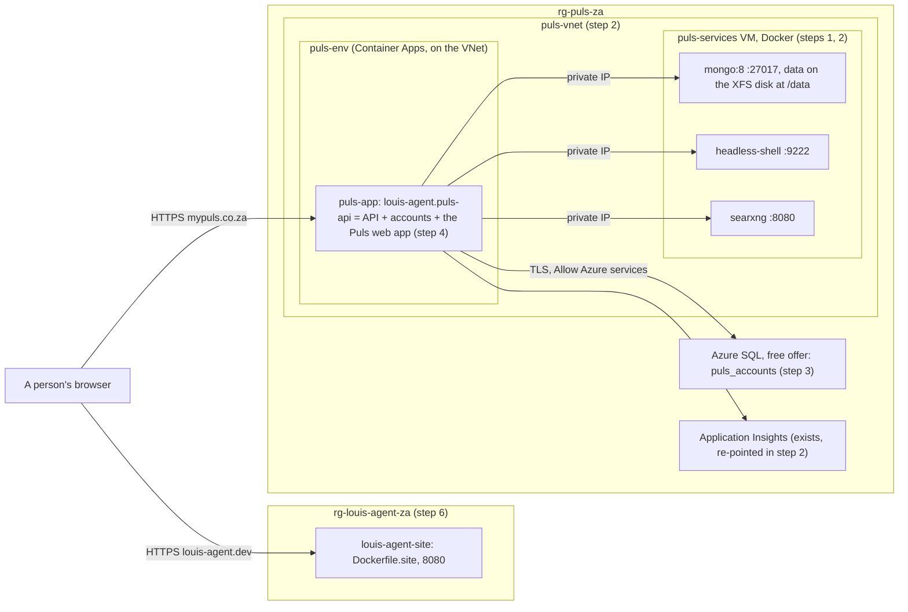
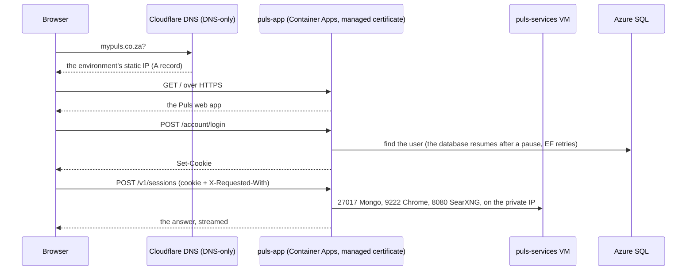

# F61.4 Everything in Azure

> **Plan** (a child of [F61](F61-accounts-and-azure.md)). How Puls and the framework's site go live on their domains from
> Azure, with Mongo, the browser and the search on one private VM, the accounts on Azure SQL's free offer, and nothing
> pointing at Louis's PC any more. Drafted 2026-11-08 from the parent's section; built on `feature/F61.4-azure`.
> Deleted when the work is done: its why goes to an ADR, its what to the deploy READMEs and the deployment view.

## Context

**What the parent decided (2026-11-07):** Mongo and the headless browser on **a small Linux VM with Docker** in a
virtual network (Container Apps can't host Mongo: its storage is a file share, and Mongo's engine fails on it); a
**new Container Apps environment on that network**, so the apps reach the VM on private IPs and nothing on the VM is
public; **Azure SQL's free offer** for the accounts; **SearXNG goes to the VM** (the parent's later pick), no longer
its own Container App; `louis-agent.dev` in **its own resource group**; the Tailscale sidecar, the ingress lock and
`AGENT_AUTH=off` go, since the web app signs in (F61.2) and the key gate takes a signed-in person.

**What exists:** `demos/puls/deploy/azure/` (`deploy.ps1` with eight verbs, `puls-app.yaml`, `puls-searxng.yaml`, the
`ts-forwarder` sidecar, the README) in `rg-puls-za` with the environment `puls-container-env`, the registry
`acrpulsza`, the storage account `pulsstorage` and `puls-insights`; `mypuls.co.za` and `louis-agent.dev` served from
the PC through Cloudflare tunnels (F58: `docker-compose.public.yml` in each demo, the Puls placeholder image);
`docker-compose.puls.yml` with `puls-mongo`, `puls-browser`, `puls-searxng` and `puls-sql`, every port on
`127.0.0.1`.

**What spends money, and waits for Louis's go:** every `az` write (the network, the VM and its disk, the SQL server,
the environment, the apps). The files and the script's verbs are built and read with `-WhatIf` first; the parent's
estimate is in its research record, and the real cost is written in the README after the first month.

## Design

**The shape, in plain words.** One private network, `puls-vnet`, with two subnets: one for the Container Apps
environment `puls-env` (a consumption environment needs a `/23`) and one for the VM `puls-services`. The VM runs
Docker with three containers from `vm/docker-compose.services.yml`, each bound to the VM's private IP only: `mongo:8`
on 27017, `headless-shell` on 9222 and `searxng` on 8080. Its network security group lets the apps' subnet in on
those three ports and nothing else; SSH only from Louis's IP when he asks for it. Mongo's data is an XFS data disk
mounted at `/data`, so a rebuilt VM keeps the runs, the recipe library and the shop prices. `puls-app` moves to the
new environment with `BROWSER_URL`, `SEARXNG_URL` and the three Mongo URLs on the VM's private IP; its accounts are
on Azure SQL (`ACCOUNTS_SQL_URL` as a secret, the free offer's serverless database `puls_accounts`, EF's retry on
for the first call after an auto-pause). The site is a Container App of its own in `rg-louis-agent-za`. Both domains
move from the tunnels to Container Apps' free managed certificates, DNS-only records in Cloudflare.

**Why a VM and not three Container Apps:** Mongo needs a real disk, and the browser and the search want to be
unreachable from the internet; on the VM all three are one compose file, like the PC's stack, with no public
address at all. **Why one script per demo:** a demo holds its own deploy ([ADR 0074](../adr/0074-the-folders-say-what-ships.md));
the site's `deploy.ps1` copies the Puls one's shape (verbs, `Invoke-Az`, `-WhatIf`), not its file.

### Architecture (after)

### Communication: a chat on mypuls.co.za

### The files (the namespace map of a deploy)

| File | Folder | Step |
|---|---|---|
| `vm/cloud-init.yaml` | `demos/puls/deploy/azure/` | 1 new: Docker, the data disk, the compose started at boot |
| `vm/docker-compose.services.yml` | `demos/puls/deploy/azure/` | 1 new: Mongo, the browser, SearXNG on the private IP |
| `DeployFilesTests` | `demos/puls/tests/louis-agent.puls.tests/Deploy/` | 1 new: no port on `0.0.0.0`, images by digest, the three services |
| `deploy.ps1` (`infra`, `vm`, `sql`, `domain` verbs; `lock`, `searxng-settings` gone) | `demos/puls/deploy/azure/` | 2, 3, 5, 7 changed |
| `puls-app.yaml` | `demos/puls/deploy/azure/` | 4 changed: no sidecar, the VM's addresses, the SQL and provider secrets |
| `puls-searxng.yaml`, `ts-forwarder/` | `demos/puls/deploy/azure/` | 7 deleted |
| `docker-compose.public.yml`, `Dockerfile.puls-placeholder`, `PlaceholderPageTests` | `demos/puls/` | 5 deleted |
| `site.yaml`, `deploy.ps1`, `README.md` | `demos/louis-agent/deploy/azure/` | 6 new |
| `docker-compose.public.yml` | `demos/louis-agent/docker/` | 6 deleted |
| the two READMEs, the deployment view, the ADR, the TODO, the write-up | docs | 8 |

## Steps

Every `az` write waits for Louis's go (rule 7); `-WhatIf` shows what a verb would do.

0. **Louis, in Cloudflare and Azure, when the apps are ready (step 5 and 6):** the DNS records the READMEs list,
   DNS-only (a proxied record blocks the certificate); `az login` on this PC.
1. **The VM's files.** `vm/cloud-init.yaml` (Docker from Docker's repository, XFS on the data disk mounted at
   `/data`, the compose copied in and started by a systemd unit) and `vm/docker-compose.services.yml` (the three
   services, the same images and settings as the PC's stack, bound to the VM's private IP, Mongo's data under
   `/data/mongo`, SearXNG's `settings.yml` and secret from files the `vm` verb copies up). Test first:
   `DeployFilesTests` reads the compose: every port binds a private address, every image is by digest, the three
   services are there.
2. **`deploy.ps1 infra`** (`-WhatIf` first): `puls-vnet` with the apps' `/23` and the services' subnet, the NSG
   (27017, 9222, 8080 from the apps' subnet; 22 from `-Ip` only while set), the VM (Ubuntu 24.04, `Standard_B2s`,
   a 32 GB Standard SSD data disk, the cloud-init, no public IP), the environment `puls-env` on the apps' subnet,
   Application Insights re-pointed with the `telemetry` verb. `deploy.ps1 vm`: copies the SearXNG settings and the
   Mongo and SearXNG env files to the VM through `az vm run-command` and restarts the compose.
3. **`deploy.ps1 sql`**: the server (`puls-sql-za`, an admin from `config/.env.sql`), the free-offer database
   `puls_accounts` (serverless, auto-pause, 32 GB), "Allow Azure services", and the connection string into
   `puls-app`'s secrets as `accounts-sql-url`.
4. **`puls-app.yaml`** for `puls-env`: one container, no sidecar; `AGENT_AUTH` gone and `AGENT_API_KEY` set from
   its secret; `BROWSER_URL`, `SEARXNG_URL`, the Mongo URLs on the VM's private IP (the IP from the `infra` verb's
   output, filled in the yaml by hand and named in the README); `ACCOUNTS_SQL_URL`, `ACCOUNTS_TENANT`,
   `ACCOUNTS_COOKIE_DOMAIN`, the provider keys by secretRef; `release` targets the new environment.
5. **The domain.** `deploy.ps1 domain [-Site]`: adds `mypuls.co.za` and `www.mypuls.co.za` to `puls-app` with a
   managed certificate, printing the records Cloudflare needs first (the environment's static IP for the A record,
   the `asuid` TXT, the CNAME for `www`). The Puls placeholder compose, image and tests go.
6. **The site.** `demos/louis-agent/deploy/azure/`: `site.yaml` (the `Dockerfile.site` image, 8080, `/health`),
   `deploy.ps1` (`infra`, `build`, `update`, `release`, `logs`, `domain`), the README; `rg-louis-agent-za`,
   `acrlouisagentza`, `louis-agent-env`, `louis-agent-site`, `louis-agent.dev`. The site's public compose goes.
7. **Retire the old.** `puls-searxng.yaml`, `ts-forwarder/`, the `lock` and `searxng-settings` verbs, `TS_AUTHKEY`
   and the tunnel tokens out of the secrets examples; the README lists what Louis deletes in the portal (the old
   environment, `puls-searxng`, the `ts-forwarder` and `searxng` images, the unused shares).
8. **Docs.** The two deploy READMEs (what exists, the cost of each resource, the month's total once known), the
   deployment view, the ADR *The sites run from Azure, and nothing points at the PC* (supersedes F58's reason), the
   TODO (F51.2's "where Puls runs", F105 "The Azure app behind a key", F54's and F58's leftovers), the write-up
   (skill 18, shipping).

## Verification

- Per step: the test of the step; `core.tests` when a file or project is added; `-WhatIf` on every verb before it
  runs for real, and Louis's go before it does.
- **By hand, with Louis:** from a phone on mobile data, `https://mypuls.co.za` and `https://louis-agent.dev` open with
  a padlock; sign in; a chat answers (**this spends the Anthropic key: ask first**); `/v1/sessions` without a sign-in
  is 401; the VM answers nothing from the internet (`nmap` from the phone: 27017, 9222, 8080 closed); `az` costs
  reviewed after the first month against the README's estimate.

## Concepts, and where they sit in GOAL.md

- **Shipping to a private network** (skill 18): a VNet environment, an NSG, a VM as the service host, managed
  certificates and DNS; why a file share can't hold a database, and why a sidecar tunnel was the wrong shape once
  the services could live beside the app.
- **Secrets stay where they're used** (skill 15): a connection string is a Container App secret set from the
  git-ignored config, never in a yaml; the VM's env files go up by a command, never in cloud-init.

## Approved during the build

- **The Azure build is a Bicep file in config (Louis, 2026-11-08).** Of three options (a state file each verb
  writes, a hand-kept step list, infrastructure as code) Louis picked the third, after "like a ps file" and "scripts
  that check for the resource first, then update or create": a Bicep deployment does exactly that for every
  resource it declares, and the file is the record. `demos/puls/config/azure/main.bicep` with `main.bicepparam`
  declares the network, the security group, the VM and its disk (cloud-init from `deploy/azure/vm/`), the SQL
  server and the free-offer database, the Container Apps environment on the network, Application Insights and the
  registry; `deploy.ps1 infra` runs `az deployment group create` on it, `-WhatIf` Azure's own what-if. The site's
  is `demos/louis-agent/config/azure/main.bicep`. What a template can't do stays a verb: copying the VM's files
  (`vm`), building images (`build`), the app's revisions (`update`, `release`), the domain's certificate once the
  DNS records exist (`domain`), the secrets (`secrets`). No secret value is in a template or a parameters file:
  the SQL admin password is a secure parameter read from the git-ignored `config/.env.sql` by the verb.
- **The table "The files" changes with it:** the `infra`, `sql` verbs of steps 2 and 3 become the template and one
  verb that deploys it; the VM's private IP and the environment's static IP are the deployment's outputs, which the
  `update` verb reads back with `az deployment group show` to fill `puls-app.yaml`, never a hand-copied value.
- **The old stays until the new is live (Louis, 2026-11-08: "remove the old ts-forwarders when we are done").** Step
  5's and 7's deletions (the placeholder and its test, the tunnel composes, `puls-searxng.yaml`, `ts-forwarder/`, the
  tunnel keys in the secrets examples) wait until the Azure build has run and both sites answer on their domains;
  until then the old deploy keeps serving from the PC and the READMEs describe both. The ADR, the TODO rows, the
  work log and this plan's deletion wait for the same moment.

---
[Docs index](../README.md) · Related: [Plans](README.md) · [F61](F61-accounts-and-azure.md) · [Deploying Puls to Azure](../../../demos/puls/deploy/azure/README.md)
