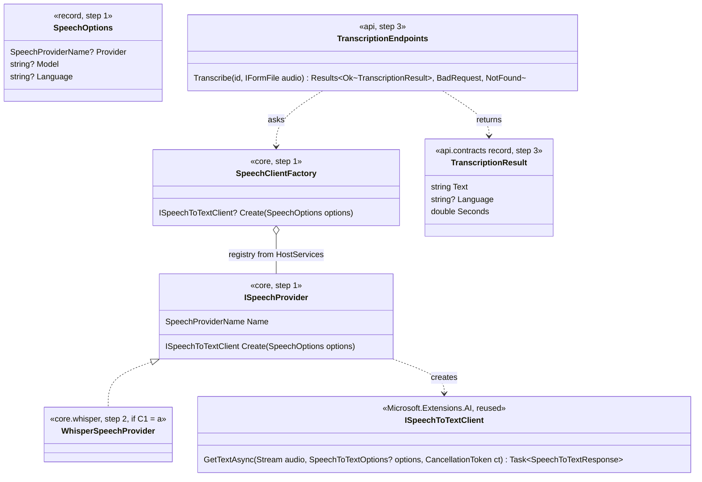
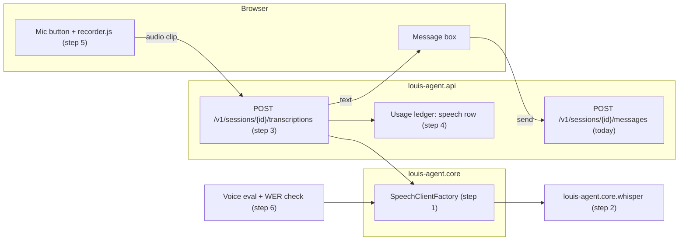
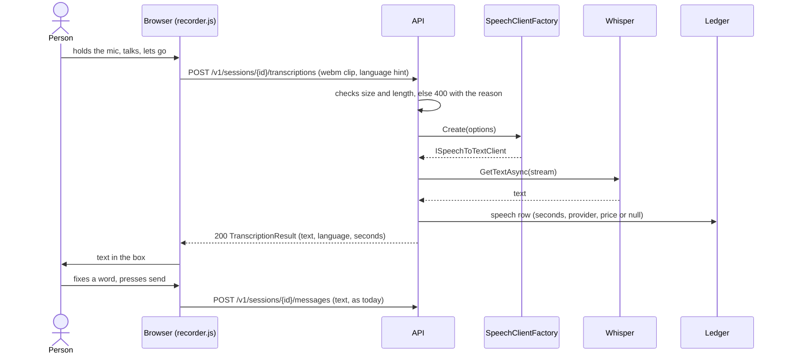
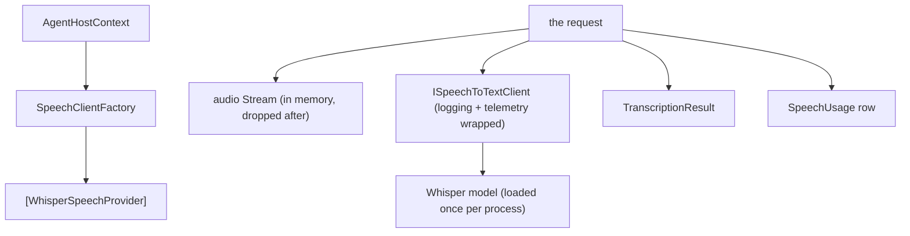

# Draft: F92 The agent listens to voice

> **Plan draft, not yet approved.** Written on 2026-11-11 from Louis's "Okay how do I get my agent to listen to
> voice?" and his pick of three (B: our own speech-to-text behind a seam, not the browser's and not realtime voice).
> The open choices below go to Louis one at a time, three options each (the development guide, rules 10 and 11); when
> they are settled this is the plan he approves, and it is committed on `feature/F92-voice-input` before step 1.

## Context

**What Louis asked.** How to let a person talk to the agent instead of typing.

**What it means.** Claude reads text and images, not sound. So "listening" is **speech-to-text** (STT): the voice is
turned into words first, and the agent gets an ordinary text message. Nothing in the loop changes: the history is
still text (ADR 0008), the cost of the turn is still the ledger's (ADR 0007).

**The three ways, and Louis's pick** (2026-11-11):

| | Way | Why not / why |
|---|---|---|
| A | The browser's own Web Speech API | Chrome sends the audio to its own server ([MDN](https://developer.mozilla.org/en-US/docs/Web/API/SpeechRecognition)), it is not Baseline (Firefox lacks it), and nothing passes our code, so nothing can be measured |
| **B** | **Record in the browser, our API turns it into text behind a seam** | **Picked.** Works in every browser, the same strategy shape as the chat models (ADR 0003), counted in the ledger, measured by an eval |
| C | Realtime voice (speech to speech) | Runs on the provider's own voice model, so it skips our loop and Claude (ADR 0002); the dearest and biggest |

**What exists today** (checked on 2026-11-11):

| Piece | State | Where |
|---|---|---|
| `ISpeechToTextClient`, Microsoft.Extensions.AI's speech twin of `IChatClient`, with logging and OpenTelemetry wrappers | In the package we use, marked experimental (`MEAI001`) | `Microsoft.Extensions.AI.Abstractions` 10.10.1 ([docs](https://learn.microsoft.com/en-us/dotnet/api/microsoft.extensions.ai.ispeechtotextclient)) |
| An OpenAI implementation of it | In a package core.openai already references | `Microsoft.Extensions.AI.OpenAI` 10.10.1 (`OpenAISpeechToTextClient`) |
| Providers picked by name from a registry the host hands in | Built | `ILlmProvider`, `LlmClientFactory`, `HostServices.Providers` (ADR 0092) |
| The message box and its buttons | Built | `louis-agent.web` `Components/Chat/Composer`, `ComposerButtons` |
| A script as a module beside its component | Built | ADR 0093 |
| Voice | A TODO row only | `F92 Voice`, Puls, later |

**Languages.** English and Afrikaans first. Azure Speech lists `af-ZA` and `zu-ZA` for speech to text but not
isiXhosa ([language support](https://learn.microsoft.com/en-us/azure/ai-services/speech-service/language-support?tabs=stt));
Whisper's models are multilingual and Afrikaans is among their languages, how well is what the eval measures.

**Prices.** Not yet verified: the official pages checked on 2026-11-11 gave no figure (Azure's page shows blanks; it
does say 5 free real-time hours a month on its free tier, billed per second; OpenAI's pricing page no longer lists its
transcribe models). A cloud provider's price goes in the dated price table from its official page before any paid run.

## Design (proposed)

### The shape, in plain words

- **One seam, a strategy per provider.** Core keeps the interface (`ISpeechToTextClient`, reused, not written), a
  small `ISpeechProvider` registry like `ILlmProvider`, and `NoSpeech` for when voice is off. Each provider is its own
  project on core (ADR 0092), and the host hands it in through `HostServices`. `SPEECH_PROVIDER` (an enum, ADR 0024)
  picks one; unset means voice is off and the mic button is not drawn.
- **Hold to talk, check, then send.** The browser records a clip with `MediaRecorder`, the API turns it into text,
  and the text lands **in the box**, not sent: the person reads it, fixes a wrong word, and presses send (choice C2).
- **One mic at a time on a page.** louis-agent.dev shows several demos on one page, each with its own chat, and a
  browser has one microphone. The recorder is one module the whole page shares (ADR 0093 imports it once): starting a
  recording in one chat stops any other first, and the words go back only to the chat that started it.
- **Many people at once on the server.** Each request gets its own Whisper processor over one model loaded once per
  process; a cap on transcriptions running together (a semaphore) keeps the CPU for chat, and a request over the cap
  waits a moment, then is refused with its reason (429).
- **Audio is never kept.** It lives in memory for the one request and is dropped; only the text and the seconds are
  recorded. A clip is capped (60 seconds, 5 MB) and refused with its reason past that (ADR 0005).
- **Counted like every request.** A speech row in the ledger: seconds of audio, the provider, the price from the dated
  table (`null` when unknown, never 0). A local model costs 0 because it is ours, recorded as such.
- **Measured.** A voice eval: short clips Louis records (English and Afrikaans, each with what was said), scored by
  **word error rate** (WER: the share of words wrong) as a new check in the catalogue.

### Open choices (asked one at a time)

| # | Choice | Options | Recommended |
|---|---|---|---|
| C1 | Where the words come from first | (a) Whisper in our own process (Whisper.net, MIT, whisper.cpp underneath): free, private, CPU and a model file in the image; (b) the OpenAI-shaped client we already reference, pointed at OpenAI's cloud: least code, paid per minute, audio leaves us; (c) Azure Speech: `af-ZA`/`zu-ZA` listed, 5 free hours a month, its own SDK and an adapter we write | **Picked (a)** (Louis, 2026-11-11: "whisper then"; free only, no account): free evals, audio never leaves our box, the seam lets (b) or (c) join in one step later |
| C2 | What happens after the person stops talking | (a) the text goes in the box to check; (b) it is sent at once; (c) a setting per site | **Picked (c)** (Louis, 2026-11-11: "if it is small just add it and it is fun"); where the setting lives is C2b |
| C2b | Where "check or send" is set (Louis's demos share one page) | (a) once per site in its config; (b) on each chat box, the component's parameter, so each demo picks; (c) per chat box with a site default | (b): a demo page holds several agents, and one parameter covers a one-chat site too |
| C3 | Where the mic shows | (a) every site on the framework's web, off unless `SPEECH_PROVIDER` is set; (b) Puls only; (c) (a) plus F131's widget now | (a), the widget picks it up when F131 builds its frame |

### Diagrams

**Interface design**



**Architecture**



**Communication**



**Objects (one transcription)**



### Namespace map

| Type | Folder | Namespace | Step |
|---|---|---|---|
| `SpeechProviderName` (enum) | `src/engine/louis-agent.core/Speech/` | `LouisAgent.Core.Speech` | 1 |
| `ISpeechProvider`, `SpeechClientFactory`, `SpeechOptions` | the same | the same | 1 |
| `HostServices.SpeechProviders` | `src/engine/louis-agent.core/Hosting/` | `LouisAgent.Core.Hosting` | 1 |
| `WhisperSpeechProvider` | `src/engine/louis-agent.core.whisper/` | `LouisAgent.Core.Whisper` | 2 |
| `TranscriptionEndpoints` | `src/hosts/louis-agent.api/Endpoints/Sessions/Transcriptions/` | `LouisAgent.Api.Endpoints.Sessions.Transcriptions` | 3 |
| `TranscriptionResult` | `src/hosts/louis-agent.api.contracts/Sessions/` | `LouisAgent.Api.Contracts.Sessions` | 3 |
| `SpeechUsage` | `src/engine/louis-agent.core/Usage/` | `LouisAgent.Core.Usage` | 4 |
| `MicButton` (+ `.razor.js`, `.razor.scss`) | `src/web/louis-agent.web/Components/Chat/Composing/` | `LouisAgent.Web.Components.Chat.Composing` | 5 |
| `WordErrorRate` check | `src/evals/` checks catalogue | its catalogue's namespace | 6 |
| Tests, one project per project above | mirrored under `src/tests/` | `….Tests` | each |

Names are checked against the code when the plan is approved.

### Folder tree (after)

```
src/engine/
  louis-agent.core/Speech/            # step 1: the seam
  louis-agent.core.whisper/           # step 2: new project, if C1 = a
src/hosts/louis-agent.api/Endpoints/Sessions/Transcriptions/   # step 3
src/web/louis-agent.web/Components/Chat/Composing/MicButton.*  # step 5
src/tests/engine/louis-agent.core.whisper.tests/               # step 2
```

## Steps

Each step is one commit with its test, written and seen failing first, and a stop for Louis's review.

1. **The seam.** `SpeechProviderName`, `ISpeechProvider`, `SpeechClientFactory`, `SpeechOptions`,
   `HostServices.SpeechProviders`; `SPEECH_PROVIDER` read once. Test: unset gives no client, an unknown name fails with
   its reason, a fake provider is found by name.
2. **The first provider** (C1). Test: the provider is picked by name; an integration test turns a two-second fixture
   clip into its words (`*.integration-tests`, the model fetched once and cached).
3. **The endpoint.** `POST /v1/sessions/{id}/transcriptions`, a named method returning `TypedResults` (ADR 0045, 0051);
   refuses over 60 s or 5 MB, an unknown session, voice off, or too many at once (429), each with its message enum (ADR 0009). Test with a
   fake client, including that nothing is written to disk.
4. **The ledger.** A speech row: seconds, provider, price from the dated table or `null`; every host's totals include
   it. Test: a local clip records 0 with its reason, an unpriced provider `null`.
5. **The mic.** `MicButton` beside the send button, its recorder as a module beside it (ADR 0093), the text into the
   box or sent, by the chat box's setting (C2, C2b), one recording on the page at a time, not drawn when voice is off, a one-line privacy note on first use. Test: bUnit for drawn/not drawn, the text
   landing in the box or sent by the setting, and a second chat's mic stopping the first.
6. **The voice eval.** The `WordErrorRate` check in the catalogue (C# once), and the eval as files: Louis's clips with
   what was said, English and Afrikaans. Free with a local provider; a cloud provider's run waits for Louis's go.
7. **Docs.** ADR 0118 (speech behind the same seam as chat; audio never kept), the core and web design docs, the
   write-up `docs/learning/19-multimodal.md`, TODO, work-log, GOAL row 19.

## Verification

- The tests of each step; the full suite once at the end.
- Free manual check: talk to Puls locally in Chrome, Edge and Firefox, English and Afrikaans, see the text in the box,
  send it, see the speech row in the usage bar.
- The voice eval's WER per language, recorded in the write-up. Any paid provider's run asks first.

## Concepts (skill map)

| Step | Concept | GOAL.md skill |
|---|---|---|
| 1, 2 | A second kind of model behind one interface; the strategy pattern again | 1 Models and providers, 19 Multimodal |
| 3 | Guarding input that isn't text: size, length, reasons | 15 Safety and security |
| 4 | Pricing something that isn't tokens | 13 Cost and token economics |
| 5 | The person checks the machine's words before they count | 16 Human in the loop |
| 6 | Word error rate, a metric with a long history in speech | 12 Evaluation |

---
[Plans](README.md) · [TODO](../../../TODO.md)
