# LouisAgent.Cli — design

> **Kind:** host (a library) · **Path:** `src/hosts/LouisAgent.Cli/` · **References:** LouisAgent.Core · **Docker service:**
> `local-agent`
> **Also shows:** `component`



## Purpose

This is the simplest way to use the agent: a chat in your terminal, or a single prompt from a script. It has no
protocol of its own, which also makes it the quickest host for trying out a change to core.

The rest of this doc follows one run: how it starts, what you see as a reply comes in, how you stop it, the commands
that never reach the model, the cost line after each answer, and how it finds its settings.

## How it works

### 1. Starting

Your program makes one call, `CliHost.RunAsync`. It builds the engine with `AgentHost.Build`, then hands it to a
`ConsoleChat`. If you passed a prompt, the chat answers that one prompt and stops (`RunSinglePromptAsync`).
Otherwise it opens the interactive loop (`RunAsync`). The library never picks a pack itself: your program names its
identities and packs in the catalogue it hands over, because a library can't reference someone else's project.

`ConsoleChat` only turns the engine's stream into text on the terminal. The turn itself is core's
`AgentEngine.StreamPromptAsync`, the same one every other host uses. A chat looks like this:

```text
You: What branch am I on?
[thinking in grey]
  > GetCurrentBranch
    done: main
You're on main.
You: exit
```

### 2. What you see

The model's thinking is printed in grey, and the answer appears as it's written, after a blank line that separates
it from the thinking. Each tool call gets one grey status line, `> Name args`, and its result another, `done:` or
`failed:` with the first line of what the tool said. A status line longer than 160 characters is cut, with `...` at
the end. Blank lines you type are ignored.

### 3. Stopping and quitting

**Ctrl+C** stops the reply that's running, and the chat shows `[stopped]`. If no reply is running, it exits. Typing
`exit`, or reaching the end of the input, quits too. A reply that fails shows its error, and the chat carries on. A
single prompt that fails prints its error and exits with code 1, so a script can tell.

### 4. Commands that never reach the model

`/tools`, `/approve <Name>`, `/reject <Name>` and `/usage` are answered by the engine, and never sent to the model.
They're core's `UserCommands`, the same ones Rider and the API answer. `/usage` gives you the session's tokens and
cost, split by purpose.

### 5. What each answer cost

After each answer, including stopped and failed ones, a grey line goes to **stderr**, like this:
`turn: 3 requests · 28k tokens (26k cached) · $0.006 · session $0.04`.

With a single prompt (`-- "…"`), that line leaves out the session total, since one prompt is the whole session. And
because it's on stderr, stdout stays the answer alone, which is what a script wants. You only get the line when the
ledger is on, meaning `LOG_DIRECTORY` is set. The cost is shown in the display currency, `DISPLAY_CURRENCY` or the
region's.

In the usage ledger, each run is one session of its own, named `cli_` and a new id, and each answer one turn of it.

*Decided in:* F3.

### 6. Finding its files

It reads its settings from the `config/` folder `CONFIG_DIRECTORY` names. Without that, it looks for the nearest
`config/` folder that holds a `.env` or `.env.secrets`, from the folder you run it in and upwards. Each demo has its
own `config/`, so you run the CLI from inside the demo's folder, or name the folder. In Docker, the compose file sets
`CONFIG_DIRECTORY` to the coding demo's.


These are the types involved:


## Structure

| File | What's in it |
|---|---|
| `CliHost.cs` | The one call a program makes: takes the catalogue, then picks one-shot or interactive |
| `ConsoleChat.cs` | The chat on the console: the loop, a single prompt, the stream drawn as text, the usage line |
| `Messages/CliUserText.cs` | The screen's words: the banner, the prompts, the status lines (ADR 0009) |
| `Messages/Holes/` | The records that fill those words' holes: an error's reason, a tool call and how it ended (ADR 0119) |
| `LouisAgent.Cli.csproj` | References core only |

The program that starts it is your own. The coding agent's is `demos/louis-agent/hosts/LouisAgent.CodingCli`, which names no
packs ([ADR 0074](../adr/0074-the-folders-say-what-ships.md)).

## Configuration

It runs in its program, in the `local-agent` container, with a terminal attached.


It uses core's settings ([Setup](../SETUP.md)), and has none of its own.

## Extending it

The steps are in [Change the CLI](../guides/change-the-cli.md). In short: how things look on the terminal lives in
`ConsoleChat`. The commands are core's `UserCommands`, shared with Rider and the API. And the program stays a
bootstrap that does nothing but start it.

## Tests

There are no tests of its own. The loop and the commands are covered through `AgentEngine`, in
`src/tests/engine/LouisAgent.Core.Tests`.

## Limits and plans

The history is lost when you exit, and a session can't be picked back up.

## Related docs

[Quick start](../../../demos/louis-agent/docs/QUICK_START_AGENT.md) · [LouisAgent.Core](LouisAgent.Core.md)

---
[Projects](README.md) · Previous: [LouisAgent.HostPacks](https://github.com/bosbevk/louis-agent/blob/puls-moved-out/demos/puls/docs/projects/LouisAgent.HostPacks.md) · Next: [LouisAgent.Acp](LouisAgent.Acp.md)
