# LouisAgent.SiteFramework — design

> **Kind:** web app (Blazor WebAssembly), and its host `LouisAgent.SiteFrameworkApi` · **Path:** `src/site/` ·
> **References:** LouisAgent.Web, LouisAgent.Web.Themes, LouisAgent.Web.Framework, LouisAgent.Web.Places; the
> host also the framework's API, core's web, telemetry and Anthropic, the framework Orbi's identity, and the docs and
> site packs · **Runs:** framework.louis-agent.dev, the Azure app `louis-agent-framework-app`, and the review copy
> on 127.0.0.1:5084



## Purpose

This is the framework's own website, meant for framework.louis-agent.dev. louis-agent.dev sells websites with agents,
and this site is where a developer learns the framework those agents run on. It is built on the framework's web like
any site, so it shows how little a site on it holds: which packages it uses, its frame, its styles, and a host of a
few lines.

The pages themselves are not in it. They are the framework's pages package,
[LouisAgent.Web.Framework](LouisAgent.Web.Framework.md), which this site turns on.

It has an agent of its own, the framework Orbi. louis-agent.dev's Orbi is Louis's agent and sells; this one speaks
for the framework, answers a developer from its docs, and sells nothing. It stands docked beside the page, and a
developer reaches it four ways: Ask Orbi in the header, Ask about this page, Ask on any code listing, and the
search's last row. Who it is lives in its own project,
[LouisAgent.Identities.Framework](LouisAgent.Identities.Framework.md).

*Decided in:* F164.1, F164.2, [ADR 0084](../adr/0084-every-site-is-built-on-the-frameworks-web.md),
[ADR 0125](../adr/0125-a-site-is-configured-framework-components.md).

## How it works

The story is a developer who opens the site's address. Part 1 is what the site is made of, part 2 the frame every
page is drawn in, part 3 the ways the developer asks its agent, and part 4 the host that serves it.

### 1. What the site is made of

The whole site is named in one place, `FrameworkAreas.Name`:

```csharp
areas.Flat().Framework().Docs(DocsAddress.GitHub("bosbevk/louis-agent", "main"))
    .Places(Home, typeof(App).Assembly);
```

It wears the flat theme alone, so it always opens flat, in light, and the visitor's look switch offers only light or
dark. It turns on the framework's pages. It says the pages' doc links lead to the repo on GitHub, until the docs have
a site of their own. And it gives every place on its pages an address of its own, the Overview's under the word
`overview`, as in `/overview/the-engine`.

That one method is the site's Composition Root, the one place where it says which parts it uses. The browser's
program hands it to `AddSiteAreas`, the host hands it to the same call when it draws a page itself, and the tests
hand it there too, so all three draw what the site draws.

The site's styles, `Styles/app.scss`, list the framework's Sass and the flat theme's two sheets, and nothing of the
site's own. `wwwroot/index.html` opens the page as `data-theme="flat"` and `data-style="light"`, so the first paint is
already the site's look.

### 2. The frame every page is drawn in

The router, `App`, draws every page in the site's layout, and a place's own address in the layout of the page it
names, through the places' `PlaceLayout`. The layout is the framework's frame, `SiteShell`, in its docs layout:


The header carries the louis-agent wordmark and the line "The C# AI agent framework", and on its right the search
and Ask Orbi. The left column is the docs' menu, the framework's pages under their groups. The middle column is the page,
with the page before and after at its foot. The right column holds the framework Orbi, docked, and while Orbi is
closed, on an extra-large screen, "On this page", the page's sections, the same list the frame's section index
reads, under the button Ask about this page. Below an extra-large screen, Orbi's button in the lower-right corner
wears the mark and says "Ask Orbi", the header button's words. The footer is one row of two groups, which the
frame's footer pushes to its ends: on the left the wordmark and the header's own line, and on the right three quiet
links, GitHub to the repository, Licence to the README's Licence section, and louis-agent.dev, each opening a new
tab. The links are the page's second grey, underlined only under the pointer or the keyboard's ring; their rule is
the site's own partial, `Styles/layout/_footer.scss`, so louis-agent.dev's footer keeps its look. The header's
line and the links' words are written once in `Layout/FrameworkWords`, and the repository's name and addresses in
`FrameworkAreas`, where the doc links read the name too. The frame's way back up is switched off. The layout holds nothing but the framework's parts given the site's words.

### 3. Asking the framework Orbi

The site places its chat once, `Components/Orbi/FrameworkOrbi`: the framework's `ChatWidget`, docked, opened as the
identity `louis-agent-framework`, titled "Orbi · AI", with its work kept out of sight. Its words, and those of every
way to ask it, are the site's own, in `Components/Orbi/OrbiAsks`.

Every way to ask goes through the door the framework's web gives every site, so none of them needs to reach the
widget. Ask Orbi in the header only opens the chat, and Ctrl+I or Cmd+I does the same from anywhere on the page. Ask
about this page puts "Explain this page to me. What does it cover, and where does it fit in the framework?" Ask on a
code listing puts the listing's code. And the search, Ctrl+K or Cmd+K, finds the site's own places by their
headings with no model, and its last row asks Orbi the same words. The page the developer reads goes with every
question, so Orbi knows what "this" is.

On an extra-large screen Orbi opens in the right column, in place of "On this page", and closing it brings the list
back. Below that, it slides in from the side, and a round button in the lower-right corner opens it. How the docked
layout, the door, the code listing's Ask and the search work is in [LouisAgent.Web](LouisAgent.Web.md).

### 4. The host

`LouisAgent.SiteFrameworkApi` is the program that serves the site:

```csharp
var services = new HostServices(WebAccess.Create, OtlpTelemetry.Instance, Providers: [AnthropicProvider.Instance]);
var host = AgentHost.Build(FrameworkCatalog.Create(), services);
var builder = WebApplication.CreateBuilder(args);
builder.AddLouisAgentApi(host);
var evals = EvalsOptions.FromEnvironment();
builder.AddLouisAgentEvals(host, EvalsStartup.JudgeClient(host, services.ClientFactory(), evals), evals);
var app = builder.Build();
app.UseLouisAgentKey();
app.MapStaticAssets();
app.MapLouisAgentSite(typeof(LouisAgent.SiteFramework.App).Assembly, FrameworkPageServices.Register,
    home: LouisAgent.SiteFramework.FrameworkAreas.Home);
app.MapLouisAgentApi(host);
string? adminKey = AdminOptions.FromEnvironment().AdminKey;
app.MapLouisAgentHostGroup().MapLouisAgentEvals(adminKey);
app.Run();
```

It takes the framework Orbi's evals the way louis-agent.dev's host takes its agents': `AddLouisAgentEvals` reads the
eval file beside Orbi's voice when the host starts, so a wrong one stops it, and `MapLouisAgentEvals` puts the eval
routes on the API's group behind the admin key ([LouisAgent.Api.Evals](LouisAgent.Api.Evals.md)). The site's
`/admin` is the framework's admin frame with this site's name, from its own `Layout/AdminLayout.razor`, and holds the
framework's eval pages, which `FrameworkAreas` names with `.Admin(typeof(AdminLayout)).Evals()`. A run is started and
read there or over the API, and kept in the host's data folder.

It is the framework's API and the site's files. What it runs is its catalogue, `FrameworkCatalog`: the framework Orbi
alone, on two packs, the docs it answers from and the site it shows places with. Nothing else, so a visitor reaches
no shell, no file or git tool, and no lead. The identity is the catalogue's first, so it is the default. The door
for visitors without a key, `OPEN_IDENTITIES=louis-agent-framework`, opens to it alone. It lets one address open at
most `OPEN_SESSIONS_PER_DAY` sessions a day, 20 in the compose file and the run profile, the same cap as
louis-agent.dev in Azure.

`MapLouisAgentSite` draws each page as HTML before the app starts in the browser, so a search engine and a reader with
no script both get the page's words. `FrameworkPageServices` registers what a page drawn there asks for, the site's
areas among them, so the host draws the framework's pages without being told of the package: the framework's web tells
it which assemblies the areas brought ([LouisAgent.Api](LouisAgent.Api.md)). The same drawn pages are the index the
search reads and Orbi's `FindPlace` reads. Like every host of the API, it refuses to start without `AGENT_API_KEY`.

It runs in the site's compose file, `src/site/docker/docker-compose.yml`, as the service `framework`, on 127.0.0.1:5084
by default (`FRAMEWORK_PORT`), from `Dockerfile.framework`. It keeps its logs in `src/site/logs/framework` on the PC. The image is the runtime, the site's own copies of the
price and rate tables the usage ledger reads, and the docs Orbi reads. Those are laid out under `/app/docs` as the
repo lays them, so their links hold: the repo's `README.md`, `ROADMAP.md` and `TODO.md`, the framework's docs
without the films, each demo's docs and the packs'. `DOCS_ROOT` points at them. In Rider, the host's
`site-framework` profile runs it on 127.0.0.1:5085, reading the docs from the repo itself (`DOCS_ROOT=../../..`). The site lists every page in `wwwroot/sitemap.xml`, one address each and no section (ADR 0128), and `robots.txt` names it.

A link to the site shows a share card of its own. The Overview, and any page with no card of its own, wears the
site's card, `wwwroot/social-card.png`: the name large, "The C# AI agent framework" and the address, which
`index.html` names with words that say what it shows. Every other page wears a card of its own in
`wwwroot/social-cards/`, named for its address: the site's name small, the page's own name large, its first heading
under it and its address on a grey band, in flat's light look. Beside each picture is a text file with the card's
words in one line, which the host puts in the head as what the picture shows ([LouisAgent.Api](LouisAgent.Api.md) says
how the host finds them). The cards are drawn by the repo's card tool, which starts this host, reads each page's name
and heading as a crawler reads them, and photographs the site's own name from its header, so the card's name is the
one the site draws. A card is a picture of words, so it goes stale when a heading changes. A test catches that: it
draws each page as the host does and holds the words beside its card to the page. The guide to
[changing the site](../guides/change-the-site.md#draw-the-framework-sites-page-cards) says when to draw them again.

In Azure it is the Container App `louis-agent-framework-app`, beside louis-agent.dev's in the same environment, on the
same image, from `src/site/deploy/azure/louis-agent-framework-app.yaml`. Every merge to `main` releases it, after
louis-agent.dev. It reads the vault with louis-agent.dev's identity and keeps its logs and usage ledger in
`framework/logs/` on louis-agent.dev's file share, so it added nothing to Azure but the app. Its own two keys come
from `config/.env.secrets.framework`, under the vault suffix `-framework`, and the model's key is the one both sites
share. Like louis-agent.dev, it sleeps when nobody visits. The how-to is the
[deploy guide](../guides/deploy-the-sites.md).

These are the types involved:


## Structure

The place to look a file up.

| Path | What's in it |
|---|---|
| `LouisAgent.SiteFramework/FrameworkAreas.cs` | The site's areas, its home word, and the repository's name and addresses |
| `LouisAgent.SiteFramework/App.razor`, `Program.cs` | The router, and the browser's program |
| `LouisAgent.SiteFramework/Layout/FrameworkLayout.razor`, `FrameworkWords.cs` | The site's frame, on `SiteShell` in its docs layout, with the search, Ask Orbi, Orbi docked and the footer's links; the frame's words, written once |
| `LouisAgent.SiteFramework/Layout/AdminLayout.razor` | The admin's frame, the framework's `AdminShell` with this site's name and its way back |
| `LouisAgent.SiteFramework/Components/Orbi/` | `FrameworkOrbi`, the chat placed once; `OrbiAsks`, the words of every way to ask it |
| `LouisAgent.SiteFramework/Errors/NotFound.razor` | The page for an address the site has no page for |
| `LouisAgent.SiteFramework/Styles/app.scss`, `layout/_footer.scss` | The framework's Sass and the flat theme, then the site's one partial, its footer's links; the build makes `wwwroot/css/app.css` |
| `LouisAgent.SiteFramework/wwwroot/` | `index.html` with its first paint, the icon, `sitemap.xml` and `robots.txt`; `social-card.png`, the site's own share card, and `social-cards/`, each page's card and its words, drawn by the card tool |
| `LouisAgent.SiteFrameworkApi/Program.cs` | The host |
| `LouisAgent.SiteFrameworkApi/FrameworkCatalog.cs` | What the host runs: the framework Orbi, and the docs and site packs |
| `LouisAgent.SiteFrameworkApi/FrameworkPageServices.cs` | What a page the host draws asks for |
| `docker/Dockerfile.framework`, `docker/docker-compose.yml` | The image, and the `framework` service |
| `deploy/azure/louis-agent-framework-app.yaml` | The Container App framework.louis-agent.dev runs |
| `config/.env.secrets.framework.example` | The site's own two keys in Azure, to copy to the git-ignored `.env.secrets.framework` |

## Configuration

The host reads the API's settings ([Setup](../SETUP.md)) from the site's `config/` folder: `AGENT_API_KEY`, and
`ANTHROPIC_API_KEY` so Orbi can answer, from `.env.secrets`, and anything optional from `.env`. In the compose file
the model comes from `.env.anthropic`, Claude Haiku 5.5. The run profile loads no model file, and the engine's
defaults are the same provider and model. `OPEN_IDENTITIES` and `OPEN_SESSIONS_PER_DAY` open the door, at 20 sessions
a day in the compose file, the run profile and the Azure yaml alike. `DOCS_ROOT` says where the docs are: the image
and the Azure yaml set it to `/app/docs`, the compose file keeps the image's, and the run profile points it at the
repo. `SITE_DATA_DIRECTORY` and `REPLAY_DIRECTORY` say where the evals keep their runs and what a live run records:
`/data` and `/data/recordings` in the compose file, on `src/site/data/framework/`, and in the Azure yaml, on the
share's `framework/data`; the run profile points both at the same folder on the PC.
`FRAMEWORK_PORT` picks the review copy's port.

## Extending it

A part the site needs is named among its areas in `FrameworkAreas`. A new page belongs to the pages' package, not to
this site. A look of the site's own goes in `Styles/`, as the footer's links do; the rest keeps to flat's.

## Tests

The tests are in `src/tests/site/LouisAgent.SiteFramework.Tests`. `Host/FrameworkSiteTests` start the host and hold
that the Overview is at the root, drawn for a crawler. `Host/FrameworkCatalogTests` hold the catalogue to the
framework Orbi on its two packs, and the program to it. `Host/FrameworkImageTests` hold the image to the docs, and
the compose service and the run profile to the docs, the door, Orbi and the evals' data folder.
`Host/FrameworkEvalRoutesTests` hold that the program takes the evals behind the admin key, and `Admin/FrameworkAdminTests`
that the admin holds the evals' card, link and pages, in a layout with this site's name. `Evals/FrameworkEvalFileTests`
hold Orbi's eval to a conversation per rule and its injection case, and `Evals/FrameworkEvalReplayTests` replay every
conversation from its recordings over no docs. `Layout/FrameworkLayoutTests` hold that the
doc links lead to GitHub, that the site opens in flat and offers flat alone, that it wears the docs layout, that Orbi
stands docked beside the page, and that the search, Ask Orbi and Ask about this page are where they belong.
`Styles/StylesheetTests` hold that the site's styles carry the chat's rules. `Meta/SitemapTests` hold
the sitemap to every page, and `robots.txt` to the sitemap. `Meta/SiteCardsTests` hold that every page but the
Overview has a card where the host looks, with words that are the page's name and first heading as the host draws it
today, that every picture is 2400 by 1260, as the head says, and under WhatsApp's 600 KB, and that the head names the
site's own picture. `Pages/PlacesTests` hold a family's address to
the Overview at its section, and the router to the catch-all. `Pages/SiteMapTests` hold that every project the
framework ships is named on some page of the site.

## Limits and plans

A search result shows the heading of its place, so two places of the same name, such as two "Cost" sections,
read alike apart from the words under them.

## Related docs

[LouisAgent.Identities.Framework](LouisAgent.Identities.Framework.md) ·
[LouisAgent.Web.Framework](LouisAgent.Web.Framework.md) · [LouisAgent.Web.Docs](LouisAgent.Web.Docs.md) ·
[LouisAgent.Web.Places](LouisAgent.Web.Places.md) · [LouisAgent.Site](LouisAgent.Site.md) ·
[Spawn a site](../guides/spawn-a-site.md)

---
[Docs index](../README.md) · Related: [Projects](README.md) · [Plans](../plans/README.md)
