# LouisAgent.Web.Themes — design

> **Kind:** contracts library (`net10.0`, built as a Razor class library so it serves files) · **Path:** `src/web/LouisAgent.Web.Themes/` · **References:**
> LouisAgent.Web only · **Used by:** LouisAgent.Site (glass, then flat), LouisAgent.SiteFramework (flat), the
> code-review app (glass and flat, beside its own retro) and LouisAgent.Starter, and so what `dotnet new louis-site`
> makes

## Purpose

A site on the framework can wear a theme, a look a visitor picks. This project holds the themes: glass and flat,
each in a folder of its own. A theme is only values, so nothing here holds a component or a rule for one. Each
theme tells a site it is there, and holds the values it sets.

A site offers a theme by naming it among its areas, `.Glass()` or `.Flat()`, the way it names its admin or its
showroom. The first theme a site names is its default.

The rest of this doc says how a site names a theme, what a theme is, and then the values each theme sets, from the
page behind to the mark. It goes on to the drawings a theme hands over as values, and how the tests hold every theme
to the framework's names. It ends with the files, to look things up, and the tests.

*Decided in:* F151.2, [ADR 0124](../adr/0124-a-sites-look-is-a-theme-and-a-style.md).

## How it works

### 1. A site names a theme

Each theme is an extension on the framework's `SiteAreasBuilder`: `GlassTheme.Glass()` and `FlatTheme.Flat()`.
Each adds one area, `theme-glass` or `theme-flat`, that carries its theme and nothing else: it registers no service
and brings no page. The site's areas then list the themes in the order the site named them, so a site that names
glass and then flat opens in glass. A theme named twice still counts once, as any area does.

The extensions live here and not in the framework, because the framework's web can't name a theme. Dependencies
point one way, from this project to the framework, as they do for the accounts library.

A site can add a theme of its own by the same door. The code-review app's retro is one: a class in the app with its
`SiteTheme` and an extension that adds its area, and two sheets of values in the app's own Sass
([its design doc](../../../demos/louis-agent/docs/projects/LouisAgent.CodeReview.md)). Nothing in this project
or in the framework knows of it.

### 2. What a theme is

Each theme holds a `SiteTheme`: its id, which goes into the page's `data-theme` and into the selector of its
stylesheet's blocks, and the name a switch shows a person. Glass is `glass` and Glass, flat is `flat` and Flat. The
framework checks the id when the theme is made.

### 3. A theme's values

A theme's look is a sheet of values for each style, in its folder under `Styles/`, such as
`Styles/theme-glass/_dark.scss`. The sheet is one block, under `:root[data-theme="glass"][data-style="dark"]`,
that sets every name the framework sets: about sixty colours, each written through the framework's `colours.both`
or `colours.numbers` so its two forms agree, the faces and the easing, and the surfaces, such as a pane's fill, rim
and blur. When the page's `<html>` says that theme and that style, the block's values win over the framework's.

Glass in the dark is black with white words and Ultraviolet for the purple. A pane is its drawing and nothing
else: no colour is painted under it and it has no border of its own, since the drawing holds its rim and its
lights. The page shows through it sharp, with no blur, only a little brightened and deepened in colour, and it
throws the shadow of something that stands off the page. At rest it carries a painted still bend at its edge: the
light a lens would gather at its thick rim, white from the top left and a little violet at the far corner, drawn
once as the pane's light and a few shadows inside its edge. Nothing in glass blurs what is behind it, the bar and
the chips included. The agent's answer that floats over the page, and the talk it opens into, are clear glass with
no blur too, but over a soft body nearly as thick as paint, a pale grey violet in the light and a deep violet black
in the dark, so the page's words under them never read through. A piece set into the page, an inset such as the
chat's card or a field, is as see-through as a pane. A press is its drawing too, with white words, no line round the second button, and a short
dark shadow under it. A bar is a plain band of deep violet over a hairline in the dark, and white glass in the
light: white the page shows through, brightest at its top, over a white edge. Neither has a blur. Flat sets an
inset to its page's colour with its hairline.

The agent's bar at the page's foot is glass in its own way. It wears a field's drawing, the resting one and the
focus one while it is typed in, over a dark body that is half see-through, so words that scroll under it stay out
of the way. Where the words go is sunk into it with shadows only, and each chip over
it wears the second button's drawing over a nearly solid body, since a chip floats over anything and must stay
readable. Flat gives the three the look of its bar, its inset and its pane.

The mark is a drawing as well, and glass has three of it. Standing alone it is a clear bubble with a white l in
it in the dark, and a violet ball inside clear glass in the light. In the agent's bar it is the violet ball in
both styles. As a letter of the site's name it is the bubble with no l, drawn a little larger than its box. Each
drawing moves a slow light across itself, and holds still under less motion. Since the drawing holds the l, glass
gives the mark no disc, no gloss and no ink, so a letter a component writes on the mark does not show. A site
whose agent is not louis-agent's sets the mark's drawings to none and the mark's own names, as each business in
the showroom does.

The page behind the glass is part of the theme. Glass lays a picture of silk ribbons of light behind the page's
content, one for the dark and one for the light, each 3840 by 2160 pixels and stretched to cover the screen. It sits
on a layer of its own that holds still while the page scrolls, so nothing behind the glass is painted again as the
visitor reads; under the agent's bar the page's content fades into that same picture. The pictures are files this
project serves beside the drawings, `glass/dark/silk.webp` and `glass/light/silk.webp`. Glass draws no lines of its
own. Flat draws no lines either and no lights: its page is one solid colour, a white a tad darker than white in the
light (`#f7f7f8`) and a very dark grey, almost black, in the dark (`#0c0c0e`).

Glass bends what is behind a pane as real glass does, in the pane under the pointer and in the one picked or
shown. Its glass is 52 pixels thick at the edge and its middle stands 70 higher, the cards of the design page.
Flat has no lens, so its panes stay as they are. The bending itself is the framework's, in its frame.

A pane that answers the pointer differs between the two as well. In glass it lifts three pixels, wears no edge and
keeps the shadow it always throws, since its light is in the hover drawing. In flat it stays where it is and only
its line changes colour, a darker grey in the light and a lighter one in the dark, as the design's card does. That
is why flat draws a pane's line as a one pixel line inside its edge, with no border: under the pointer the
framework puts the hover edge where the resting line was, so the same line takes the new colour and nothing grows.
What floats over the page throws a pane's shadow in glass, and in flat wears the same line.

The presses answer the pointer through values too. In glass the hover drawing does it, over the press's own
colours. In flat, which has no drawings there, the main button turns the lighter violet, the second button fills
with the words' colour and takes the page's colour for its words, and a chip floating over the bar takes a line in
the words' colour. A small plate an icon stands on in a card, such as a tile's, is white glass with a soft shadow in
glass, and in flat the page's own colour with no shadow.

A veil, the thin sheet the showroom lays over its stage, is a pane's own glass in the glass theme: see-through,
with the pane's colour change, no blur and no edge. In flat it is the pane's fill with a hairline and no blur.

Glass in the light turns white and black over and keeps the purple. The page is a wash of the violet, mixed from
its second step a little over half way into white, so it follows the purple and is deep enough for a white rim to
stand against. The words are black, and a visitor's mark is black. A pane is its drawing here too, with the page
sharp behind it, a little deepened in colour, and a soft violet-dark shadow under it. A bar is a plain pale band with a
hairline.

Flat draws every surface as one solid colour with a hairline round it, with no gradient, shadow or blur anywhere,
so a pane's rim, light, shadow and blur are all `none`. In the dark the page is almost black and a pane a dark grey a
step lighter (`#141418`). In the light the page is a tad darker than white and a pane a solid grey clearly darker than
it, with a firmer grey line, since a card on a white page must be darker than the page. The press is the same solid violet in both, the second button
an outline in the words' colour.

Flat has no shadow to set a piece apart, so its lines and its quiet words have to carry that on their own. In the
dark every line is one firmer grey, `#404048`: a pane's, a card's, a field's, the bar's, a chip's and the
scrollbar's, so a card on the near black page shows its edge. In the light the line stays `#a7aaba`. Flat's
faintest words, a note under a band or a hint in a field, are a grey dark enough to read on a pane and not only on
the page: `#5f5f6c` in the light and `#8c8c98` in the dark, and a listing's comments take the same grey. Each of
the three inks, the words, the quieter words and the faint ones, reads at 4.5 to 1 or more on the page, on a pane
and on a dialog, which is what WCAG asks of text.

A word of code in running words, such as `dotnet run` in a sentence, is drawn from three names a theme sets: its
fill, its ink and its edge. Flat makes it a plain chip, the listing's grey with the words' own colour and the
hairline round it. Glass makes it the brand's pale violet with deep violet words and no line, the look a chat has
always given it.

Glass in the light keeps the brand's deep violet, `#3a22c4`, as its purple, where flat in the light keeps the
middle one, `#6b4dff`. Glass's light page is itself a violet wash, and the middle violet on it read at less than
3 to 1, so a page's small topic line, written in the theme's purple, could barely be read. The deep one reads at
about 5.4 to 1 on that page and 9.5 on white.

A big heading reads the same in every theme. Its words are their strongest colour, painted solid as any text is, so
their edges stay crisp. No theme sets a colour for headings of its own.

Both themes give their light look deeper accents than their dark one. The red, amber, blue and green the dark looks
share are pale, and on a white or violet page they all but vanish, so in the light each is a deeper shade of
itself: deep enough for white words on it, as on a demo's button, and to stand out as an icon on the dock. The
purple already had a light value of its own. `LightAccentsTests` holds every accent in both light looks to at least
4.5 to 1 against white.

Flat's mark is a flat violet disc with the brand's white l on it, and a hard step of deeper violet under the l. The
l is a drawing, as glass's is, so the letter a site hands the orb gets no ink. As a letter of the site's name the
mark is smaller than glass's, half the letters' size against 0.76: glass's o is a ball inside a glass bubble, and
flat's is the ball alone, as big as glass's ball, with no bubble round it; the framework
works out how far it drops from its size, so it stands on the line at any size.

In both themes your own message sits under the same ink as a press, since the framework writes both with one name,
`--web-on-primary`. Their ink is white, so your message is a dark grey in the dark and black in the light.

### 4. Drawings, handed over as values

A glass piece is a drawing laid over what is behind it, seen sharp. The framework names one drawing for each part and state,
34 of them, `--web-art-pane-rest`, `--web-art-press-hover`, `--web-art-toggle-on` and the rest, each `none` as its
own value, since the framework draws no glass. Glass sets each to the address of its drawing. Flat sets every one
to `none` but three, its mark and the bar's ball, which carry the brand's l on a disc the size of glass's ball, since flat has no bubble round it, and the name's o, the disc alone. A browser keeps a drawing for an hour by its address, so flat's addresses carry a version, `?v=3`, which goes up whenever one of its drawings changes. Glass's drawings and its silk carry theirs the same way, `?v=1`. So a theme still hands over only values,
and no component names a theme.

The drawings are SVGs with no size of their own: their shapes are written against their own edges, so the browser
draws one fresh at whatever size the piece is. They are in `wwwroot/glass/dark/` and `wwwroot/glass/light/`, one
file each, named for the part and the state. The project is built as a Razor class library, though it holds no
component, so a site that references it serves them at `_content/LouisAgent.Web.Themes/`. The list of drawings
is written once, in `Styles/_theme-art.scss`, and each theme's sheet sets every one of them from it. A drawing's
address is written from the site's root, so it starts `/_content/`. It can't be written from the site's `css/`
folder: a drawing is a value, and Chrome reads a value's address from the sheet of the rule that uses it. A
component's rules are in its library's own sheet, which is served under `_content/`, so from there an address
that starts `../_content/` leads to `_content/_content/` and finds nothing.

### 5. Held to the framework's names

The project's own build compiles `Styles/app.scss` to `obj/css/app.css`, through the same Sass compiler the sites
use, outside what the project serves. That sheet forwards the framework's colours and surfaces, then every theme's sheets, so the
compiled file holds the framework's names and each theme's blocks. No site loads it. It is there so the tests can
ask the framework's `ThemeSheet` which names a theme's block for one style leaves unset, against the names the
framework really sets.

## Structure

| Path | What's in it |
|---|---|
| `Glass/GlassTheme.cs` | The glass theme, its area's name, and `Glass()`, the extension a site names |
| `Flat/FlatTheme.cs` | The flat theme, its area's name, and `Flat()` |
| `Styles/theme-glass/_dark.scss`, `_light.scss` | Glass's values in the dark style and in the light |
| `Styles/theme-flat/_dark.scss`, `_light.scss` | Flat's values in the dark style and in the light |
| `Styles/_theme-art.scss` | The list of drawings, written once, and the three ways a theme names them: each to its drawing, each to none, or none but the mark's |
| `wwwroot/glass/dark/`, `wwwroot/glass/light/` | Glass's drawings, one SVG for each part and state, and the page behind, `silk.webp`, served at `_content/LouisAgent.Web.Themes/` |
| `wwwroot/flat/dark/`, `wwwroot/flat/light/` | Flat's three drawings: the mark and the bar's ball, each a disc with the brand's stepped l, and the name's o |
| `Styles/app.scss`, `sasscompiler.json` | The sheet the build compiles for the tests, the framework's names and every theme's sheets, and the compiler's settings (`obj/css/`, not served) |

## Configuration

There's nothing to set. A site references the project and names the themes it offers among its areas.

## Extending it

A new theme is a new folder: a class like `GlassTheme`, with its own id, name and area. The project holds values
only. A change to how a component looks is made in the component, reading the framework's names, never here. A
name a theme should set is added in the framework first, in its settings, and then given a value in every theme,
for each style.

*Decided in:* [ADR 0124](../adr/0124-a-sites-look-is-a-theme-and-a-style.md).

## Tests

The tests are in `src/tests/web/LouisAgent.Web.Themes.Tests`, on NUnit, a folder per theme as the project has.
`GlassThemeTests` and `FlatThemeTests` name each theme on a site's areas and check that they list it by its id and
its name, once, even when it is named twice, and that glass named before flat comes first. `GlassSheetTests` and
`FlatSheetTests` read the compiled `app.css`, through `CompiledThemes`, and ask `ThemeSheet` which of the
framework's names their theme leaves unset, in each style; the answer must be none. `ThemesArtTests` reads the
values: each of glass's drawing names is its drawing's address, and the file is there, and each of flat's is none
but its mark's three, which are there too. `FlatFollowsItsDesignTests` holds flat to its design: the mark, no lights
and no glow, the solid headline, the smaller o, the pane's line that only changes colour under the pointer, the
presses' hovers, the icon's plate, and in the dark every line the firmer grey. `FlatInksTests` measures flat's
three inks against the page, a pane and a dialog, the two firmer inks on the menu too, and a listing's comment against its grey, at 4.5 to 1
or more, and the theme's purple on the page in every theme and style; the sum is the W3C's, in the web tests'
shared `Contrast`. `GlassValuesTests` holds glass to its design page in the same way: a pane and a
button their drawing alone, nothing blurred, the silk behind, and the header's band. `GlassMarkDrawingTests` holds
the mark's drifting lights inside its blur, so none is cut. `LightAccentsTests` holds the light accents' contrast,
and `PicturesWearTheThemesTests` holds the theme names a picture on a page wears equal to the ids the themes give
themselves, and a picture on a flat page drawing flat's own line.

## Limits

The gauge and the dial have no drawing here: they show a number, which a drawing held as a value can't be given.

## Related docs

[LouisAgent.Web](LouisAgent.Web.md) · [ADR 0124](../adr/0124-a-sites-look-is-a-theme-and-a-style.md)

---
[Projects](README.md) · [Docs index](../README.md)
