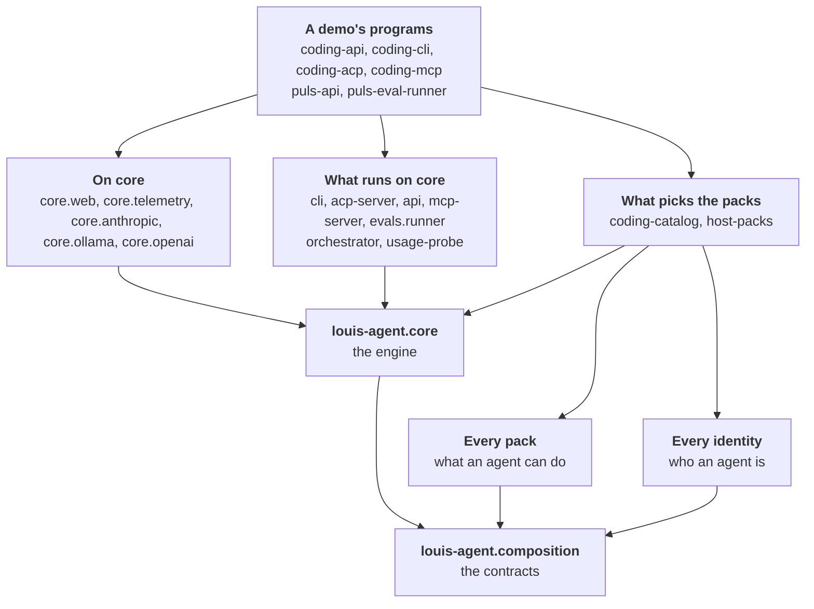
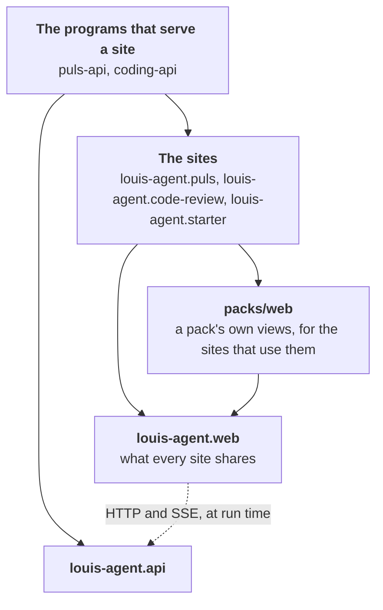

# Project design docs

One design doc per project in the solution: what it's for, how it works, its parts, its settings, how to extend it,
how it's tested, and its limits. For the whole system at once, read [Architecture](../architecture/README.md) first; come here
when you're about to change a particular project. Each project's `.csproj` links its design doc and its how-to from
[Guides](../guides/README.md), so both show under `src/docs/` in the IDE's solution explorer.

## The projects

| Project | Kind | In one line | Doc |
|---|---|---|---|
| `louis-agent.core` | Class library | The engine: tools, skills, the tool loop, providers, bootstrap; names no product (CL15) | [core](louis-agent.core.md) |
| `louis-agent.core.web` | Class library | Web access on core (CL33): the browser, the fetcher, the robots policy, search, rendering and the recorders; a host hands it in through `HostServices` | [core.web](louis-agent.core.web.md) |
| `louis-agent.core.telemetry` | Class library | Telemetry on core (CL33): the OpenTelemetry tracer and exporter and the collector's log sink; a host hands it in through `HostServices` | [core.telemetry](louis-agent.core.telemetry.md) |
| `louis-agent.core.anthropic` | Class library | Claude on core (CL57): the provider strategy, the cache-write mapper, the two prompt-cache markers; a program hands `AnthropicProvider.Instance` in through `HostServices` | [core.anthropic](louis-agent.core.anthropic.md) |
| `louis-agent.core.ollama` | Class library | A local model through Ollama on core (CL57), with the long timeout a small GPU needs | [core.ollama](louis-agent.core.ollama.md) |
| `louis-agent.core.openai` | Class library | Any server that speaks OpenAI's chat API, on core (CL57) | [core.openai](louis-agent.core.openai.md) |
| `demos/puls/identity/louis-agent.identity.puls` | Class library | Who Puls is: its voice and modes, its roles, the packs it names (`where-to-buy`, `shop-prices`, `recipes`, `web`, `calculator`); its prompts embedded with their paths | [identity.puls](../../../demos/puls/docs/projects/louis-agent.identity.puls.md) |
| `demos/puls/evals/louis-agent.identity.puls.evals` | Class library | What proves Puls: its evals as folders of files, their readers and expectations; only the runner references it | [identity.puls](../../../demos/puls/docs/projects/louis-agent.identity.puls.md) |
| `demos/puls/evals/louis-agent.identity.puls.judges` | Class library | Puls's model judge, the cook's `meal-for-people`, apart from the identity because it needs the harness; only the runner references it | [identity.puls.judges](../../../demos/puls/docs/projects/louis-agent.identity.puls.judges.md) |
| `packs/tools/louis-agent.pack.calculator` | Class library | Sums worked out in code: the `calculator` toolset's `Calculate` | [pack.calculator](../../../packs/docs/projects/louis-agent.pack.calculator.md) |
| `packs/tools/louis-agent.pack.where-to-buy` | Class library | Where to buy: the `where-to-buy` toolset (a shop's nearest branches on OpenStreetMap, and which is the town's), its guide and its texts | [pack.where-to-buy](../../../packs/docs/projects/louis-agent.pack.where-to-buy.md) |
| `packs/evals/louis-agent.pack.where-to-buy.checks` | Class library | The shop rules evals name; only the runner references it | [pack.where-to-buy](../../../packs/docs/projects/louis-agent.pack.where-to-buy.md) |
| `packs/tools/louis-agent.pack.shop-prices` | Class library | Shop prices: the `shop-prices` toolset (a list estimated from Stats SA's average prices, totals in code), its tables, its store (`SHOP_PRICES_MONGO_URL`), its guide and its texts | [pack.shop-prices](../../../packs/docs/projects/louis-agent.pack.shop-prices.md) |
| `packs/tools/louis-agent.pack.recipes` | Class library | What the recipes are: the `recipes` toolset (search an enabled South African recipe site, read any recipe page), its guide, its setting (`RECIPE_SOURCES`) and its texts | [pack.recipes](../../../packs/docs/projects/louis-agent.pack.recipes.md) |
| `packs/evals/louis-agent.pack.recipes.checks` | Class library | The rule evals name to prove a recipe's link is on a site of the pack's table; only the runner references it | [pack.recipes](../../../packs/docs/projects/louis-agent.pack.recipes.md) |
| `demos/puls/hosts/louis-agent.host-packs` | Class library | Picks what Puls's programs run: the one project that references the identity and packs they can load; `Plugins.FromEnvironment()` builds the `AgentCatalog` a host runs with, from `IDENTITIES` and `PACKS` | [host-packs](../../../demos/puls/docs/projects/louis-agent.host-packs.md) |
| `src/engine/louis-agent.composition` | Class library | The contracts a pack, an identity and the engine share; it names no pack and leans on no project | [ADR 0076](../adr/0076-core-ships-no-agent.md) |
| `src/hosts/louis-agent.cli` | Library | Chat with the agent in a terminal; a demo's program starts it | [cli](louis-agent.cli.md) |
| `src/hosts/louis-agent.acp` | Library (stdio); a demo's program starts it | The agent inside JetBrains Rider's AI chat (Agent Client Protocol) | [acp-server](louis-agent.acp.md) |
| `src/hosts/louis-agent.api` | Library (ASP.NET Core); a demo's program starts it | HTTP API with streamed answers, workspace and git endpoints; serves the web app | [api](louis-agent.api.md) |
| `src/hosts/louis-agent.accounts` | Library (ASP.NET Core); a demo's program adds it beside the API | Sign-in, registration and profiles on ASP.NET Core Identity, a tenant on every account, EF Core on SQL Server; the `/account` routes (F61) | [accounts](louis-agent.accounts.md) |
| `src/hosts/louis-agent.accounts.contracts` | Class library | The records the accounts routes send and read, so the browser app reads what the server writes (ADR 0045) | [accounts](louis-agent.accounts.md) |
| `demos/louis-agent/web/louis-agent.code-review` | Blazor WebAssembly | The coding agent's browser app: a thin chat page on the framework's frame, with the files and git packs' screens | [web](../../../demos/louis-agent/docs/projects/louis-agent.code-review.md) |
| `demos/puls/web/louis-agent.puls` | Blazor WebAssembly | Puls: the general assistant in Afrikaans; a landing page and a three-panel chat that delegates every task | [puls](../../../demos/puls/docs/projects/louis-agent.puls.md) |
| `demos/louis-agent/web/louis-agent.site` | ASP.NET Core app (static Razor) | The coding agent's landing page: the framework's colours and two CSS films of how the engine works; references no project of ours | [site](../../../demos/louis-agent/docs/projects/louis-agent.site.md) |
| `src/hosts/louis-agent.mcp` | Library (stdio or ASP.NET Core); a demo's program starts it | Hands the agent's tools to any MCP client (no model of its own) | [mcp-server](louis-agent.mcp.md) |
| `demos/louis-agent/hosts/louis-agent.orchestrator` | Console app | A second agent that watches a service's errors and has louis-agent fix them (POC) | [orchestrator](../../../demos/louis-agent/docs/projects/louis-agent.orchestrator.md) |
| `src/tools/louis-agent.usage-probe` | Console app (developer tool) | Prints what a provider reports as token usage and what the ledger makes of it | [usage-probe](louis-agent.usage-probe.md) |
| `src/evals/louis-agent.evals` | Class library | The eval harness: `IEval` and the eval read from files, datasets, trials, the common graders, the judge and its calibration, the runner loop, conformance (F18) | [evals](louis-agent.evals.md) |
| `src/evals/louis-agent.evals.checks` | Class library | The check contract: what a check reads and returns, out of the harness so a pack can reference it (Separated Interface; empty until F49.1 steps 2 and 3, ADR 0056) | [evals.checks](louis-agent.evals.checks.md) |
| `src/evals/louis-agent.evals.protocol` | Class library | The eval protocol v2: the events the runner writes and the API and portal read, records and enums only (ADR 0047) | [evals.protocol](louis-agent.evals.protocol.md) |
| `src/evals/louis-agent.evals.runner` | Library; a demo's program starts it | The command that lists and runs evals, re-scores a stored run and checks a judge; the API starts it as a child process | [evals.runner](louis-agent.evals.runner.md) |
| `louis-agent.choices` | Class library | `SettingChoice` and `[WireName]`: the one parser for a name that is an enum member; references nothing ([ADR 0043](../adr/0043-repeated-names-are-enums.md)) | — (to write) |
| `louis-agent.session-stream` | Class library | Reads a session's server-sent events into records, for core's sub-sessions, the web apps and the eval runner | — (to write) |
| `src/hosts/louis-agent.api.contracts` | Class library | The API's replies and bodies as records, and each wire's options object, shared by the API and its clients ([ADR 0045](../adr/0045-typed-answers-and-a-shared-contract.md)) | — (to write) |
| `src/web/louis-agent.web` | Razor class library | What every site shares: the chat's and the admin's frames, the eval pages ([their own doc](eval-pages.md)), a pack's screens, chat models, the API client, markdown, usage and currency | [louis-agent.web](louis-agent.web.md) |
| `src/web/louis-agent.web.accounts` | Razor class library, on `louis-agent.web` | The account pages, their client, words, styles and passkey script; a site that has accounts opts in (CL30, ADR 0089) | [louis-agent.web.accounts](louis-agent.web.accounts.md) |
| `src/tests`, `demos/*/tests`, `packs/tests` | NUnit | The tests of core, the API's sessions, the orchestrator, the ACP server, Puls's prompts and golden, the packs, the composition root and the three web projects (bUnit); `src/tests/shared/louis-agent.testing` and `src/tests/web/louis-agent.web.testing` hold the fakes they share | [tests](tests.md) |

## How they depend on each other

An arrow means "references". **The engine:** core sits in the middle. What runs it and what picks its packs are above it, what an agent is made from is below, and the contracts they all agree on are at the bottom.

A pack or an identity references only the contracts, and core references no pack, identity or host, so only what picks the packs knows them all. Behaviour lives in core, and every host is a thin
adapter between its protocol and `AgentEngine`.

**The web:** a site is a small program on the framework's web, and it reaches the engine only over HTTP.

**What the diagrams leave out,** to stay readable:

- The test projects, and the small shared projects: `louis-agent.choices`, `louis-agent.session-stream`, `louis-agent.api.contracts` and `louis-agent.evals.protocol`.
- `louis-agent.site`, the landing page, which references none of our projects.
- That the orchestrator and the usage probe are programs of their own, which no demo's program starts, and the orchestrator's reference to the coding identity.
- The calls at run time on the engine's side: the API opens sub-sessions on a peer, and the orchestrator and the eval runner open sessions on the API, all over HTTP and SSE.

## Where each one runs

| Project | Run it with | Docker service |
|---|---|---|
| core | (library) | — |
| cli | `dotnet run --project demos/louis-agent/hosts/louis-agent.coding-cli` | `local-agent` |
| acp-server | Rider starts it per chat | `acp-server` (`docker compose run --rm -T acp-server`) |
| api + web | `docker compose … up -d api` → http://127.0.0.1:5080 | `api` |
| mcp-server | an MCP client starts it (stdio), or HTTP with `MCP_TRANSPORT=http` | `mcp-server` |
| orchestrator | `dotnet run --project demos/louis-agent/hosts/louis-agent.orchestrator` (its demo returns with the benchmarks) | — |

## Each doc covers

**Purpose** · **How it works** · **Structure** (files and what's in them) · **Key types** · **Configuration** ·
**Extending it** · **Tests** · **Limits and plans** (with links to [features](../features/README.md) and the
[TODO](../../../TODO.md)) · **Related docs**.

---
[Docs index](../README.md) · Next: [louis-agent.core](louis-agent.core.md)
