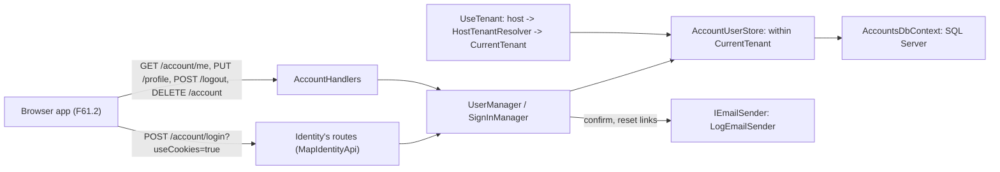
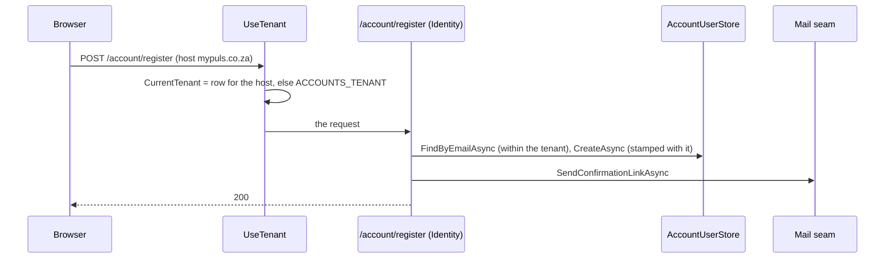

# louis-agent.accounts — design

> **Explanation.** How the framework's accounts work: who a person is to a site, which tenant they belong to, how they
> sign in and what the browser app reads. **Elsewhere:** why in [ADR 0087](../adr/0087-identity-is-the-identity-server.md)
> and [ADR 0088](../adr/0088-a-tenant-on-every-account.md); how to change the web in [Change the web](../guides/change-the-web.md);
> the plan that builds the rest, [F61](../plans/F61-accounts-and-azure.md), until it's done.

## Purpose

Puls's chat spends the API key, so a public site needs to know who is asking. `louis-agent.accounts` is the
framework's answer: sign-in, registration and a profile on ASP.NET Core Identity, with a **tenant on every account**
from the first day, so the public site is one tenant and a company on a business site is another row, not another
deployment. A demo's program calls three methods beside the API's, and the framework's web draws the pages (F61.2).
`louis-agent.accounts.contracts` holds the records the browser reads and sends, as `louis-agent.api.contracts` does
for the API (ADR 0045).

## How it works

A program does this, before the API's key check (which reads the person the cookie names, F61.2):

```csharp
builder.AddLouisAgentAccounts(AccountsOptions.FromEnvironment());   // Identity, the tenant, the cookie, the database
app.UseLouisAgentAccounts();     // migrate, then: the tenant from the host, who the cookie says, what they may do
app.MapLouisAgentAccounts();     // /account/*: Identity's routes and ours
```

Without `ACCOUNTS_SQL_URL` each call is a quiet no: one warning, no accounts, no `/account` route. With it:

- **Identity is the identity server** (ADR 0087). Its routes under `/account` are Microsoft's own: `register`,
  `login?useCookies=true`, `confirmEmail`, `resendConfirmationEmail`, `forgotPassword`, `resetPassword`,
  `manage/info`, `manage/2fa`. A person can't sign in until the mail's link confirmed them.
- **Ours beside them** (`Endpoints/AccountHandlers`, named static methods, ADR 0051): `GET /account/me` (the
  `AccountInfo` the profile shows), `PUT /account/profile` (the display name), `POST /account/logout`,
  `DELETE /account` (the person deletes their own account, POPIA) and `GET /account/providers` (the sign-in
  providers this instance has keys for; empty until F61.3). The table is pinned in `AccountsRoutesSnapshot.json`.
- **The cookie** (`Config/AccountCookies`): HttpOnly, SameSite Lax, secure where the request is, 14 days sliding; a
  call without it gets a 401, never a redirect.
- **The tenant** (ADR 0088): `Tenants/TenantHost` normalises the host (lower case, no port, no `www.`),
  `HostTenantResolver` finds the row that owns it or falls back to `ACCOUNTS_TENANT`, `UseTenant` fills the request's
  `CurrentTenant`, and `Store/AccountUserStore` looks a person up within it and stamps it on a new account. The
  store refuses without a tenant.
- **Mail** goes through Identity's `IEmailSender<AccountUser>`; `Mail/LogEmailSender` writes the link to the log,
  decoded from Identity's HTML form, hashed unless `LOG_CONTENT=full`. A real sender is one class behind the seam.
- **Storage** is EF Core on SQL Server: `Store/AccountsDbContext` is Identity's context plus `Tenants`, with the
  unique indexes on the email and the user name made again as (tenant, email) and (tenant, user name).

### Diagrams





## Structure

```
src/hosts/louis-agent.accounts/
├── AccountsStartup.cs   # AddLouisAgentAccounts, UseLouisAgentAccounts, MapLouisAgentAccounts
├── Config/              # AccountsOptions (the settings), AccountCookies (the cookie's rules)
├── Endpoints/           # AccountHandlers (named static methods), AccountRoutes (the map)
├── Mail/                # LogEmailSender behind Identity's IEmailSender
├── Messages/            # AccountErrorMessage, AccountLogMessage, AccountUserText (ADR 0009)
├── Migrations/          # what `dotnet ef migrations add` wrote; a tool's record, not sized by the file rule
├── Store/               # AccountsDbContext, AccountUserStore, AccountsMigrator, the design-time factory
├── Tenants/             # TenantHost, ITenantResolver, HostTenantResolver, CurrentTenant, TenantMiddleware
└── Users/               # AccountUser, Tenant
src/hosts/louis-agent.accounts.contracts/   # AccountInfo, ProfileBody, ProviderInfo, the Identity bodies, AccountJson
src/tests/hosts/louis-agent.accounts.tests/             # pure: the host rule, the options, the cookie, the JSON pins
src/tests/hosts/louis-agent.accounts.integration-tests/ # against the Docker SQL Server (ACCOUNTS_SQL_TEST_URL)
```

**Migrations.** The schema is EF Core migrations in `Migrations/`, applied by the host at start-up with the default
tenant's row. A schema change is `dotnet ef migrations add {Name} --project src/hosts/louis-agent.accounts
--startup-project src/hosts/louis-agent.accounts --output-dir Migrations --namespace LouisAgent.Accounts.Migrations`
(`dotnet tool restore` first: `dotnet-ef` is in `.config/dotnet-tools.json`). The tool never connects; it reads the
model from the code. If it writes the model snapshot under `LouisAgent/Accounts/Migrations/`, move it to `Migrations/`.

## Configuration

| Setting | File | Means |
|---|---|---|
| `ACCOUNTS_SQL_URL` | `.env.secrets` | The database; unset, no accounts |
| `ACCOUNTS_TENANT` | `.env` | The tenant for a host no row names (default `site`; Puls sets `puls`) |
| `ACCOUNTS_COOKIE_DOMAIN` | `.env` | The cookie's domain; unset, the request's host |
| `MSSQL_SA_PASSWORD` | `.env.sql` | The PC's SQL Server, read only by `puls-sql` |
| `ACCOUNTS_SQL_TEST_URL` | shell, CI | The integration tests' server |

**On the PC** the server is `puls-sql` in the Puls compose: SQL Server Developer edition on a Docker volume (a
Windows bind mount makes the non-root server crash at start-up), its sa password in `config/.env.sql`. The
integration tests reach it at `ACCOUNTS_SQL_TEST_URL` and each fixture makes and drops its own database.

## Tests

`src/tests/hosts/louis-agent.accounts.tests` (no server: the host rule, the options, the cookie's rules, the store's
refusal, the mail sender, the JSON pins to Identity's request types) and `louis-agent.accounts.integration-tests`
(the migrations on a real server and the per-tenant rule, the resolver, the store, and a test host that does what a
program does: register, confirm from the mail, sign in with the cookie, read `/account/me`, change the name, sign
out, delete; the route table pinned). CI runs the second against a SQL Server service container.

## What the build decided (F61.1, 2026-11-07, unattended)

- A migration's files aren't sized by `FileSizeTests`: a tool's record, not code a person maintains (ADR 0044).
- The SQL Server's data is a Docker volume, not a host folder: SQL Server 2025 runs as its own user and crashes on a
  Windows bind mount it can't own (`Failed to load LSA`).
- A tenant in a test is never `puls`: it's an identity's wire name, and the names rule flags the string.
- Identity writes a link for an HTML mail (`&amp;`); the log sender and the test sender decode it.

## Limits and plans

The pages, the agent key gate taking a signed-in person and Puls using it all are F61.2; Google, Microsoft and
LinkedIn F61.3; passkeys and two-factor F61.5; a real mail sender, Facebook and X, and the business site are later.
One Google account links in one tenant only. A tenant has at most one host.

## Related docs

[louis-agent.api](louis-agent.api.md) · [louis-agent.web](louis-agent.web.md) · [ADR 0045](../adr/0045-typed-answers-and-a-shared-contract.md) ·
[ADR 0087](../adr/0087-identity-is-the-identity-server.md) · [ADR 0088](../adr/0088-a-tenant-on-every-account.md)

---
[Docs index](../README.md) · Related: [Projects](README.md) · [Plans](../plans/README.md)
