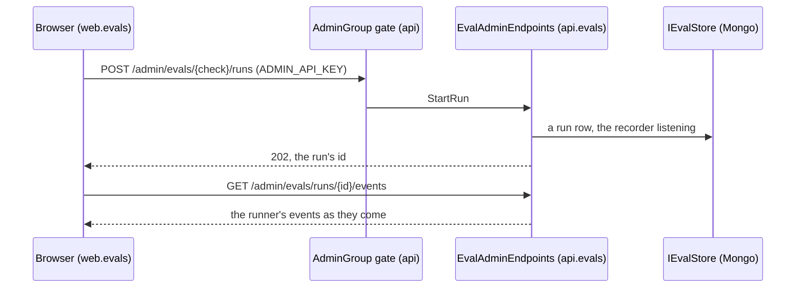

# louis-agent.api.evals — design

> **Kind:** Class library (`net10.0`) · **Path:** `src/hosts/louis-agent.api.evals/` · **References:** louis-agent.api,
> louis-agent.core, louis-agent.evals.protocol, louis-agent.evals.checks, MongoDB.Driver · **Used by:** a program that
> wants the eval studio: the Puls API, the coding API, the starter API


## Purpose

The eval studio on the API (CL57, [ADR 0092](../adr/0092-a-project-holds-what-is-reused-together.md)): the runner
process, the stores for runs, grades, drafts and judge checks (MongoDB), the recorders, the reports and every admin
route for them. It was over half of `louis-agent.api`, and brought MongoDB, the checks and the protocol into every
site's API; now a program opts in with `app.MapLouisAgentEvals(host)` after `MapLouisAgentApi`, and one that doesn't
ships none of it.

## How it works

`EvalsStartup.MapLouisAgentEvals(app, host)` does what `ApiStartup` did for the studio:

- reads `EvalOptions` (the runner, the store, the callback address), lists the runner's evals off the start-up path,
  opens the Mongo stores when `EVALS_MONGO_URL` is set (none without: no run starts, the pages say so), tidies what
  an older build stored and closes the runs a restart cut off, in the background;
- maps the studio's routes on a gated `/admin` group the API hands out (`AdminGroup.MapAdminGroup`, behind
  `ADMIN_API_KEY`), through `EvalAdminEndpoints.MapEvalAdmin`: the evals and benchmarks lists, a check's manual, the
  stored runs, reviews, notes, rescoring, calibrations, drafts, the studio, a run's start, events and requests, the
  trends, under `/evals` and the old `/benchmarks` name;
- records with each run what it ran with (`EvalSettings`), the web named by core's `WebSetup` seam, never by the web
  library.

The API keeps the admin gate, the key, its own admin routes (prompts, imports, screens) and the contracts; the
studio's replies are built here (`Replies/`, the `Of` factories), its texts in `Messages/` (`EvalApiLogMessage`,
`EvalApiUserText`, the draft, listing, note and review texts).

## Diagrams




## Structure

```
src/hosts/louis-agent.api.evals/
├── EvalsStartup.cs        # MapLouisAgentEvals
├── Config/EvalOptions.cs  # BENCHMARK_API_URL, EVALS_MONGO_URL, EVALS_MONGO_DATABASE, EVAL_RUNNER
├── Endpoints/             # Runs/ (EvalAdminEndpoints, AdminHandlers, stored runs, rescore), Drafts/, Evals/, Reviews/, Studio/
├── Replies/               # the contracts' Of factories
├── Messages/              # EvalApiLogMessage, EvalApiUserText, DraftMessage, EvalListingMessage, NoteUserText, ReviewUserText
├── Calibrations/ Drafts/ Export/ List/ Reports/ Reviews/ Runs/ Store/ Studio/   # as they were under the API's Evals/
demos/puls/tests/louis-agent.api.evals.tests/   # the studio's tests, beside the API's; EvalRoutesSnapshot.json pins the routes
```

## Configuration

`EVALS_MONGO_URL`, `EVALS_MONGO_DATABASE`, `EVAL_RUNNER`, `BENCHMARK_API_URL`; the key is the API's `ADMIN_API_KEY`.

## Tests

`demos/puls/tests/louis-agent.api.evals.tests`: the stores, the recorder, the reports and trends, the drafts and
the studio, the reviews and calibrations, each handler through the in-memory test host (`ApiTestHost`, which maps
the studio for them and leaves it out for the API's own route snapshot), and `EvalRoutesSnapshotTests`.

## What the build decided (CL57, 2026-11-07, unattended)

- The admin group is the API's to hand out: each library maps its routes on its own gated `/admin` group with the
  same filter, so the key check is one class and the route table still says who may call what.
- The studio's texts moved into its own enums; `InvalidApiKey` and `AdminClosed` stayed with the gate.

## Related docs

[louis-agent.api](louis-agent.api.md) · [louis-agent.web.evals](louis-agent.web.evals.md) ·
[ADR 0092](../adr/0092-a-project-holds-what-is-reused-together.md) · [ADR 0039](../adr/0039-api-routes-under-v1.md)

---
[Docs index](../README.md) · Related: [Projects](README.md) · [Plans](../plans/README.md)
