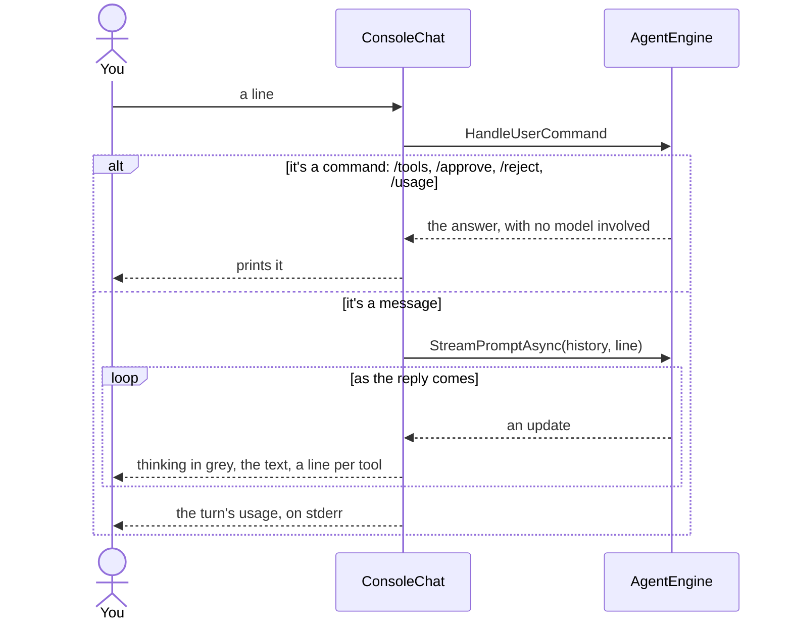

# louis-agent.cli — design

> **Kind:** library · **Path:** `src/hosts/louis-agent.cli/` · **References:** louis-agent.core · **Docker service:**
> `local-agent`


## Purpose

The simplest way to use the agent: a terminal chat, or a single prompt from a script. It has no protocol of its own,
which also makes it the quickest host for trying a change to core.

## How it works

`Program.cs` is 13 lines: `AgentHost.Build()`, then `ConsoleChat` runs either `RunSinglePromptAsync(args[0])` when a
prompt is passed, or `RunAsync()` for the interactive loop. `ConsoleChat` only maps the engine's stream to the
terminal; the turn itself is `AgentEngine.StreamPromptAsync` (core), shared with the other hosts:

```text
You: What branch am I on?
[thinking in grey]
  > GetCurrentBranch
    done: main
You're on main.
You: exit
```

- Thinking is printed in grey, the answer as it's written, and one status line per tool call (`> Name args`, then
  `done:` or `failed:`).
- **Ctrl+C** stops the reply in progress; with no reply running it exits. `exit` (or end of input) quits.
- `/tools`, `/approve <Name>`, `/reject <Name>` and `/usage` (the session's tokens and cost, by purpose) are answered
  locally and never sent to the model.
- **Usage** (F3): after each answer, stopped and failed ones too, a grey line on **stderr**:
  `turn: 3 requests · 28k tokens (26k cached) · $0.006 · session $0.04`. A single prompt (`-- "…"`) prints it without
  the session total, so stdout stays the answer alone for scripts. Only with the ledger on (`LOG_DIRECTORY` set).
- Outside Docker, `config/.env` and the repository root are found from any folder inside the repository.

## Diagrams


**Flow:** one line typed in the interactive loop. A single prompt from a script goes straight to the engine and then exits.



## Structure

| File | What's in it |
|---|---|
| `CliHost.cs` | The one call a program makes: takes the catalogue, then picks one-shot or interactive |
| `louis-agent.cli.csproj` | References core only |

The program that starts it is your own. The coding agent's is `demos/louis-agent/hosts/louis-agent.coding-cli`, which names no
packs ([ADR 0074](../adr/0074-the-folders-say-what-ships.md)).

## Configuration

The core settings ([Setup](../SETUP.md)); nothing CLI-specific.

## Extending it

The steps are in [Change the CLI](../guides/change-the-cli.md). In short: rendering lives in `ConsoleChat`; commands are
core's `UserCommands`, shared with Rider and the API; `Program.cs` stays a bootstrap.

## Tests

No CLI-specific tests; the loop and commands are covered through `AgentEngine` in `src/tests/engine/louis-agent.core.tests`.

## Limits and plans

- History is lost on exit → backlog *CLI: resume a previous session* ([TODO](../../../TODO.md)).
- Costs in another currency → [F14](https://github.com/bosbevk/louis-agent/blob/pre-cl24/docs/features/F14-display-currency.md).

## Related docs

[Quick start](../../../demos/louis-agent/docs/QUICK_START_AGENT.md) · [louis-agent.core](louis-agent.core.md)

---
[Projects](README.md) · Previous: [louis-agent.host-packs](../../../demos/puls/docs/projects/louis-agent.host-packs.md) · Next: [louis-agent.acp](louis-agent.acp.md)
