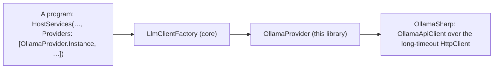

# louis-agent.core.ollama — design

> **Kind:** Class library (`net10.0`) · **Path:** `src/engine/louis-agent.core.ollama/` · **References:** louis-agent.core,
> OllamaSharp · **Used by:** every program whose agent may talk to a local model through Ollama


## Purpose

Ollama on core (CL57, [ADR 0092](../adr/0092-a-project-holds-what-is-reused-together.md)): the provider strategy that
talks to a local model through OllamaSharp. A program hands `OllamaProvider.Instance` to `AgentHost.Build` in its
`HostServices`; core itself ships no SDK.

## How it works

`OllamaProvider` is core's `ILlmProvider` seam made real, a singleton: named `ollama`; `Create(options)` is
OllamaSharp's client over an `HttpClient` at `LLM_ENDPOINT`, or Ollama's own port on this machine, with a ten-minute
timeout, since a small GPU writes about five tokens a second and HttpClient's default 100 seconds cancelled replies
Ollama was still writing. It reports usage in the standard fields and marks no cache, so the seam's defaults hold.



## Structure

```
src/engine/louis-agent.core.ollama/
└── OllamaProvider.cs           # ILlmProvider made real; CreateHttpClient for the timeout and the address
src/tests/engine/louis-agent.core.ollama.tests/   # the timeout, the address, the seam's defaults
```

## Configuration

`LLM_PROVIDER=ollama`, `LLM_MODEL`, `LLM_ENDPOINT` (unset: `http://localhost:11434`); core's `LlmOptions` names this
provider for a model that isn't `claude*`, and knows which local models take no tools.

## Tests

`src/tests/engine/louis-agent.core.ollama.tests`: the client waits longer than the default, talks to the endpoint or
localhost, and the registry gives it the standard mapper and no cache.

## Related docs

[louis-agent.core](louis-agent.core.md) · [louis-agent.core.anthropic](louis-agent.core.anthropic.md) ·
[louis-agent.core.openai](louis-agent.core.openai.md) · [ADR 0003](../adr/0003-provider-strategies.md)

---
[Docs index](../README.md) · Related: [Projects](README.md) · [Plans](../plans/README.md)
