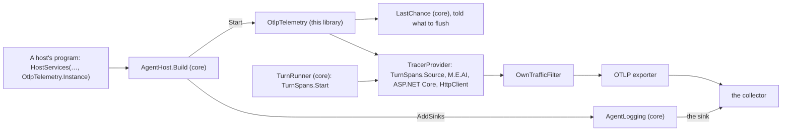

# louis-agent.core.telemetry — design

> **Kind:** Class library (`net10.0`) · **Path:** `src/engine/louis-agent.core.telemetry/` · **References:**
> louis-agent.core, OpenTelemetry, OpenTelemetry.Exporter.OpenTelemetryProtocol, Serilog.Sinks.OpenTelemetry ·
> **Used by:** every host's program, the eval runner, the orchestrator


## Purpose

Telemetry on core (CL33, [ADR 0091](../adr/0091-web-access-and-telemetry-are-libraries-on-core.md)): the
OpenTelemetry tracer that listens to core's turn spans and exports them over OTLP, the log sink that sends the log
lines the same way, and the filter that keeps our own calls to the collector out of the traces. A host opts in by
handing `AgentHost.Build` a `HostServices` with `OtlpTelemetry.Instance`; core alone runs on `NoTelemetry`, still
measures every turn on its own `ActivitySource`, which nothing listens to, and still logs a crash once.

## How it works

`OtlpTelemetry` is core's `IHostTelemetry` seam made real, a singleton for the process:

- **`AddSinks(logging)`**, called by `AgentLogging.Configure` with the host's configuration: with
  `OTEL_EXPORTER_OTLP_ENDPOINT` set, every log line goes to the collector too, the record files left out as on the
  console; the sink reads the endpoint, protocol, headers and `OTEL_SERVICE_NAME` itself, and they win over ours.
- **`Start()`**, called by `AgentHost.Build` once the .env files have loaded (so `OTEL_*` there count under Rider
  too, F52): installs core's crash handler (`LastChance`) with this telemetry to flush, then builds the tracer over
  our sources (`TurnSpans.Source`, Microsoft.Extensions.AI's model requests and tool calls, ASP.NET Core's requests,
  every `HttpClient` call) with the OTLP exporter, or none without an endpoint, so a host with no collector pays
  nothing. A second start gets the same handle; disposing it stops the tracer; the process's exit does that too.
- **`Flush()`**: sends what the tracer still holds, waiting three seconds at most, so a dead collector never holds a
  host's exit; a crash's last word.
- **`OwnTrafficFilter`**, a processor before the exporter: an `HttpClient` span whose address is the collector's is
  not exported, or every batch of log lines would be a span.

What stays in core: `TurnSpans` (a span per turn, on the GenAI conventions), `SpanTag`, `LastChance`, and the
seam with its Null Object.

## Diagrams



```mermaid
sequenceDiagram
    participant P as Program
    participant H as AgentHost
    participant L as AgentLogging
    participant T as OtlpTelemetry
    participant C as the collector
    P->>H: Build(catalog, HostServices(Telemetry: OtlpTelemetry.Instance))
    H->>L: Configure(directory, content, telemetry.AddSinks)
    L->>T: AddSinks(configuration)
    T-->>L: the collector's sink, when an endpoint is named
    H->>T: Start()
    T->>T: LastChance.Install(this); the tracer on TurnSpans.Source
    Note over H,C: a turn runs: TurnSpans.Start, the model's and tools' spans
    T->>C: spans over OTLP; log lines through the sink
```

## Structure

```
src/engine/louis-agent.core.telemetry/
├── OtlpTelemetry.cs      # IHostTelemetry made real: the sink, the tracer, the flush, the exit
└── OwnTrafficFilter.cs   # the processor that drops our calls to the collector
src/tests/engine/louis-agent.core.telemetry.tests/   # OtlpTelemetryTests, LastChanceTests, AgentLoggingOtlpTests, on the shared OtlpReceiver
```

## Configuration

`OTEL_EXPORTER_OTLP_ENDPOINT` (the collector; unset, nothing listens), `OTEL_EXPORTER_OTLP_PROTOCOL`,
`OTEL_EXPORTER_OTLP_HEADERS`, `OTEL_SERVICE_NAME` and `OTEL_RESOURCE_ATTRIBUTES` (the spec's own names, read by the
exporter and the sink); the service name defaults to the host's. [ADR 0064](../adr/0064-observability-through-opentelemetry.md)
has the why.

## Tests

`src/tests/engine/louis-agent.core.telemetry.tests`: a model request reaches the collector as a span, the
environment's service name wins, a second start gives the same handle, no endpoint listens to nothing, our source
is listened to, a call to the collector is left out; a crash is one fatal line that reaches the collector on its own;
the log lines reach it with the records left out. The receiver is `louis-agent.testing/Otlp/OtlpReceiver`. Core's own
`HostTelemetryTests` prove the seam without this library.

## What the build decided (CL33, 2026-11-07, unattended)

- `LastChance` stayed in core: it needed the tracer only to flush, so it is installed with the host's telemetry and
  flushes through the seam; the web library needs nothing of this one.
- The tests that prove lines reach a collector moved here with the sink; the receiver went to the shared test
  library.

## Limits and plans

Metrics (speed, tokens per second) are F44.1's; a second exporter is a second class on the same seam.

## Related docs

[louis-agent.core](louis-agent.core.md) · [louis-agent.core.web](louis-agent.core.web.md) ·
[ADR 0091](../adr/0091-web-access-and-telemetry-are-libraries-on-core.md) · [ADR 0064](../adr/0064-observability-through-opentelemetry.md)

---
[Docs index](../README.md) · Related: [Projects](README.md) · [Plans](../plans/README.md)
