# louis-agent.diagrams — design

> **Kind:** Class library (`net10.0`), plain C# · **Path:** `src/web/louis-agent.diagrams/` · **References:**
> louis-agent.choices · **Used by:** louis-agent.web (the site's `GraphView`, and the chat's `DrawnCard`), and
> `src/tools/louis-agent.doc-diagrams`, the tool that draws the docs' pictures · **How-to:**
> [Draw a diagram](../guides/draw-a-diagram.md)



## Purpose

Every picture in the docs and every flow on the site is drawn from data, by one renderer. A diagram is a JSON file
beside its doc. This library lays it out and writes one SVG that carries a light and a dark look and loads nothing
from outside, so GitHub, Rider and a browser all show it as it is.

It is not Mermaid. Louis: "we must not use mermaid it must look modern". Our own layouts look like the site, and a
test can prove that every word fits its box.

*Decided in:* CL60, [ADR 0118](../adr/0118-a-diagram-is-data-our-renderer-draws.md).

## How it works

This section has four parts, to be read in order. Part 1 follows one picture from its file to its SVG. Part 2
goes through the five kinds of picture, one at a time. Part 3 is what every kind shares, tones and icons. Part 4
is a drawing held inside a web page, which needs care of its own.

### 1. One picture, from its file to its SVG


**Step 1: the file is read into records** (`Sources/`). `DiagramReader.Read(json)` reads a `DiagramSource`. It has
a kind, a title that a screen reader is told, an optional caption, and the kind's own part. The kind is one of
`flow`, `cards`, `sequence`, `classes` or `ticket`.

The reader refuses what is wrong, with the reason: a misspelt field, an unknown kind, a missing title, an arrow
or a link to an id that nothing has, or a link between two cards that are not in neighbouring rows. The reasons are the library's own messages (`Messages/DiagramMessage`), filled
by `DiagramText`, its own small stand-in for core's `MessageText`. That keeps the library from leaning on any part
of the engine.

**Step 2: the kind picks a renderer** (`Svg/`). `DiagramRenderers.Render` picks the renderer for the kind, a
Strategy. There is one per kind in `Svg/Renderers/`: `FlowRenderer`, `CardsRenderer`, `SequenceRenderer`,
`TicketRenderer`, `ComponentsRenderer`, and `ClassesRenderer`, which turns a class chart into a flow. Each
renderer has a layout that places every box and word, and then draws. Part 2 explains each layout.

A flow is drawn by `FlowDrawing`, in the new look described below. A class chart is turned into a flow and drawn
by `PlainFlowDrawing`, the drawing both had before: boxes in their tone with a round icon badge, arrows that join,
a word in a chip. Each drawing has a name of its own so the two renderers can change apart.

**How a renderer writes the file** (`SvgWriter`). It is a Builder: a renderer adds boxes, paths and words one by
one and asks for the file at the end. So no renderer writes markup or escapes text by hand, and the style and the
arrowhead every picture needs are written in one place. A drawing may also define a paint, a fade from one colour
into another that a style fills a shape with by its id, since a style alone can't give a shape one. Each stop of a
paint is classed by the paint's id and its number, and the style colours it. A line may wear an end of its own at
either side (`Ends/LineEnd`): the arrowhead, a hollow triangle, a diamond or an open arrowhead, in the line's tone
when it has one. An end turns with its line, is written once however many lines wear it, and only when one does.
It is classed by its kind and its tone, as `end-triangle tone-violet`, and the look colours it. The file is built
with `XElement` and has a `<title>`.
Every number is written in the invariant culture and every line ends in a plain `\n`, so the same drawing is the
same bytes on every machine.

**The picture carries both looks** (`Svg/Theme/`). The site's palette and its light twin are CSS variables in the
picture's own style, the dark one under `prefers-color-scheme: dark`. Each tone's fill, line and ink are there
too.

**The new look is one shared style** (`Svg/Theme/Looks/`). A component diagram and a flow are drawn in the new
look: a ground of faint dots, the picture's own title, panels tinted in their tone and lifted by a shadow, and
lines whose dots march the way the arrow points. What any kind in that look wears is `PictureLook`, with class
names that start `pic-`, and the parts drawn with it are `PictureParts`: the ground, the title and a panel.
`ComponentsStyle` adds only what is a component's own, the pins, the pill and the dashed box, with names that
start `cmp-`. `FlowStyle` adds a flow's own, with names that start `flow-`: a group's frame, a box's name and
icon badge, the glow round a shape, and the pill an arrow's word stands in. The shared rules come first in a
picture's style, so two kinds can't drift apart in what they share.

**The Marquee look is shared too** (`MarqueeLook`). A cards picture is drawn in a second look, and a sequence
wears it as well. What both wear has names that start `mrq-`: the picture's small title, the soft light, the
glass with the accent along its top, the pill with its code, and a node on a lit line. Its accent is the palette's
violet running to its blue, and it sets the few variables of its own for a light page and again for a dark one.
`CardsStyle` comes after it and adds what is a card's own, with names that start `crd-`: the lit rail and its
lines, a headline with its badge, a glass card's badge, name and text, and the quiet card. `SequenceStyle` holds
what a sequence adds, with names that start `seq-`: a participant's badge in its tone and its name, the
lifeline, a call's beam either way, an answer's quiet line and the words above them. `ClassesStyle`
(`Looks/Kinds/`) holds what a class chart adds, with names that start `cls-`: a type's badge in its tone with its
letter, its name, kind and members, a line for each kind of link, and the colours of a line's ends. No class
chart is drawn with it yet.

**What a flow's drawing shows** (`Svg/Renderers/Parts/FlowDrawing`). It places nothing itself: it draws what the
layout placed by `FlowRules.Straight`.

- *The title.* The words before the first colon of the picture's title, and the rest on a line under them.
- *A box.* A panel tinted in its tone, with a colour bar and its icon in a badge, in its shape.
- *A line.* It has the colour of the box it leaves, and a ring stands where a box's line leaves it. Dots march
  along it to its head. A dashed arrow has no dots.
- *The key* (`FlowKey`, placed by `Flow/Keys/FlowKeyLayout`). Across the picture's width, under the drawing: an
  item for each tone and each shape the picture uses, and one that says a line has the colour of the box it
  leaves.

**Step 3: the docs' frame goes round it** (`Svg/TitledFrame`, a Decorator). `DiagramRenderers.RenderTitled` draws
the picture bare and then frames it: a navy title bar, a legend of the tones the chart uses, and a note bar from
its caption. A component diagram, a flow and a sequence write their own title and their own key inside the
picture, so they get only the note bar. A cards picture writes its own title too, and has no tones to explain, so
it gets only the note bar as well. Of the kinds the docs draw, that leaves the bar and the legend to a class
chart. Only the docs' tool asks for the frame. A bare picture, as the site draws and the chat's
cards draw, is unchanged.

#### The tool that draws the docs' pictures


`src/tools/louis-agent.doc-diagrams` finds every `diagrams/*.json` under `src/docs`, `packs/docs` and each demo's
folder. It writes the framed SVG beside each one, and only when what it draws changed.

It has two more ways to run. `--check` writes nothing and fails, naming any stale picture. `import <doc>` reads a
doc's Mermaid flowcharts, sequences and class diagrams once into JSON. It never writes over a picture already
there, and it prints the link for each block, which is swapped into the doc by hand.

The docs hold no Mermaid now. The import stays for a doc someone brings in.

*Decided in:* CL60.1, CL60.2, [ADR 0118](../adr/0118-a-diagram-is-data-our-renderer-draws.md).

### 2. The five kinds of picture

#### A flow: boxes and arrows on a grid

A flow (`Flow/`) is drawn on ADR 0103's row grid.

**Placing the boxes.** `GraphLayout` puts each box in its column and row. A box that names no column gets one from
`Ranks`: one past the furthest box that points at it. `Bands` handles groups: it stands each group's boxes in rows
of their own, inside a labelled frame.

**The rule the boxes stand by.** A band is one group's rows, or every box's rows when a picture has no groups.
Two things about a band are not `Bands`' to decide: how tall its rows are, and which row each box stands on. A
rule answers both (`IRowRule`). `CentredRows` is the one a class chart uses: a band's rows are as tall as its
own tallest box, and a column's boxes stand one after another, centred in the band.

The other rule is `LevelRows`, which a flow in the docs and a diagram on a site's page are drawn by. With it a box
stands level with the box that feeds it, so the line between them runs straight:

- The columns are taken from the left. In each, the boxes keep their order and take the rows nearest the boxes
  that feed them. Every way to stand them is weighed, and the nearest one overall is taken.
- Then from the right, so a box nothing feeds stands level with what it feeds, and from the left once more.
- A box only ever stands on a whole row. Two boxes are then level or a row apart, never a few pixels off.
- The bands that start at the top stand beside each other, and share one row height so their rows line up. A
  band whose tallest box is far taller than the rest gets rows that span three of the shared ones, so one tall
  box doesn't make every row beside it as tall. A band under another keeps its own row height.

The rule for the rows and the rule for the arrows, described below, are handed to the layout together, as one
`FlowRules`. `FlowRules.Joined` is the pair a layout uses when it is handed none: arrows that join, and boxes
centred. `FlowRules.Straight` is the other pair: arrows apart, and boxes level.

**Drawing the arrows.** `Routing/EdgeRouter` draws an arrow as connectors at right angles. A long arrow goes
through a waypoint in each column it passes. A blocked arrow goes round a detour. The bends are as soft as the
caller asks: the site asks for 8 px, the docs for `SoftBend`.

**The rule the arrows run by.** Two things about a forward arrow are not the router's to decide: which track in
the gap it bends on, and where on its target's side it arrives. A rule answers both (`IArrowRule`), and the
layout is handed it in its `FlowRules`. Handed none, it uses `JoinedArrows`: the arrows into a box meet at the middle of its
side, and a gap has a track for each source only when several boxes feed several. So a caller picks how its
arrows run without the router knowing which rule it has.

The other rule is `ApartArrows`. With it each arrow into a box arrives at a point of its own:

- The points are 18 apart, spread round the middle of the side, the arrow from the upper box at the upper point.
  One arrow alone arrives at the middle.
- An arrow from a box at its target's own height runs straight in, and the others take the points beside it. If a
  point would then stand off the side, the points are spread round the middle instead.
- A box's side is at least as long as its points need: two or three arrows fit a box 52 high, and a fourth makes
  it 84.
- An arrow past a column is led in line with its own point, where no box stands in the way and no other box's
  long arrow already runs within 9. If it can't run there, it runs at the height it leaves at. If a box stands
  there too, it passes between two boxes of a column it crosses, in the middle of the room between them, when
  that is a shorter way up and down than the row it was given. It only passes between two boxes of one group, or
  of none, so it never runs along a group's frame.
- A point never stands level with the line out of a box in the column before that feeds something else: the
  points then stand 9 aside, towards the boxes their arrows come from.
- In a picture that runs to the right, an arrow's word stands on its own line, in its pill. Above the line, the
  word of the lower of two arrows into one box would sit on the upper arrow, 18 away.

With `ApartArrows` the lines of a gap also turn on one line:

- Each box's line has an upright piece in the gap, from the highest of where it leaves and arrives to the lowest.
  Two lines whose upright pieces are clear of each other, by 9 or more, turn on the same line.
- A line whose upright piece would lie on another's gets the track 18 beside it. The gap is as wide as its
  tracks need.
- Of two such lines, the one that turns first is the one that makes fewer crossings that way. So a fan of boxes
  into a box above them turns top first, each line inside the next, and into a box under them bottom first. A
  line that arrives level with another's line out never turns before it, since the two would lie on one another.

Whether two upright pieces overlap depends on how high the boxes stand. So `GraphLayout` places the boxes once
with the columns far apart, only to learn the heights, sizes each gap from them, and then places the boxes
where they belong.

**A box's shape.** A box may name a shape where the shape means something: `decision` is a diamond, `data` a
slanted box, `terminal` a pill for a start or an end. Left out, it is a plain box. A name that is no shape is
refused with the shapes there are. A shape stands inside the box the layout gives it, so the layout and the
router go on working with boxes and ask `NodeShapes` for the two things a shape changes:

- *Its room.* A diamond is twice as wide and twice as tall as its words, so each line fits between the slanted
  sides at its own height. A slanted box is 18 wider, and a pill wider by half its height.
- *Where its outline is.* A diamond's side is inside its box everywhere but at the tip, so an arrow that arrives
  off the middle ends on the slanted side, not at the box's edge. The same holds under a shape, where an arrow
  back to an earlier column leaves and arrives.

**A chart that runs down.** It is laid out turned, and `Turn` turns every point back. So one layout and one router
serve both directions.

**The words.** `FlowText` says where a box's badge, label and note sit, and where an arrow's word chip stands. A
box may list members under a divider in the code font, as a class's box does. It is then as wide as its longest
member, and a member wraps at 60 characters.

The site's `GraphView` animates the same placed graph, laid out by `FlowRules.Straight` as a flow in the docs is,
in the site's own look.

#### A sequence: who calls whom, in order

A sequence (`Sequence/`) is made of steps. A step is a message, a reply, a note, or a block that holds steps of
its own. They are a Composite of records (`Spec/Steps/`), read by their `step` field.

`SequenceLayout` stands each lifeline as far from the others as the words between them need. It works that out as
a longest path over the lifelines. `SequenceRows` then walks the steps down the page and frames each block round
what it holds, so a nested frame sits inside its parent. `SequenceMeasures` holds the measures as one value the
layout is handed: words wrap at 40 characters, and a head at 24.

`SequenceKeyLayout` (`Keys/`) places a sequence's key: an item for each tone a participant wears, with what the
tone means, then a call, an answer, a note and each kind of block, each only when the sequence has one. A block's
item says what its kind does: a `loop` repeats, an `opt` runs only if, an `alt` is one case or the other. The
items stand side by side across a width and go on to a new row when one is full.

**What a sequence's drawing shows** (`Svg/Renderers/Parts/Lifelines/`). `SequenceDrawing` draws what the layout
placed and decides no place itself. The look is `PictureLook`, then `MarqueeLook`, then `SequenceStyle`.

- *Its own title*, small, in the top left corner, on a soft light that stands behind the row of participants. A
  picture is as wide as its title when the title is the wider.
- *A participant* is a badge filled with its tone, its icon in the badge and its name under it, with no box. A
  person who names no icon wears a person's. This is the one place a tone is shown, so a tone says what a
  participant is, as a box's tone does in a flow.
- *A lifeline* runs down from a node under the name and fades out at the bottom.
- *A call* is a beam: a line that runs from violet at its sender to blue at its receiver, whichever way it points,
  with a glow, a node where it leaves and an arrowhead where it arrives. Dots run along it the way it points. Its
  words stand above it, bold. Every call wears this one accent, so a call does not have its sender's tone.
- *An answer* is a thin dashed grey line with an arrowhead, and its words above it are grey too. It stands still.
- *A call a participant makes to itself* leaves its lifeline, turns and comes back a little lower, with its words
  beside the turn.
- *A note* is a glass panel over the lifelines it names.
- *A block* is a glass frame with the accent along its top. Its kind stands in a pill with its label beside it.
  Each other case of an `alt` stands under a dashed line, with `else` in a grey pill and the case's label. What
  comes after a block starts 12 under its frame, so a frame never touches the next thing.
- *A numbered picture* puts each step's number in a small ring where its line starts.
- *The key* (`SequenceKey`) stands under a faint line across the picture's width. Each sample is drawn with the
  shapes of the real thing, a call's and an answer's by the same code that draws them in the picture.

A reader who asked their system for less motion sees no dots. The arrowheads stay, so the direction never rests
on motion alone.

#### A class chart: the interface design

A class chart (`Classes/`) has types and relations. A type has a name, a kind, members, an icon and a tone. A
relation is one of `inherits`, `implements`, `holds`, `uses` or `creates`.

It has no layout of its own. `ClassFlow`, an Adapter, turns it into a flow. A type becomes a box with its members.
A type with no tone named takes its kind's: teal for an interface, a record or an enum, and green otherwise. A
relation becomes an arrow whose style and word say its kind. A word shared by several arrows into or out of one
type is shown once.

So the flow's layout, router, word chips and clearance check all serve a class chart too.

#### Cards: a project's overview

Cards (`Cards/`) are the overview a project doc opens with: the project, and under it the parts it is made of. The
picture is rows of cards, top to bottom, and links between neighbouring rows.

**What each card looks like.** A card has a look, its `CardLook`, and the picture draws it by that look wherever
its row is:

- *`highlight`, a headline.* No box: its icon in an accent badge, its title large, its code name in a pill, its
  text, all centred, on a soft light. This is the project.
- *`heading`, a quieter headline.* The same words smaller, with a plain icon and no light.
- *`plain`, glass.* A faint panel with an accent line along its top, its icon in a tinted badge beside its title,
  and its text. A long title on a narrow card goes under the badge.
- *A plain card no link touches is quiet*, in a picture that has links: lower, with no badge and no accent line.
  In a picture with no links at all, every plain card is glass.

**Placing the cards.** `OverviewLayout` lays the rows under one another. A row's cards share its width and take its
tallest card's height. `CardSizes` says how tall each kind of card is and where its words break. The words are in
the sans font, whose letters differ in width, so a line's width is taken as its length times a number chosen wide.
The tests hold that every line fits its card by that measure, and the pictures are looked at.

**The rails.** A link is not drawn as a line of its own. In the gap between two rows, the cards above that are
linked to exactly the same cards below share one rail: a lit line, with a stem down to it from each card above and
a drop from it to each card below. Every other card above has a rail of its own, so you can still see which card
feeds which. `CardRails` does that grouping from the data alone. `RailPlaces` then says where a gap's rails stand:
two that are clear of each other stand at one height, and one that would lie on another stands 18 under it. A gap
is as tall as its rails need, 52 for one rail, and 26 when no link crosses it.

**Which way a link points.** A small arrowhead stands on the end a link points at: the card below for `down`, the
card above for `up`, both for `both`. Dots run down a rail's lines only where every one of its links points down,
since dots say one way. So the direction never rests on motion alone.

**A link the rail cannot draw.** A rail stands in the gap between two rows. So a link that skips a row, or joins
two cards of one row, is refused when the JSON is read, with the two cards it names.

**The drawing** (`Svg/Renderers/Parts/Overview/`). `OverviewDrawing` draws what the layout placed and decides no
place itself: the picture's own small title, the light behind each highlighted card, the rails and the cards. The
look is `PictureLook`, then `MarqueeLook`, then `CardsStyle`. A card has no tone, so the colour is the look's own, one accent:
the palette's violet running to its blue. The fades, the rail's, the light's and the glass's, are paints the
drawing defines and the style fills with.

#### A ticket: a card an agent draws in the chat

A ticket (`Tickets/`) is a read-only card an agent draws in the chat, such as a booking request. It has a kicker
and a title on a band, an optional subtitle, a status pill in a tone, a torn edge, one to six rows of an icon, a
label and a value, and a note at the foot.

`TicketLayout` places every word. The kicker wraps beside the pill. A long value wraps, and the card grows. It is
320 wide, so a phone's chat shrinks it little.

`TicketCard` is the one translation from a tool call to a ticket. `Of` builds a ticket from its parts, with icons
and tones given by name, and a wrong name is refused with the names there are. `FromCall` reads a `ShowCard` call's
input. So the pack and the page read a call one way.

A ticket's colours are `--ticket-*` CSS variables with the site's as their fallback (`TicketStyle`), so a
business's window can set its brand on it.

*Decided in:* [ADR 0103](../adr/0103-a-diagram-is-data-on-a-row-grid.md) (flows), CL60.3 (sequences), CL60.4
(classes), CL60.1 (cards), F127.4.1 (tickets).

### 3. What every kind shares

**Tones** (`Tones/`). A box may carry an icon and a `DiagramTone`, so a colour means the same in every chart. Blue
starts it. Green is this project. Violet is the framework. Teal is contracts and state. Amber is files and data.
Red is outside the process. A box's arrows and their word chips take its tone.

**Icons** (`Icons/`). There are 37 of Tabler's outline icons (MIT), copied in as path data in `IconPaths`, with
the licence beside them and a row in `THIRD-PARTY-NOTICES.md`. It is the framework's one set of icons: the web's
`LineIconView` draws a page's line icons from it too, so a page and a diagram never hold two copies of a drawing.

*Decided in:* CL60.1, CL60.2, F134.1 (the one set).

### 4. A drawing held inside a web page

A page holds a drawing's SVG inline, so the page's colour variables reach it. But that brings a problem: a style
inside an inline SVG applies to the whole page.

`DiagramRenderers.RenderForPage` makes the page's copy (`Svg/PageSvg`) to deal with it. It does three things. It
wraps each style in `@scope`, with the root named `:scope`, since a bare `svg` inside a scope means an svg inside
it and would miss the root. It drops an arrowhead that nothing uses, so two cards on one page hold no id twice. And
it trims the empty ground round the drawing.

*Decided in:* F127.4.1.

## Diagrams

The flow and the sequence are shown in part 1, where they are explained. This is the interface design.


## Structure

This section is for looking a file up.

```
src/web/louis-agent.diagrams/
├── Sources/        # DiagramSource, DiagramKind, DiagramReader, DiagramJson (the one options object)
├── Flow/           # GraphLayout, FlowRules, Ranks, Bands, Turn, FlowText; Spec/, Placed/, Routing/ (EdgeRouter, Detours, Plan, IArrowRule, JoinedArrows, ApartArrows), Rows/ (IRowRule, BandShape, RowGrid, CentredRows, LevelRows), Shapes/ (NodeShape, NodeShapes, ShapeSide)
├── Cards/          # CardsSpec, CardRow, Card, CardLook, OverviewLayout; Links/ (CardLink, CardLinkKind); Rails/ (Rail, CardRails, RailPlaces, RailSpan, RailSpot); Sizes/ (CardSize, CardSizes); Placed/
├── Sequence/       # SequenceLayout, SequenceRows, SequenceMeasures; Spec/ (Steps/), Placed/, Keys/ (SequenceKeyLayout, SequenceKeyItem, SequenceKeyKind)
├── Classes/        # ClassFlow; Spec/ (ClassesSpec, ClassType, ClassRelation, RelationKind)
├── Tickets/        # TicketLayout, TicketCard; Spec/ (TicketSpec, TicketRow, TicketStatus), Inputs/, Placed/
├── Tones/          # DiagramTone
├── Icons/          # DiagramIcon, IconPaths, LICENSE-tabler-icons.txt
├── Svg/            # IDiagramRenderer, DiagramRenderers, SvgWriter, TitledFrame, PageSvg; Ends/ (LineEnd); Renderers/ (with Parts/, Parts/Overview/ for a cards picture's drawing and Parts/Lifelines/ for a sequence's), Theme/ (with Looks/, and Looks/Kinds/ for a class chart's own style)
├── Messages/       # DiagramMessage
└── DiagramText.cs, TextWrap.cs
src/tools/louis-agent.doc-diagrams/   # Program, DiagramSync, SyncOutcome, Mermaid/ (the import; Readers/), Messages/
```

## Tests

- `src/tests/web/louis-agent.diagrams.tests`: the layouts with numbers (no card overlaps another, every card inside
  the frame, every line inside its card; a flow's ranks, a down chart's rows, every group's boxes inside its frame
  and no other, a chip clear of its line; a sequence's heads apart, its words between their lifelines, its frames
  round their steps and nested inside their parents; a box's members and tones in `Flow/Boxes/`; a class chart's
  boxes, arrows and refusals in `Classes/`), the tones and the frame, the reader's refusals, a card's looks, every
  icon drawn, a ticket's refusals, layout and translation from a call (`Tickets/`), a page's copy scoped, rooted and
  trimmed (`Svg/PageSvgTests`), and the goldens `Svg/flow.svg`, `Flow/down.svg`, `Flow/groups.svg`,
  `Classes/classes.svg`, `Svg/Renderers/Parts/Overview/overview-look.svg`, `Svg/Renderers/Parts/Lifelines/sequence-look.svg` and `Tickets/ticket.svg`
  (`LOUIS_UPDATE_GOLDEN=1` writes them anew).
- `src/tests/tools/louis-agent.doc-diagrams.tests`: the tool on a temporary folder, the import on samples of each
  Mermaid form, and `DocsDiagramsTests` on the real docs: every picture is what its JSON draws, a doc shows it,
  every picture a doc shows is there, every project doc shows its overview and all four kinds of picture
  (`EveryProjectDoc_ShowsItsFourDiagrams`), every flow and class chart keeps its
  words and lines clear (`Clearance`), every sequence keeps its words inside its drawing, every `diagrams` folder is
  one the tool draws, and no doc holds Mermaid (`NoDoc_HoldsMermaid`).

## Limits and plans

- A class chart over about twenty types tangles its arrows, since the layout doesn't reduce crossings; such a chart is
  split in two pictures. Wide charts stay: F106.1, F92 and F40's agent side among the plans, core's and the recipes
  pack's interfaces (about 2,600 px) among the projects.
- Sequences with eight participants run about 2,000 px wide (the API's and core's turns, F39's fix, F40's run), since
  their names don't break; they read clearly, small in a doc's column.
- **Two back arrows at one box cross.** When one leaves a box's bottom and another comes into its side, their loops
  cross and a word lands on a line; the clearance test catches it. F106's plan keeps one loop whose word carries
  both reasons, until a chart needs the router to nest them.
- Three plan charts (F40's playground, F39's and F106.3's architecture) stay about 2,000 px wide, small in a doc's
  column, since their frames say who owns what.
- A word's width is reckoned from the code font; a reader whose screen falls back to another font may see a line run
  a little wider.
- F137 takes the same idea to the site: its cards read from JSON.

## Related docs

[Draw a diagram](../guides/draw-a-diagram.md) · [louis-agent.web](louis-agent.web.md) ·
[ADR 0103](../adr/0103-a-diagram-is-data-on-a-row-grid.md) ·
[ADR 0118](../adr/0118-a-diagram-is-data-our-renderer-draws.md) · [ADR 0092](../adr/0092-a-project-holds-what-is-reused-together.md) ·
CL60 in the [work log](../work-log.md)

---
[Docs index](../README.md) · Related: [Projects](README.md) · [Guides](../guides/README.md)
