# louis-agent.diagrams — design

> **Kind:** Two class libraries (`net10.0`), plain C# · **Paths:** `src/web/louis-agent.diagrams/`, what a
> diagram is, and `src/web/louis-agent.diagrams.engine/`, what builds one · **References:** the first references
> louis-agent.choices, the second the first · **Used by:** louis-agent.web (the site's `GraphView`, and the
> chat's `DrawnCard`), and `src/tools/louis-agent.doc-diagrams`, the tool that draws the docs' pictures ·
> **How-to:** [Draw a diagram](../guides/draw-a-diagram.md)


## Purpose

Every picture in the docs and every flow on the site is drawn from data, by one renderer. A diagram is a JSON file
beside its doc. This library lays it out and writes one SVG that carries a light and a dark look and loads nothing
from outside, so GitHub, Rider and a browser all show it as it is.

It is not Mermaid. Louis: "we must not use mermaid it must look modern". Our own layouts look like the site, and a
test can prove that every word fits its box.

*Decided in:* CL60, [ADR 0118](../adr/0118-a-diagram-is-data-our-renderer-draws.md).

**Two projects, one way.** What a diagram is and what builds one are apart.

- `louis-agent.diagrams` says what a diagram is: its kinds, the records each kind's JSON reads into, the reader
  and what it refuses, a ticket made from an agent's call, and the names a record is written with, a tone, an
  icon and a shape. It is small on purpose. Something that only writes or reads a diagram, a pack's tool or an
  agent, takes this project and no drawing code.
- `louis-agent.diagrams.engine` builds a diagram: every layout and what it places, the routing, the drawings,
  the keys, the looks and the SVG writer. Its namespace is `LouisAgent.Diagrams.Engine`. It references the first
  project and nothing else.

The first never reaches for the second. A test holds that (`DiagramsProjectTests`): the small project references
only the enum-name parser, holds no layout, renderer, drawing, look or writer, and never names the engine's
namespace.

The texts are split the same way. What the reader refuses with is `DiagramMessage`, in the small project. The
words a drawing writes, a key's heading, what a tone means, a picture's type, are the engine's `DrawingMessage`.
One formatter, `DiagramText`, fills either.

*Decided in:* CL65.1, [ADR 0092](../adr/0092-a-project-holds-what-is-reused-together.md).

## How it works

In what follows, a folder is the engine's unless it is `Sources/`, a kind's `Spec/` or `Messages/`. The lookup
under *Structure* lists both projects' folders.

This section has four parts, to be read in order. Part 1 follows one picture from its file to its SVG. Part 2
goes through the kinds of picture, one at a time. Part 3 is what every kind shares: tones, icons, and the small
types a layout and a drawing ask for a box's edge, a width of words and a path. Part 4 is a drawing held inside a
web page, which needs care of its own.

### 1. One picture, from its file to its SVG


**Step 1: the file is read into records** (`Sources/`). `DiagramReader.Read(json)` reads a `DiagramSource`. It has
a kind, a title that a screen reader is told, an optional caption, and the kind's own part. The kind is one of
`flow`, `cards`, `sequence`, `classes`, `components`, `composite` or `ticket`.

**A source also has a type** (`Sources/Types/`). A kind is how a picture is laid out: boxes and arrows, lifelines,
cards. A type is what the picture shows, by UML's name for it. There are UML's thirteen, such as `class`,
`sequence`, `activity` and `composite-structure`, and one name of our own, `overview`, for a cards picture.

- *A kind that is only ever one type need not write it.* A sequence is a `sequence`, a class chart a `class`, a
  composite and a component diagram a `composite-structure`, a cards picture an `overview`. `DiagramTypeCheck`
  fills it in.
- *A flow writes its own.* Boxes and arrows draw eight of UML's types: `activity`, `component`, `deployment`,
  `object`, `package`, `state-machine`, `use-case` and `communication`. So a flow's file says which, in
  `"type"`, and one that does not is refused with the eight.
- *A ticket has none.* It is a card in a chat.

`DiagramTypes` says which types a kind may be, and the check holds a file to it. The writer leaves a kind's own
type out again, as it leaves out everything at its default, and writes a flow's straight after its kind.

The reader fills in what can only be one thing: a kind's own type, and no links for a cards picture whose file
says nothing of links.

The reader refuses what is wrong, with the reason: a misspelt field, an unknown kind, a missing title, a type
that is not the kind's, an arrow or a link to an id that nothing has, or a link between two cards that are not in
neighbouring rows. The reasons are the library's own messages (`Messages/DiagramMessage`), filled
by `DiagramText`, its own small stand-in for core's `MessageText`. That keeps the library from leaning on any part
of the engine.

**Step 2: the kind picks a renderer** (`Svg/`). `DiagramRenderers.Render` picks the renderer for the kind, a
Strategy. There is one per kind, and each stands beside its drawing, in a folder of `Svg/Renderers/Parts/`:
`Flows/`, `Overview/` for cards, `Lifelines/` for a sequence, `Types/` for a class chart, `Structure/` for a
composite and `Nesting/` for a component diagram. The ticket's stands alone in `Svg/Renderers/`. Each kind has a
layout that places every box and word, and a drawing that draws what was placed. Part 2 explains each layout.
The renderer is also handed the geometry its boxes and points are made by, which part 3 explains.

**One builder puts the picture together** (`Svg/Renderers/Parts/PictureBuilder`). Six kinds are built the same
way, and only the ticket, a card in a chat, is not. A kind's drawing places with its own layout and then tells
the builder its parts: its title, its type, its own fades, its body, its key, its caption and
its styles. `Build()` then does what every kind needs done the same way.

- *The width.* The picture is as wide as its body, or as its title and type side by side when that is wider, so
  a type never stands over a title. A body narrower than its picture stands at the left, under the title.
- *The type.* A drawing asks `Types/TypeNames` for its type's name: the type its source says, or its kind's own
  for a source built in code. The builder writes it at the right of the title's line. The names are among the
  drawings' words, in `DrawingMessage`: "Class diagram", "Use case diagram", "Overview".
- *The key last.* A key's rows wrap at the picture's width. So the key is handed over as a function of the
  width, and asked for once the width is known. Nothing is written before that.
- *The height.* The room above, the body, the room before the key, the key, and 34 for a caption.
- *One order.* The light, the title, the type, the body, the key, the caption.
- *What differs is said by the kind.* Four numbers differ between kinds, the room above, the room before the
  key, and how far down and how deep the light is. They are one record, `PictureMeasures`, whose usual values
  are a flow's. A sequence and a cards picture hand in their own. A cards picture also hands in its own lights,
  one behind each highlighted card. So the builder never asks which kind it is building.

A rule test holds it (`DiagramsProjectTests`): nothing under the engine's renderers but the builder writes a
title, a caption or the SVG itself, and only a cards picture a light.

**One placer puts a key's items in rows** (`Keys/KeyRows`): side by side, each after the one before, and on to a
new row at the left when the width is full. Each kind's key layout says what its items are and how wide each
sample is.

*Decided in:* CL65.2, CL65.3.

A flow is drawn by `FlowDrawing`, in the new look described below. A class chart is turned into a flow for its
layout and drawn by `ClassesDrawing`, as cards. Part 2 says what each shows.

**How a renderer writes the file** (`SvgWriter`). It is a Builder: a renderer adds boxes, paths and words one by
one and asks for the file at the end. So no renderer writes markup or escapes text by hand, and the style and the
arrowhead every picture needs are written in one place. A drawing may also define a paint, a fade from one colour
into another that a style fills a shape with by its id, since a style alone can't give a shape one. Each stop of a
paint is classed by the paint's id and its number, and the style colours it. A fade is a small value (`Paints/Fade`):
its id, the way it runs over the shape (`PaintRun`: across, down, corner to corner, or out from the middle) and where
along that run each stop stands. It is named once, beside the style that colours its stops, as `MarqueeLook.GlassFade`
and `SequenceStyle.LifeFade` are, and a drawing asks the writer for it by that name. So a fade's id, its run and its
stops can't differ between the style and a drawing, or between two drawings, and a rule test holds that no drawing
says how a fade runs. A line may wear an end of its own at
either side (`Ends/LineEnd`): the arrowhead, a hollow triangle, a diamond or an open arrowhead, in the line's tone
when it has one. An end turns with its line, is written once however many lines wear it, and only when one does.
It is classed by its kind and its tone, as `end-triangle tone-violet`, and the look colours it. The file is built
with `XElement` and has a `<title>`.
Every number is written in the invariant culture and every line ends in a plain `\n`, so the same drawing is the
same bytes on every machine.

**The picture carries both looks** (`Svg/Theme/`). The site's palette and its light twin are CSS variables in the
picture's own style, the dark one under `prefers-color-scheme: dark`. Each tone's fill, line and ink are there
too. That style (`SvgStyle`) holds only what every picture needs whatever look it wears: the ground, an
arrowhead in each tone and a caption. A rule test holds that each of its rules, and each of the docs' frame's, is
for a class some drawing writes (`DiagramsProjectTests`).

**The new look is one shared style** (`Svg/Theme/Looks/`, and each kind's own in `Looks/Kinds/`). A component
diagram and a flow are drawn in the new look: the picture's small title over a soft light, panels with a little body and a hairline edge, and lines
whose dots march the way the arrow points. A panel is filled with a little of the page's ink, the same wherever
it stands. So a panel inside a panel is a step deeper with no rule for its depth, and on a white page a box four
deep is not white. A tone never tints a panel: a box's badge, its chip or its pins say its tone. What any kind
in that look wears is `PictureLook`, with class names that start `pic-`, and the parts drawn with it are
`PictureParts`: a panel, and a tone as a shape's class. The title and the light are `MarqueeLook`'s and are
written by the builder, so they are the same in every kind. In both kinds' keys a tone's sample is a
small badge filled with the tone, and what an item means is written by one rule of the shared look.
`ComponentsStyle` adds only what is a component's own, the pins, the pill and the dashed box, with names that
start `cmp-`. `FlowStyle` adds a flow's own: the thin outline of a shape that means something. The shared
rules come first in a picture's style, so two kinds can't drift apart in what they share.

**What two kinds draw alike is styled once.** A box's name, a quiet line of words under it, the icon in a
badge, the pill an arrow's word stands in and what a key's item means are `PictureLook`'s, whichever kind draws
them: a flow's box and a class chart's type wear the same `pic-name`. The faint rule over a key and a node on a
line are `MarqueeLook`'s. A kind may add a class of its own beside a shared one, as a class chart's pill is
`pic-pill cls-chip holds`: the shared rule draws the pill, and the kind's own colours its edge by the kind of
link. A test holds it (`SharedRulesTests`): no kind's style has a rule a shared look has, and no two kinds'
styles have the same rule.

**The Marquee look is shared too** (`MarqueeLook`). A cards picture is drawn in a second look, and a sequence
wears it as well. A flow and a component diagram wear its title and its light. What both wear has names that
start `mrq-`: the picture's small title, the soft light, the glass with the accent along its top, the pill with
its code, a node on a lit line, and the rule over a key. Its accent is the palette's
violet running to its blue, and it sets the few variables of its own for a light page and again for a dark one.
`CardsStyle` comes after it and adds what is a card's own, with names that start `crd-`: the lit rail and its
lines, a headline with its badge, a glass card's badge and name, and the quiet card. `SequenceStyle` holds
what a sequence adds, with names that start `seq-`: a participant's badge in its tone and its name, the
lifeline, a call's beam either way, an answer's quiet line and the words above them. `ClassesStyle`
holds what a class chart adds, with names that start `cls-`: a type's badge in its tone with its
letter, its members, a line for each kind of link, and the colours of a line's ends.

**What a flow's drawing shows** (`Svg/Renderers/Parts/Flows/FlowDrawing`). It places nothing itself: it draws what the
layout placed.

- *The title.* The picture's whole title as one small line, in the top left corner, on a soft light.
- *A box.* A panel in its shape, with its icon in a badge in its tone. A shape that means something, a decision,
  data, a start or an end, has a thin outline: grey, or its tone's colour when it has one.
- *A group.* Its frame is a panel too, with its name in the corner, so a box in a group is a step deeper.
- *A line.* It has the colour of the box it leaves, and a ring stands where a box's line leaves it. Dots march
  along it to its head. A dashed arrow has no dots.
- *The key* (`FlowKey`, placed by `Flow/Keys/FlowKeyLayout`). Across the picture's width, under the drawing and
  under a faint rule: an item for each tone and each shape the picture uses, and one that says a line has the
  colour of the box it leaves. A tone's sample is a small badge filled with it, as a box's badge is. A shape's
  is the shape itself, small. The rule, the heading and the rows stand as they do in the other kinds' keys.

**Step 3: the docs' frame goes round it** (`Svg/TitledFrame`, a Decorator). `DiagramRenderers.RenderTitled` draws
the picture bare and then frames it: a note bar under the drawing from its caption, with the part before the first
colon in bold. That is all the frame adds. Every kind writes its own title inside the picture, and every kind
whose colours or lines mean something says so in its own key. Only the docs' tool asks for the frame. A bare picture, as the site draws and the chat's
cards draw, is unchanged.

#### The tool that draws the docs' pictures


`src/tools/louis-agent.doc-diagrams` finds every `diagrams/*.json` under `src/docs`, `packs/docs` and each demo's
folder. It writes the framed SVG beside each one, and only when what it draws changed.

It has two more ways to run. `--check` writes nothing and fails, naming any stale picture. `import <doc>` reads a
doc's Mermaid flowcharts, sequences and class diagrams once into JSON. It never writes over a picture already
there, and it prints the link for each block, which is swapped into the doc by hand.

The docs hold no Mermaid now. The import stays for a doc someone brings in.

*Decided in:* CL60.1, CL60.2, [ADR 0118](../adr/0118-a-diagram-is-data-our-renderer-draws.md).

### 2. The kinds of picture

#### A flow: boxes and arrows on a grid

A flow (`Flow/`) is drawn on ADR 0103's row grid.

**Placing the boxes.** `GraphLayout` puts each box in its column and row. A box that names no column gets one from
`Ranks`: one past the furthest box that points at it. `Bands` handles groups: it stands each group's boxes in rows
of their own, inside a labelled frame.

**The rows the boxes stand on.** A band is one group's rows, or every box's rows when a picture has no groups.
Two things about a band are not `Bands`' to decide: how tall its rows are, and which row each box stands on.
`Rows/LevelRows` answers both. A box stands level with the box that feeds it, so the line between them runs
straight:

- The columns are taken from the left. In each, the boxes keep their order and take the rows nearest the boxes
  that feed them. Every way to stand them is weighed, and the nearest one overall is taken.
- Then from the right, so a box nothing feeds stands level with what it feeds, and from the left once more.
- A box only ever stands on a whole row. Two boxes are then level or a row apart, never a few pixels off.
- The bands that start at the top stand beside each other, and share one row height so their rows line up. A
  band whose tallest box is far taller than the rest gets rows that span three of the shared ones, so one tall
  box doesn't make every row beside it as tall. A band under another keeps its own row height.

**Drawing the arrows.** `Routing/EdgeRouter` draws an arrow as connectors at right angles. A long arrow goes
through a waypoint in each column it passes, which `LongLines` adds, moves into line and takes out again. A blocked arrow goes round a detour. The bends are as soft as the
caller asks: the site asks for 8 px, the docs for `SoftBend`.

**Where an arrow bends and arrives.** Two things about a forward arrow are not the router's to decide: which
track in the gap it bends on, and where on its target's side it arrives. `Routing/ApartArrows` answers both. Each
arrow into a box arrives at a point of its own:

- The points are 18 apart, spread round the middle of the side, the arrow from the upper box at the upper point.
  One arrow alone arrives at the middle.
- An arrow from a box at its target's own height runs straight in, and the others take the points beside it. If a
  point would then stand off the side, the points are spread round the middle instead.
- A box's side is at least as long as its points need: two or three arrows fit a box 52 high, and a fourth makes
  it 84.
- An arrow past a column is led on as few lines as it can be. A line is clear in a column where no box stands
  in the way and no other box's long arrow already runs within 9. The ways are tried in this order:
  - *One line the whole way*: in line with its own point, else at the height it leaves at.
  - *Two lines, with one step between them*: the height it leaves at past as few columns as it must, and the
    line of its own point from there.
  - *Three lines*: the height it leaves at, a line past the boxes in its way, and the line of its own point.
    This one only when it is a shorter way up and down than the row the arrow was given. Of two ways as short,
    it takes the one that steps less often.
- A line past the boxes in an arrow's way is the middle of the room between two boxes of a column it crosses, or
  a line 18 beside one box, no nearer than 18 to any other box of that column. It passes only between two boxes
  of one group, or of none, and beside a box of none, so it never runs along a group's frame.
- The long arrows are looked at again while one of them still moves. An arrow whose line was taken by another
  one, which has since moved to a line of its own, then gets that line.
- A point never stands level with the line out of a box in the column before that feeds something else: the
  points then stand 9 aside, towards the boxes their arrows come from.
- In a picture that runs to the right, an arrow's word stands on its own line, in its pill. Above the line, the
  word of the lower of two arrows into one box would sit on the upper arrow, 18 away.

The lines of a gap also turn on one line:

- Each box's line has an upright piece in the gap, from the highest of where it leaves and arrives to the lowest.
  Two lines whose upright pieces are clear of each other, by 9 or more, turn on the same line.
- A line whose upright piece would lie on another's gets the track 18 beside it. The gap is as wide as its
  tracks need.
- Of two such lines, the one that turns first is the one that makes fewer crossings that way. So a fan of boxes
  into a box above them turns top first, each line inside the next, and into a box under them bottom first. A
  line that arrives level with another's line out never turns before it, since the two would lie on one another.

Whether two upright pieces overlap depends on how high the boxes stand. So `GraphLayout` places the boxes once
with the columns far apart, only to learn the heights, sizes each gap from them, and then places the boxes
where they belong.

**A box's shape.** A box may name a shape where the shape means something: `decision` is a box with pointed
ends, `data` a slanted box, `terminal` a pill for a start or an end. Left out, it is a plain box. A name that is no shape is
refused with the shapes there are. A shape stands inside the box the layout gives it, so the layout and the
router go on working with boxes and ask `NodeShapes` for the two things a shape changes:

- *Its room.* A decision is as tall as a plain box and 22 wider, a point's length. A plain box keeps 14 clear each
  side of its words, so they still fit between the two slanted ends. A slanted box is 18 wider, and a pill wider
  by half its height.
- *Where its outline is.* A decision's end is a point at half its height, and slants in to a corner 22 from the
  tip. Its top and its bottom are flat between the corners. So an arrow that arrives off the middle of an end
  stops on the slant, not at the box's edge, and one from above or below meets the flat. A decision too small
  for that, as the key's sample is, has points of half its height. The same holds under a shape, where an arrow
  back to an earlier column leaves and arrives.

**A chart that runs down.** It is laid out turned, and `Turn` turns every point back. So one layout and one router
serve both directions.

**The words.** `FlowText` says where a box's badge, label and note sit, and where an arrow's word chip stands. A
box may list members under a divider in the code font, as a class's box does. It is then as wide as its longest
member, and a member wraps at 60 characters.

The site's `GraphView` animates the same placed graph, laid out as a flow in the docs is, in the site's own
look.

#### A sequence: who calls whom, in order

A sequence (`Sequence/`) is made of steps. A step is a message, a reply, a note, or a block that holds steps of
its own. They are a Composite of records (`Spec/Steps/`), read by their `step` field.

`SequenceLayout` stands each lifeline as far from the others as the words between them need. It works that out as
a longest path over the lifelines. `SequenceRows` then walks the steps down the page and frames each block round
what it holds, so a nested frame sits inside its parent. `SequenceMeasures` holds the measures as one value the
layout is handed: words wrap at 40 characters, and a head at 24.

`SequenceKeyLayout` (`Keys/`) places a sequence's key: an item for each tone a participant wears, with what the
tone means, then a call, an answer, a note and each kind of block, each only when the sequence has one. A block's
item says what its kind does: a `loop` repeats, an `opt` runs only if, an `alt` is one case or the other. The
items stand side by side across a width and go on to a new row when one is full.

**What a sequence's drawing shows** (`Svg/Renderers/Parts/Lifelines/`). `SequenceDrawing` draws what the layout
placed and decides no place itself. The look is `PictureLook`, then `MarqueeLook`, then `SequenceStyle`.

- *Its own title*, small, in the top left corner, on a soft light that stands behind the row of participants. A
  picture is as wide as its title when the title is the wider.
- *A participant* is a badge filled with its tone, its icon in the badge and its name under it, with no box. A
  person who names no icon wears a person's. This is the one place a tone is shown, so a tone says what a
  participant is, as a box's tone does in a flow.
- *A lifeline* runs down from a node under the name and fades out at the bottom.
- *A call* is a beam: a line that runs from violet at its sender to blue at its receiver, whichever way it points,
  with a glow, a node where it leaves and an arrowhead where it arrives. Dots run along it the way it points. Its
  words stand above it, bold. Every call wears this one accent, so a call does not have its sender's tone.
- *An answer* is a thin dashed grey line with an arrowhead, and its words above it are grey too. It stands still.
- *A call a participant makes to itself* leaves its lifeline, turns and comes back a little lower, with its words
  beside the turn.
- *A note* is a glass panel over the lifelines it names.
- *A block* is a glass frame with the accent along its top. Its kind stands in a pill with its label beside it.
  Each other case of an `alt` stands under a dashed line, with `else` in a grey pill and the case's label. What
  comes after a block starts 12 under its frame, so a frame never touches the next thing.
- *A numbered picture* puts each step's number in a small ring where its line starts.
- *The key* (`SequenceKey`) stands under a faint line across the picture's width. Each sample is drawn with the
  shapes of the real thing, a call's and an answer's by the same code that draws them in the picture.

A reader who asked their system for less motion sees no dots. The arrowheads stay, so the direction never rests
on motion alone.

#### A class chart: the interface design

A class chart (`Classes/`) has types and relations. A type has a name, a kind, members, an icon and a tone. A
relation is one of `inherits`, `implements`, `holds`, `uses` or `creates`.

It has no layout of its own. `ClassFlow`, an Adapter, turns it into a flow. A type becomes a box with its members.
A type with no tone named takes its kind's: teal for an interface, a record or an enum, and green otherwise. A
relation becomes an arrow whose style and word say its kind. A word shared by several arrows into or out of one
type is shown once.

So the flow's layout, router, word chips and clearance check all serve a class chart too.

`TypeMarks` (`Marks/`) says what a type is from the words of its kind: an interface, a record, an enum, abstract,
static, or a plain class. A kind is words a person wrote, such as "static, a Decorator", so the first mark the
words name is taken, a contract first: an abstract record is a record. The tone a type takes when it names none
comes from the same answer.

`ClassKeyLayout` (`Keys/`) places a class chart's key: an item for each tone a type wears, each letter of a mark
the chart has, and each kind of relation it has, the structure first (holds, is a, implements, then creates and
uses). The items stand side by side across a width and go on to a new row when one is full.

**What a class chart's drawing shows** (`Svg/Renderers/Parts/Types/`). `ClassesDrawing` draws what the flow's
layout placed and decides no place itself, with one exception named below. The look is `PictureLook`, then
`MarqueeLook`, then `ClassesStyle`.

- *Its own title*, small, in the top left corner, on a soft light. A picture is as wide as its title when the
  title is the wider.
- *A type* is a glass card. A badge in its tone holds a letter for what it is: I an interface, R a record, E an
  enum, A abstract, S static, C a plain class. A type that names an icon shows the icon instead. Its name stands
  beside the badge, its kind under the name, and its members under a hairline, each without the plus it is
  written with. A contract, an interface, a record or an enum, wears the accent along its top.
- *A long name wraps* at 30 characters, so one name doesn't widen a whole column. The adapter does that, and asks
  for a badge's room beside every name. A flow gives that room to a box that names an icon, so a type that names
  none is handed one, and the drawing shows its letter in the icon's place.
- *A relation's kind is in its line*, and not in the colour of the box it leaves, which is what a flow's line
  says:

  | Kind | Line | Its ends | Dots run along it |
  |---|---|---|---|
  | `holds` | whole, violet | a diamond at the holder, an arrowhead at what it holds | yes |
  | `inherits` | whole, violet | a hollow triangle at the base type | yes |
  | `implements` | dashed, violet | a hollow triangle at the interface | no |
  | `creates` | dotted, blue | an arrowhead | yes |
  | `uses` | dashed, grey, thin | an open arrowhead | no |

  So a chart's structure, what holds what and what is what, stands out from what merely calls what. The lines
  are drawn loosest first, so the structure lies on top where two cross.
- *A relation's word* stands in a pill on its line, in the code font, edged in the line's colour: a flow's pill,
  by a flow's measures. A `holds` line starts in a diamond just where a flow stands a word, so that one pill is
  moved along its line until it is clear of the diamond. It is the one thing this drawing moves.
- *Which line is which relation.* A flow's arrow doesn't say what kind of link it is, and the layout hands back a
  copy of some arrows. So a placed line is matched to its relation by the two types it joins, and two relations
  between the same two types in the order they were written.
- *The key* (`ClassesKey`) stands under a faint line across the picture's width. A link's sample is a short line
  drawn by the code that draws the real one.

A class chart is laid out by the rule a flow is drawn by, each arrow at its own place and the lines of a gap
turning on one line.

#### A composite structure diagram: the inside of one class

A composite (`Composite/`) shows one class from the inside: the parts it is built from, the ports on its edge,
and which parts work together. A class chart shows whole classes. This shows the pieces of one.

**It is read into five records** (`Composite/Spec/`): the class, a part, a port, a connector, and which way a
port faces. `CompositeCheck` refuses a class with no part, an id two parts share, and a port or a connector that
names a part the class doesn't have.

**It has no layout of its own.** `CompositeFlow` turns it into a flow, an Adapter, as `ClassFlow` does for a
class chart, and the flow's layout places it. So every fix a flow's layout and routing get reaches this kind too.

- Every part and every port is a box, all in one group: the class.
- What is asked of the class stands in the first column. A part stands one past the furthest part that uses it.
  What the class needs stands in the last column. So the picture reads from what comes in to what goes out.
- A connector is an arrow from the part that uses to the part it uses. A port is an arrow too: from what is
  asked to the part that does it, or from the part that needs something to what it needs.
- The layout measures a box by its label's length. So a box's label is padded to the room its drawing needs: a
  part's type with its role's chip beside it, and a port's words with its pin beside them.

**What its drawing shows** (`Svg/Renderers/Parts/Structure/`). `CompositeDrawing` draws what the layout placed,
and decides one place itself: the frame.

- *The frame.* The layout's frame goes round every box, the ports' too. The drawing's goes round the parts. Its
  left edge runs through the middle of the pins of what is asked, and its right edge through the middle of the
  pins of what is needed, since a port stands on the class's edge. The class's name, its chip and where it is
  stand along the frame's top.
- *A part.* A panel with its type large, its role in a chip at the right, and its note under them.
- *A port.* The component diagram's own pin (`ComponentPins`), its middle on the frame's edge: pointing down for
  what is asked, up for what is needed. Outside the frame stands what is asked or needed, in the code's words.
  A pin wears its port's tone, and a port with none wears the class's.
- *A line.* What is passed on runs from a pin's end to a part, or from a part to a pin's end, with an arrowhead
  and running dots, in the pin's colour. A line between two parts is plain, with no arrowhead and no dots, and
  its word stands in a flow's pill.
- *The type.* "Composite structure diagram" stands at the right of the title's line, as every kind's type
  does.
- *The key* (`CompositeKey`) stands under a faint rule: a pin each way, a plain line and a line that runs, each
  only when the picture has one.

Its style, `CompositeStyle`, has two rules of its own, with names that start `cps-`: the plain line, and the
face of the words outside a pin. Everything else it wears is another look's.

#### Cards: a project's overview

Cards (`Cards/`) are the overview a project doc opens with: the project, and under it the parts it is made of. The
picture is rows of cards, top to bottom, and links between neighbouring rows.

**What each card looks like.** A card has a look, its `CardLook`, and the picture draws it by that look wherever
its row is:

- *`highlight`, a headline.* No box: its icon in an accent badge, its title large, its code name in a pill, its
  text, all centred, on a soft light. This is the project.
- *`heading`, a quieter headline.* The same words smaller, with a plain icon and no light.
- *`plain`, glass.* A faint panel with an accent line along its top, its icon in a tinted badge beside its title,
  and its text. A long title on a narrow card goes under the badge.
- *A plain card no link touches is quiet*, in a picture that has links: lower, with no badge and no accent line.
  In a picture with no links at all, every plain card is glass.

**Placing the cards.** `OverviewLayout` lays the rows under one another. A row's cards share its width and take its
tallest card's height. `CardSizes` says how tall each kind of card is and where its words break. The words are in
the sans font, whose letters differ in width, so a line's width is taken as its length times a number chosen wide.
The tests hold that every line fits its card by that measure, and the pictures are looked at.

**The rails.** A link is not drawn as a line of its own. In the gap between two rows, the cards above that are
linked to exactly the same cards below share one rail: a lit line, with a stem down to it from each card above and
a drop from it to each card below. Every other card above has a rail of its own, so you can still see which card
feeds which. `CardRails` does that grouping from the data alone. `RailPlaces` then says where a gap's rails stand:
two that are clear of each other stand at one height, and one that would lie on another stands 18 under it. A gap
is as tall as its rails need, 52 for one rail, and 26 when no link crosses it.

**Which way a link points.** A small arrowhead stands on the end a link points at: the card below for `down`, the
card above for `up`, both for `both`. Dots run down a rail's lines only where every one of its links points down,
since dots say one way. So the direction never rests on motion alone.

**A link the rail cannot draw.** A rail stands in the gap between two rows. So a link that skips a row, or joins
two cards of one row, is refused when the JSON is read, with the two cards it names.

**The drawing** (`Svg/Renderers/Parts/Overview/`). `OverviewDrawing` draws what the layout placed and decides no
place itself: the picture's own small title, the light behind each highlighted card, the rails and the cards. The
look is `PictureLook`, then `MarqueeLook`, then `CardsStyle`. A card has no tone, so the colour is the look's own, one accent:
the palette's violet running to its blue. The fades, the rail's, the light's and the glass's, are paints the
style names and fills with, and the drawing asks for each by its name.

#### A ticket: a card an agent draws in the chat

A ticket (`Tickets/`) is a read-only card an agent draws in the chat, such as a booking request. It has a kicker
and a title in its head, an optional subtitle, a status pill in a tone, one to six rows of an icon, a label and a
value, and a note at the foot.

It wears the look the other pictures wear, and nothing of a paper ticket. The card is the look's glass, with the
accent along its top. A soft light falls from the accent down the head and is gone at the hairline under it. Each
row's icon stands in a small chip, and the note stands in a well, a panel a step deeper inside the card. The
status pill is tinted and edged in its tone, with its words in the tone's ink. Under the glass the card has solid
paper, so its words read on whatever page it lies. It has no title and no ground of its own, since it is a card in
a chat.

`TicketLayout` places every word. The kicker wraps beside the pill. A long value wraps, and the card grows. The
note wraps inside its well. It is 320 wide, so a phone's chat shrinks it little.

`TicketCard` is the one translation from a tool call to a ticket. `Of` builds a ticket from its parts, with icons
and tones given by name, and a wrong name is refused with the names there are. `FromCall` reads a `ShowCard` call's
input. So the pack and the page read a call one way.

A ticket's colours are `--ticket-*` CSS variables with the look's as their fallback (`TicketStyle`), so a
business's window can set its brand on it: `--ticket-paper` for the paper under the glass, `--ticket-line` for its
hairlines, `--ticket-ink` and `--ticket-quiet` for its words, `--ticket-chip` for the icons' chips and the note's
well, `--ticket-accent` for the kicker, the icons, the accent and the light, and `--ticket-title-font`.

*Decided in:* [ADR 0103](../adr/0103-a-diagram-is-data-on-a-row-grid.md) (flows), CL60.3 (sequences), CL60.4
(classes), CL60.1 (cards), F127.4.1 (tickets).

### 3. What every kind shares

**Tones** (`Tones/`). A box may carry an icon and a `DiagramTone`, so a colour means the same in every chart. Blue
starts it. Green is this project. Violet is the framework. Teal is contracts and state. Amber is files and data.
Red is outside the process. A box's arrows and their word chips take its tone.

**Icons** (`Icons/`). There are 37 of Tabler's outline icons (MIT), copied in as path data in `IconPaths`, with
the licence beside them and a row in `THIRD-PARTY-NOTICES.md`. It is the framework's one set of icons: the web's
`LineIconView` draws a page's line icons from it too, so a page and a diagram never hold two copies of a drawing.

*Decided in:* CL60.1, CL60.2, F134.1 (the one set).

**Boxes and points** (`Geometry/`). A layout works out where things stand, and nearly every sum in it is about
a box: its right edge, its middle, the same box with a little room round it. Those sums are the box's own. A
layout asks a geometry for a box or a point, what it places holds that box, and a drawing asks the box for its
edge. No layout and no drawing adds a left to a width itself. So each sum is written once, and where there was
`card.X + card.W` a reader finds `card.Box.Right`.

A box answers what the layouts and the drawings ask of it, and no more:

- its edges, its middle and half its height;
- the same box grown by some room, moved, turned over the picture's diagonal, or set with its middle on a line;
- a place part of the way along it or down it;
- whether it holds another box, and whether a level or upright stretch of a line passes through it.

A point answers how far another point is for a line that runs only across and down, and the point a little way
off towards another. The geometry itself also makes the smallest box round several, which is a group's frame.



**Two families stand behind that seam.** The geometry is an Abstract Factory: one geometry makes a box and a
point of the same family, so a picture is never drawn with a box of one and a point of the other.

- *Ours* (`Geometry/Generic/`): `Box<T>` and `Point<T>`, whose sums are written once over any number type, by
  .NET's generic math. The engine uses them in `double`.
- *Microsoft's* (`Geometry/DotNet/`): `DotNetBox` on `RectangleF` and `DotNetPoint` on `Vector2`, which have a
  box's and a point's sums ready-made, in single precision.

`Geometries.InUse` says which one draws: ours. `DiagramRenderers.Render` hands it to the kind's renderer, unless
its caller hands it another, and the docs' frame is given the same one. A layout that is told none takes the one
in use. So which family draws a picture is said in one place, and no drawing names one. Microsoft's is kept and
not in use, and a test draws every picture of the docs with it too (see *Tests*).

**Faces** (`Words/Face`). No font is measured when a picture is drawn. Words are taken to be as wide as their
count of characters times a width a character is given, generously. A `Face` is that width for one kind of
words: a title's, a note's, a chip's. A layout asks it how wide some words are, how wide the longest of several
lines is, or how many characters a room holds. Each kind names its faces beside its other sizes, as
`CardSizes.TitleFace` and a ticket's `TicketWords` do.

**Paths** (`Svg/Paths/PathWriter`). A drawing tells the path writer a path's pieces, from a point, a line, a
curve, an arc, a whole oval, and takes the path's text at the end. So no drawing builds that text by hand, and
SVG's letters and how a number is written are in one place. Every path is written one way: a letter and its
numbers, with nothing between two pieces. A flow's arrow is a type of its own, `Flow/Arrows/ArrowPath`: its
places in the order the line runs, exact as the layout placed them, which knows how it is turned, moved and
joined to another. Its numbers are rounded to one decimal only where its text is written.

A rule test holds all of it (`EngineAsksItsTypesTests`). Outside the folders of these types, no record of the
engine is a box by four numbers, no file works out a box's edge or half its size, none measures words by their
length, and none builds a path as text. And among the drawings, only the list of renderers names the geometry in
use.

*Decided in:* CL65.6, [ADR 0123](../adr/0123-ask-the-type.md).

### 4. A drawing held inside a web page

A page holds a drawing's SVG inline, so the page's colour variables reach it. But that brings a problem: a style
inside an inline SVG applies to the whole page.

`DiagramRenderers.RenderForPage` makes the page's copy (`Svg/PageSvg`) to deal with it. It does three things. It
wraps each style in `@scope`, with the root named `:scope`, since a bare `svg` inside a scope means an svg inside
it and would miss the root. It drops an arrowhead that nothing uses, so two cards on one page hold no id twice. And
it trims the empty ground round the drawing.

*Decided in:* F127.4.1.

## Diagrams

The flow and the sequence are shown in part 1, where they are explained, and the geometry's two families in part
3. The interface design is two pictures, since one of all of it can't be read. The first is the way in: who
reads a diagram and who writes one, how its kind picks one of the seven renderers, and what a renderer is handed.


The second is a kind's own parts: the layout its renderer asks where things stand, and what the picture is put
together with. A class chart and a composite are laid out as a flow, each through an adapter. Six kinds are put
together through `PictureBuilder`, and a ticket, which has no title, light or key, draws with `SvgWriter` itself.


## Structure

This section is for looking a file up.

```
src/web/louis-agent.diagrams/
├── Cards/      # Card, CardLook, CardRow, CardsSpec; Links/ (CardLink, CardLinkKind)
├── Classes/    # Spec/ (ClassRelation, ClassType, ClassesSpec, RelationKind)
├── Components/ # ComponentsCheck; Spec/ (ComponentBox, ComponentNeighbour, ComponentState, ComponentsSpec, NeighbourSide)
├── Composite/  # CompositeCheck; Spec/ (CompositeConnector, CompositePart, CompositePort, CompositeSpec, PortSide)
├── Flow/       # Shapes/ (NodeShape); Spec/ (EdgeStyle, FlowDirection, GraphEdge, GraphGroup, GraphNode, GraphSpec)
├── Icons/      # DiagramIcon
├── Messages/   # DiagramMessage; Holes/Components/ (DuplicateComponentHoles, UnknownComponentHoles, UnknownPinHoles); Holes/Composites/ (CompositeNoPartsHoles, DuplicatePartHoles, UnknownPartHoles); Holes/Reading/ (MissingPartHoles, UnknownKindHoles, UnknownShapeHoles, UnreadableHoles); Holes/Shapes/ (EmptyBlockHoles, NoteOverNoOneHoles, TicketHalfRowHoles, TicketRowCountHoles); Holes/Strays/ (LinkNotBetweenRowsHoles, UnknownBoxHoles, UnknownCardHoles, UnknownGroupHoles, UnknownParticipantHoles, UnknownTypeHoles); Holes/Types/ (MissingDiagramTypeHoles, NoDiagramTypeHoles, UnknownDiagramTypeHoles, WrongDiagramTypeHoles)
├── Sequence/   # Spec/ (BlockKind, Participant, SequenceSpec); Spec/Steps/ (BlockStep, ElseCase, MessageStep, NoteStep, ReplyStep, SequenceStep)
├── Sources/    # DiagramJson, DiagramKind, DiagramReader, DiagramSource, DiagramWriter, NodeShapeConverter; Types/ (DiagramType, DiagramTypeCheck, DiagramTypeConverter, DiagramTypes)
├── Tickets/    # TicketCard; Inputs/ (TicketRowInput, TicketStatusInput); Spec/ (TicketRow, TicketSpec, TicketStatus)
├── Tones/      # DiagramTone
└── DiagramText.cs, TextWrap.cs
src/web/louis-agent.diagrams.engine/
├── Cards/      # OverviewLayout; Placed/ (PlacedCard, PlacedOverview, PlacedRail, RailEnd); Rails/ (CardRails, Rail, RailPlaces, RailSpan, RailSpot); Sizes/ (CardSize, CardSizes)
├── Classes/    # ClassFlow; Keys/ (ClassKeyItem, ClassKeyKind, ClassKeyLayout); Marks/ (TypeMark, TypeMarks)
├── Components/ # ComponentLayout, ComponentSizes, KeyLayout, NeighbourLayout; Placed/ (PlacedBox, PlacedComponents, PlacedNeighbour, PlacedPill, PlacedPin); Placed/Keys/ (KeyRow, KeyRowKind, PlacedKey); Placed/Lines/ (LineKind, LinePath, PlacedLine); Routing/ (Obstacles, StateRoutes)
├── Composite/  # CompositeFlow
├── Flow/       # Bands, FlowText, GraphLayout, LongLines, Ranks, Turn; Arrows/ (ArrowPath, ArrowPiece, ArrowStretch, ArrowTurn); Keys/ (FlowKeyItem, FlowKeyKind, FlowKeyLayout); Placed/ (PlacedEdge, PlacedGraph, PlacedGroup, PlacedNode); Routing/ (ApartArrows, Detours, EdgeRouter, Plan); Rows/ (BandShape, LevelRows, RowGrid); Shapes/ (NodeShapes, ShapeSide)
├── Geometry/   # Geometries, IBox, IGeometry, IPoint; DotNet/ (DotNetBox, DotNetGeometry, DotNetPoint); Generic/ (Box, GenericGeometry, Point)
├── Icons/      # IconPaths
├── Keys/       # KeyParts, KeyRows
├── Messages/   # DrawingMessage; Holes/Reading/ (NoRendererHoles)
├── Sequence/   # SequenceLayout, SequenceMeasures, SequenceRows; Keys/ (SequenceKeyItem, SequenceKeyKind, SequenceKeyLayout); Placed/ (PlacedBlock, PlacedCase, PlacedHead, PlacedRow, PlacedSequence)
├── Svg/        # DiagramRenderers, IDiagramRenderer, PageSvg, SvgWriter, TitledFrame; Ends/ (LineEnd); Paints/ (Fade, PaintRun); Paths/ (PathWriter); Renderers/ (TicketRenderer); Renderers/Parts/ (PictureBuilder, PictureMeasures, PictureParts); Renderers/Parts/Flows/ (FlowDrawing, FlowKey, FlowRenderer); Renderers/Parts/Lifelines/ (SequenceDrawing, SequenceFrames, SequenceHeads, SequenceKey, SequenceRenderer, SequenceSteps); Renderers/Parts/Nesting/ (ComponentChips, ComponentPins, ComponentsKey, ComponentsRenderer); Renderers/Parts/Overview/ (CardsRenderer, OverviewCards, OverviewDrawing, OverviewRails); Renderers/Parts/Structure/ (CompositeDrawing, CompositeKey, CompositeKeyItem, CompositeRenderer); Renderers/Parts/Types/ (ClassesDrawing, ClassesKey, ClassesRenderer, RelationLines, TypeCards); Theme/ (SvgPalette, SvgStyle, SvgTheme, SvgTone, TicketStyle); Theme/Looks/ (MarqueeLook, PictureLook); Theme/Looks/Kinds/ (CardsStyle, ClassesStyle, ComponentsStyle, CompositeStyle, FlowStyle, SequenceStyle)
├── Tickets/    # TicketLayout; Placed/ (PlacedPill, PlacedRow, PlacedTicket, PlacedWords, TicketWords)
├── Tones/      # ToneMeanings
├── Types/      # TypeNames
├── Words/      # Face
src/tools/louis-agent.doc-diagrams/   # Program, DiagramSync, SyncOutcome, Mermaid/ (the import; Readers/), Messages/
```

## Tests

- `src/tests/engine/louis-agent.core.tests`, `DiagramsProjectTests`: the two projects' references, that the small
  one holds nothing that builds a diagram, and that every file of the engine is in the engine's namespace.
  `EngineAsksItsTypesTests`: the five rules of part 3, read from the engine's source.
- `src/tests/web/louis-agent.diagrams.tests`, one project that references and tests both: the layouts with
  numbers (no card overlaps another, every card inside
  the frame, every line inside its card; a flow's ranks, a down chart's rows, every group's boxes inside its frame
  and no other, a chip clear of its line; a sequence's heads apart, its words between their lifelines, its frames
  round their steps and nested inside their parents; a box's members and tones in `Flow/Boxes/`; a class chart's
  boxes, arrows and refusals in `Classes/`), the tones and the frame, the reader's refusals, a card's looks, every
  icon drawn, a ticket's refusals, layout and translation from a call (`Tickets/`), a picture's type filled in,
  kept or refused (`Sources/Types/`) and what it is called (`Types/`), a page's copy scoped, rooted and
  trimmed (`Svg/PageSvgTests`), each sum a box and a point have, run over both families and our own in `float`
  against Microsoft's (`Geometry/`), a face's widths (`Words/`), a path's text (`Svg/Paths/`), that a picture is
  drawn with the geometry it is told (`Svg/DiagramRenderersTests`), and the goldens `Svg/Renderers/Parts/Flows/flow-look.svg`,
  `Svg/Renderers/Parts/Overview/overview-look.svg`, `Svg/Renderers/Parts/Lifelines/sequence-look.svg`, `Svg/Renderers/Parts/Types/classes-look.svg` and `Tickets/ticket.svg`
  (`LOUIS_UPDATE_GOLDEN=1` writes them anew).
- `src/tests/tools/louis-agent.doc-diagrams.tests`: the tool on a temporary folder, the import on samples of each
  Mermaid form, and `DocsDiagramsTests` on the real docs: every picture is what its JSON draws, a doc shows it,
  every picture a doc shows is there, every project doc shows its overview and all four kinds of picture
  (`EveryProjectDoc_ShowsItsFourDiagrams`), every flow and class chart keeps its
  words and lines clear (`Clearance`), every sequence keeps its words inside its drawing, every `diagrams` folder is
  one the tool draws, and no doc holds Mermaid (`NoDoc_HoldsMermaid`). `DocsTypesTests` holds that every picture
  with a type shows its name once, on the title's line, ending at the picture's right edge.
  `BothFamiliesDrawTests` draws every picture of the docs three ways: with the geometry in use, with Microsoft's
  family, and with our own family in `float`. It holds that Microsoft's refuses none and draws the shapes and
  the words ours does, that our own in `float` draws exactly what Microsoft's draws, and that at least nine
  pictures in ten are the same to a tenth of a pixel whichever family draws them. It writes out how many are the
  same, how many a tenth apart, and the names of the rest.

## Limits and plans

- A class chart over about twenty types tangles its arrows, since the layout doesn't reduce crossings; such a chart is
  split in two pictures. Wide charts stay: F106.1, F92 and F40's agent side among the plans, core's and the recipes
  pack's interfaces (about 2,600 px) among the projects.
- Sequences with eight participants run about 2,000 px wide (the API's and core's turns, F39's fix, F40's run), since
  their names don't break; they read clearly, small in a doc's column.
- **Two back arrows at one box cross.** When one leaves a box's bottom and another comes into its side, their loops
  cross and a word lands on a line; the clearance test catches it. F106's plan keeps one loop whose word carries
  both reasons, until a chart needs the router to nest them.
- Three plan charts (F40's playground, F39's and F106.3's architecture) stay about 2,000 px wide, small in a doc's
  column, since their frames say who owns what.
- A word's width is reckoned from the code font; a reader whose screen falls back to another font may see a line run
  a little wider.
- Microsoft's family of boxes and points is kept and not in use. It works in single precision, and that is all
  that tells its pictures from ours: our own family run in `float` draws the same as it, to the byte. Beside ours
  in `double` most pictures are the same or have a few numbers a tenth of a pixel apart, and in a few flows an
  arrow takes another way. Which of the router's decisions turn on single precision is not known.
- F137 takes the same idea to the site: its cards read from JSON.

## Related docs

[Draw a diagram](../guides/draw-a-diagram.md) · [louis-agent.web](louis-agent.web.md) ·
[ADR 0103](../adr/0103-a-diagram-is-data-on-a-row-grid.md) ·
[ADR 0118](../adr/0118-a-diagram-is-data-our-renderer-draws.md) · [ADR 0092](../adr/0092-a-project-holds-what-is-reused-together.md) ·
[ADR 0123](../adr/0123-ask-the-type.md) ·
CL60 in the [work log](../work-log.md)

---
[Docs index](../README.md) · Related: [Projects](README.md) · [Guides](../guides/README.md)
