# louis-agent.site-framework — design

> **Kind:** web app (Blazor WebAssembly), and its host `louis-agent.site-framework-api` · **Path:** `src/site/` ·
> **References:** louis-agent.web, louis-agent.web.themes, louis-agent.web.framework, louis-agent.web.places; the
> host also the framework's API, core's web, telemetry and Anthropic · **Runs:** the review copy on 127.0.0.1:5084,
> and framework.louis-agent.dev once it is live



## Purpose

This is the framework's own website, meant for framework.louis-agent.dev. louis-agent.dev sells websites with agents,
and this site is where a developer learns the framework those agents run on. It is built on the framework's web like
any site, so it shows how little a site on it holds: which packages it uses, its frame, its styles, and a host of a
few lines.

The pages themselves are not in it. They are the framework's pages package,
[louis-agent.web.framework](louis-agent.web.framework.md), which this site turns on. It runs no agent yet: its
host starts the framework's API with no identity, and the site's own agent, louis-agent · AI, comes in F164.2.

*Decided in:* F164.1, [ADR 0084](../adr/0084-every-site-is-built-on-the-frameworks-web.md),
[ADR 0125](../adr/0125-a-site-is-configured-framework-components.md).

## How it works

The story is a developer who opens the site's address. Part 1 is what the site is made of, part 2 the frame every
page is drawn in, and part 3 the host that serves it.

### 1. What the site is made of

The whole site is named in one place, `FrameworkAreas.Name`:

```csharp
areas.Flat().Framework().Docs(DocsAddress.GitHub("bosbevk/louis-agent", "main"))
    .Places(Home, typeof(App).Assembly);
```

It wears the flat theme alone, so it always opens flat, in light, and the visitor's look switch offers only light or
dark. It turns on the framework's pages. It says the pages' doc links lead to the repo on GitHub, until the docs have
a site of their own. And it gives every place on its pages an address of its own, the Overview's under the word
`overview`, as in `/overview/the-engine`.

That one method is the site's Composition Root, the one place where it says which parts it uses. The browser's
program hands it to `AddSiteAreas`, the host hands it to the same call when it draws a page itself, and the tests
hand it there too, so all three draw what the site draws.

The site's styles, `Styles/app.scss`, list the framework's Sass and the flat theme's two sheets, and nothing of the
site's own. `wwwroot/index.html` opens the page as `data-theme="flat"` and `data-style="light"`, so the first paint is
already the site's look.

### 2. The frame every page is drawn in

The router, `App`, draws every page in the site's layout, and a place's own address in the layout of the page it
names, through the places' `PlaceLayout`. The layout is the framework's frame, `SiteShell`, in its docs layout:


The header carries the louis-agent wordmark and the line "The C# AI agent framework". The left column is the docs'
menu, the seven pages under their groups. The middle column is the page, with the page before and after at its foot.
On an extra-large screen the right column is "On this page", the page's sections, the same list the frame's section
index reads. The frame's way back up is switched off. The layout holds nothing but the framework's parts given the
site's words.

### 3. The host

`louis-agent.site-framework-api` is the program that serves the site:

```csharp
var host = AgentHost.Build(AgentCatalog.CoreOnly, new HostServices(WebAccess.Create, OtlpTelemetry.Instance,
    Providers: [AnthropicProvider.Instance]));
var builder = WebApplication.CreateBuilder(args);
builder.AddLouisAgentApi(host);
var app = builder.Build();
app.UseLouisAgentKey();
app.MapStaticAssets();
app.MapLouisAgentSite(typeof(LouisAgent.SiteFramework.App).Assembly, FrameworkPageServices.Register,
    home: LouisAgent.SiteFramework.FrameworkAreas.Home);
app.MapLouisAgentApi(host);
app.Run();
```

It is the framework's API with `AgentCatalog.CoreOnly`, so no identity and no pack, and the site's files.
`MapLouisAgentSite` draws each page as HTML before the app starts in the browser, so a search engine and a reader with
no script both get the page's words. `FrameworkPageServices` registers what a page drawn there asks for, the site's
areas among them, so the host draws the framework's pages without being told of the package: the framework's web tells
it which assemblies the areas brought ([louis-agent.api](louis-agent.api.md)). Like every host of the API, it refuses to
start without `AGENT_API_KEY`.

It runs in the site's compose file, `src/site/docker/docker-compose.yml`, as the service `framework`, on 127.0.0.1:5084
by default (`FRAMEWORK_PORT`), from `Dockerfile.framework`. The image is the runtime only, with the site's own copies
of the price and rate tables the usage ledger reads. In Rider, the host's `site-framework` profile runs it on
127.0.0.1:5085. The site lists every page and place in `wwwroot/sitemap.xml`, and `robots.txt` names it.

These are the types involved:


## Structure

The place to look a file up.

| Path | What's in it |
|---|---|
| `louis-agent.site-framework/FrameworkAreas.cs` | The site's areas and its home word |
| `louis-agent.site-framework/App.razor`, `Program.cs` | The router, and the browser's program |
| `louis-agent.site-framework/Layout/FrameworkLayout.razor` | The site's frame, on `SiteShell` in its docs layout |
| `louis-agent.site-framework/Errors/NotFound.razor` | The page for an address the site has no page for |
| `louis-agent.site-framework/Styles/app.scss` | The framework's Sass and the flat theme; the build makes `wwwroot/css/app.css` |
| `louis-agent.site-framework/wwwroot/` | `index.html` with its first paint, the icon, `sitemap.xml` and `robots.txt` |
| `louis-agent.site-framework-api/Program.cs` | The host |
| `louis-agent.site-framework-api/FrameworkPageServices.cs` | What a page the host draws asks for |
| `docker/Dockerfile.framework`, `docker/docker-compose.yml` | The image, and the `framework` service |

## Configuration

The host reads the API's settings ([Setup](../SETUP.md)), `AGENT_API_KEY` among them, from the site's
`config/.env` and `config/.env.secrets`. `FRAMEWORK_PORT` picks the review copy's port.

## Extending it

A part the site needs is named among its areas in `FrameworkAreas`. A new page belongs to the pages' package, not to
this site. A look of the site's own would go in `Styles/`, but the site keeps to flat's.

## Tests

The tests are in `src/tests/site/louis-agent.site-framework.tests`. `Host/FrameworkSiteTests` start the host and hold
that the Overview is at the root, drawn for a crawler. `Layout/FrameworkLayoutTests` hold that the doc links lead to
GitHub, that the site opens in flat and offers flat alone, and that it wears the docs layout. `Meta/SitemapTests` hold
the sitemap to every page and place, and `robots.txt` to the sitemap. `Pages/PlacesTests` hold a family's address to
the Overview at its section, and the router to the catch-all. `Pages/SiteMapTests` hold that every project the
framework ships is named on some page of the site.

## Limits and plans

The site is on this PC only: framework.louis-agent.dev, its image in Azure and louis-agent.dev's link to it come in
F164.3. Its agent comes in F164.2.

## Related docs

[louis-agent.web.framework](louis-agent.web.framework.md) · [louis-agent.web.docs](louis-agent.web.docs.md) ·
[louis-agent.web.places](louis-agent.web.places.md) · [louis-agent.site](louis-agent.site.md) ·
[Spawn a site](../guides/spawn-a-site.md)

---
[Docs index](../README.md) · Related: [Projects](README.md) · [Plans](../plans/README.md)
