# louis-agent.web.framework — design

> **Kind:** Razor library (`net10.0`, runs in the browser) · **Path:** `src/web/louis-agent.web.framework/` ·
> **References:** louis-agent.web, louis-agent.web.docs, Microsoft.AspNetCore.Components.Web and .WebAssembly ·
> **Used by:** louis-agent.site-framework, the framework's own site, which turns it on with `.Framework()`



## Purpose

This library is the framework told to a developer, page by page. It walks someone from what the framework is to
building on it: what it is, how to start, how a turn works, everything it does, how to build your own and run it,
what it costs, what already runs on it, and how it compares. Each section hands the reader on to the docs it was written from.

It is a package a site turns on, the way a site turns on the account pages. The framework's own site names it with
`.Framework()`, and any other site could do the same. So the pages are the framework's, and a site holds only its
frame, its styles and which packages it uses.

Every page holds the framework's parts and nothing else: bands, tiles, term lists, code listings, comparison tables
and pictures from `louis-agent.web`, given their words and data. No page holds a tag of HTML. What a page says comes
from records in `Content/`, and tests hold those records to the repo, so a page can't drift from the code it tells.

*Decided in:* F164.1, [ADR 0125](../adr/0125-a-site-is-configured-framework-components.md),
[ADR 0100](../adr/0100-the-site-tells-the-whole-architecture.md).

## How it works

The story is a developer reading straight through, from the Overview to the Comparison. Part 1 is how the pages
reach a site, part 2 the order they read in, part 3 how a page is put together, part 4 how what it says is held to
the repo, and part 5 its pictures.

### 1. A site turns the pages on

A site names the pages among its areas:

```csharp
areas.Flat().Framework().Docs(DocsAddress.GitHub("bosbevk/louis-agent", "main"))
```

`Framework()` is an extension on the framework's `SiteAreasBuilder`, kept in this library because the framework's web
can't name a package of pages built on it. It does two things. It brings the pages' assembly, `FrameworkLibrary.Assembly`,
to the site's router, so every page answers at its address. And it registers the pages' reading order,
`FrameworkContents.All`, which the docs layout's menu and page turns read.

The site's host draws the same pages for a search engine, with no word of them in the host: the framework's web tells
the host which page assemblies the areas brought ([louis-agent.api](louis-agent.api.md)).

The pages link to their docs by path, so a site that turns them on also names where its docs live, with `.Docs()`
([louis-agent.web.docs](louis-agent.web.docs.md)).

### 2. The pages, in a reading order

The pages sit at the root of the site's address, each page's name following its address, and each section its own
address under its page.

| Group | Page | Address | What it tells |
|---|---|---|---|
| Start | Overview | `/` | What it is, at a glance, with the real program, then each of the five families and every project it ships, the sites, demos and packs built on them, why C#, and that it runs on your own hardware |
| Start | Getting started | `/getting-started` | The coding agent's whole program, what it loads, whose is what, the steps that run it, and the guides that come next |
| Understand | How it works | `/how-it-works` | One turn through every layer, the web with the backend, every identity and every pack, and the rules every turn keeps |
| Understand | Features | `/features` | The 39 things it does, in seven areas: the engine, the models, where it runs, the web, its guards, what it measures and the code |
| Build | Build your own | `/build-your-own` | An identity, a pack and a site of your own, each in a few steps, handed on to the guide that walks it through |
| Build | Run it | `/run-it` | The Docker stacks of your own machine with the commands that start them, the dashboard that watches them, and the two sites released to Azure on every merge |
| Decide | Cost and evals | `/cost-and-evals` | The ledger and the price table, one request worked through to rand, and the evals' places, each saying the evals are coming |
| Decide | Examples | `/examples` | Puls, the coding agent and the guide, by their identities, and what's coming |
| Decide | Comparison | `/comparison` | louis-agent beside Microsoft Agent Framework and Semantic Kernel |

`FrameworkContents.All` is that table's first three columns, as the docs' `DocsContents`, so the menu groups the pages
and the foot of each page leads to the one before and after.

### 3. How a page is put together

A page is a run of `Band`s, each a named section with an id in words. A band holds the parts it needs and ends with
its `DocLinks`, the docs it was written from. The Overview is the fullest example.


Its first band opens with the framework at a glance, a picture. The next shows the call that starts the coding agent,
in a `CodeListing`, the real lines from its program. Then come the five families, the engine, the hosts, the web, the
evals and the tools, each a band of its own with a picture of the family and every project it ships. They are drawn
from `FrameworkFamily.All`, the one list of families, where each family names its folder, its icon, its colour and
its projects. Every page and picture that talks of a family asks that record, so a family wears one colour wherever
it is named.

The other pages are built the same way. Features opens on its areas at a glance and gives each area a section of
its own. Comparison sets three columns side by side in a `ComparisonTable`. Cost and evals opens on a request's path
to rand. Its evals' places say the evals are being reworked and are coming, and claim nothing about how they work
today.

### 4. What a page says is held to the repo

What a page says is a record in `Content/`, written from the code's own summaries, and a test holds each record to
the repo:

| What | Held by |
|---|---|
| The program on Getting started and the Overview is the coding agent's real `Program.cs` (`ProgramListings`) | `GettingStartedPageTests`, `OverviewPageTests` |
| Every folder the Overview names as built on the framework is a folder of the repo (`BuiltOnIt`) | `OverviewPageTests` |
| Every identity and every pack on the disk is named on How it works | `HowItWorksPageTests` |
| Each step of Build your own hands on to its guide, and every folder the steps name is in the repo (`BuildYourOwn`) | `BuildYourOwnPageTests` |
| Each stack on Run it is a compose file with the services it names, and each release file is in the repo (`RunIt`, `ComposeStack`) | `RunItPageTests` |
| Each feature names code that exists and a doc that exists (`FrameworkFeature`) | `FeaturesPageTests` |
| The worked request's numbers are read from the coding demo's price table and rates (`CostExample`) | `CostAndEvalsPageTests` |
| Each example names its identity's folder on the disk (`FrameworkExample`) | `ExamplesPageTests` |
| Each of our claims names the file that proves it, and the others' pages are linked with the day they were read (`ComparisonClaim`) | `ComparisonPageTests` |
| Every doc a page links to is a file in the repo | `DocPathsTests` |
| No page holds a tag of HTML | `NoMarkupTests` |

So a feature that is removed, a pack that is added, or a price that changes fails the page that would have told it
wrong. The comparison says only what Microsoft's own pages say, read on the date it names, and "Not stated" where they
say nothing.

*Decided in:* [ADR 0100](../adr/0100-the-site-tells-the-whole-architecture.md),
[ADR 0110](../adr/0110-a-page-says-what-it-is-in-one-head.md).

### 5. The pictures

Every picture on the pages is drawn by the diagram engine's own renderer, the one that draws the docs' pictures. Each
is a `DiagramSource` in `Graphs/`, plain data such as `FrameworkAtAGlance`, `FamilyOverview.For(family)`, `OneTurn`,
`WhatItLoads`, `FeaturesAtAGlance`, `CostPath` and `ExamplesAtAGlance`. The page hands it to the framework web's
`DiagramFigure`, which draws it inline. The picture wears the page's theme, flat or glass, light or dark, by the
engine's palette for each, and carries the louis-agent brand in its footer, as every picture does
([louis-agent.diagrams](louis-agent.diagrams.md)).

These are the types involved:


## Structure

The place to look a file up.

```
src/web/louis-agent.web.framework/
├── FrameworkArea.cs        # .Framework(), the area a site names
├── FrameworkContents.cs    # the pages in reading order, under their groups
├── FrameworkLibrary.cs     # the pages' assembly, for the router
├── Pages/                  # OverviewPage, GettingStartedPage, HowItWorksPage, FeaturesPage;
│                           # Build/ (BuildYourOwnPage, RunItPage); Decide/ (CostAndEvalsPage, ExamplesPage, ComparisonPage)
├── Content/                # what the pages say: FrameworkFamily, FrameworkProject, BuiltOnIt, GettingStarted,
│                           # HowItWorks, ProgramListings; Build/, Features/, Cost/, Examples/, Comparison/
├── Graphs/                 # the pictures' data: FrameworkAtAGlance, FamilyOverview, OneTurn, WhatItLoads,
│                           # FeaturesAtAGlance; Decide/ (CostPath, ExamplesAtAGlance)
└── _Imports.razor
src/tests/web/louis-agent.web.framework.tests/   # the same folders
```

## Configuration

None of its own. The site names the area, and where the docs live.

## Extending it

A new page goes in `Pages/`, with its words as records in `Content/`, its pictures in `Graphs/`, and a test that holds
what it says to the repo. It joins the reading order in `FrameworkContents`, and its sections end with their
`DocLinks`. A part the page needs that the framework's web doesn't have is built in `louis-agent.web` first, and a kind
of picture the engine lacks is added to the diagram engine, never drawn another way.

## Tests

The tests are in `src/tests/web/louis-agent.web.framework.tests`, on NUnit with bUnit. Each page's test renders it and
holds its heading, its sections in order and what it says to the repo, as the table in part 4 shows.
`FrameworkAreaTests` hold that the area brings the pages and their contents, each entry a page of it.

## Limits

The pages run no agent of their own. The framework's site docks one beside them, the framework Orbi
([louis-agent.identity.framework](louis-agent.identity.framework.md)). The evals' sections say only that the
evals are being reworked and are coming. The doc links lead to GitHub, since the docs have no site of their own.

## Related docs

[louis-agent.site-framework](louis-agent.site-framework.md) · [louis-agent.web.docs](louis-agent.web.docs.md) ·
[louis-agent.web](louis-agent.web.md) · [louis-agent.diagrams](louis-agent.diagrams.md) ·
[ADR 0125](../adr/0125-a-site-is-configured-framework-components.md)

---
[Docs index](../README.md) · Related: [Projects](README.md) · [Plans](../plans/README.md)
