# louis-agent.web — design

> **Kind:** Razor library (`net10.0`, runs in the browser) · **Path:** `src/web/louis-agent.web/` ·
> **References:** Markdig, Net.Codecrete.QrCodeGenerator, Microsoft.AspNetCore.Components.Web and .WebAssembly · **Used by:** every site with a chat:
> louis-agent.code-review, louis-agent.puls and louis-agent.starter
> **Also shows:** `component`, `sequence`



## Purpose

This library is the framework's web: what every site built on the framework shares. That is the chat's frame, the
admin's frame, the screens a pack brings, the frame of a site's public pages and its showroom of demos. Under them
it is everything a chat needs to work the same on each site: the chat as data, the client that calls the API, a
turn's life from the first message to the saved answer, the views of a turn and of a specialist's work, markdown,
usage and currency.

A site holds what makes it itself. For now that is its colours and its brand, with its own words and pages. The
rules and the scripts of the frames are here.

Two rules let the same parts fit any site. A component only gives its elements class names, so how it looks comes
from the site's colours. And a component's words come from one `ChatText`, English by default, which a site can
replace.

*Decided in:* [ADR 0084](../adr/0084-every-site-is-built-on-the-frameworks-web.md).

## How it works

This section has eight parts, to be read in order. Part 1 is how a site says what it has. Parts 2 to 5 each
follow one person: someone who chats, someone who reads the site, someone who watches a demo, and the owner who
opens the admin. Part 6 is what a site can opt into, part 7 how it looks and moves, and part 8 the general parts
any page can use. *Structure*, further down, goes folder by folder, for looking a file up.

### 1. A site says what it has

A site never builds or registers the framework's parts itself. It names its **areas**, in one call, and the
framework does the rest. This is the framework's own site:

```csharp
builder.Services.AddSiteAreas(areas => areas
    .Showroom(SiteDemos.All)
    .Focuses(Focuses)
    .Admin(typeof(AdminLayout)).Overview(count => count.Tool("SendLead", "leads")));
```

`AddSiteAreas` does three things, in this order.

**First it registers the chat's plumbing, for every site.** The settings kept in the browser (`ChatSettings`), the
store of chats (`ChatStore`), the client that calls the API (`AgentApi`), the currency (`CurrencyState`) and an
English `ChatText`. Each is registered only where the site set none of its own.

**Then it registers each area the site named.**

`Chat()` adds the chat portal's handoff. That is how a Review or Ask button on an admin screen reaches the chat:
it opens the site's chat with the words as a draft. It can't send them, so the person always reads the prompt and
sends it themselves.

`Admin(layout)` adds the admin's frame, its home and its pages. Part 5 explains them.

`Showroom(demos)` adds the demos, the guide's way in, the demos' windows and the kept guide. Part 4 explains
them.

A library adds an area of its own through `Add`. The eval studio's `Evals()` and the accounts' `Accounts(layout)`
do that. An area may also bring a theme, a look the site can wear, in its `Theme` slot. Part 7 explains themes.

An area named twice counts once.

**Last, it keeps one record of what the site has.** `SiteAreas` is registered once. It gives the router its page
assemblies, it gives the admin's shell each area's admin links, and it lists the themes the areas brought, in the
order the site named them, the first one being the site's default.

`Focuses(f => …)` names the part of the site each page is. A page's part is the longest address that matches it,
compared by whole segments, and the default when none matches. The guide's widget sends that part with every
message.

`SitesNameTheirAreasTests` holds the rule that a site names its areas this way. The code is in `Components/Areas/`,
and the focuses in `Components/Areas/Focuses/`.

*Decided in:* F127.6, F127.7, [ADR 0120](../adr/0120-nothing-is-hand-wired-from-the-framework.md).

### 2. Someone chats: one message, from start to finish

#### The frame around the chat

`ChatShell` is the whole chat: the sidebar, the phone's top bar, the messages, the message box, search, the toast
and the work panel. A site writes a small page with its addresses and fills the frame's **slots**: `Logo`, `Views`,
`Profile`, `Background`, `Empty`, `ViewContent` and `UsageLine`. An empty slot leaves no gap. With no `Empty`, a
new chat is just the message box.

The site also says how a session opens (`OpenSession`), since the toolsets it asks for are its own. The frame hands
it what it knows, the voice, the place and the time zone, as a `ChatOpening`.

A site can reach into the frame for two things: to put a draft in the message box, and to say something is coming
soon.

What the frame keeps that can be tested without drawing it is a plain class in `Shell/`: renaming a chat, this
browser's settings, choosing a language, a chat's costs. `ChatShell` holds these and only passes them on.

#### What happens when a message is sent


Follow one message through four steps.

**One runner holds the turn's life.** `ChatRunner` holds what every chat page does with a message. It keeps the
draft and its attachments, and the page the visitor is reading when one is set, which is sent once and then
forgotten. It opens the session on the first message, streams the answer, can stop it, saves the chat, and puts
errors in the app's own words.

While the answer streams, it raises a redraw at most every 50 ms and always draws the last update. The last
update matters. Without it, an update that comes just after a redraw would wait for the next event, which can
be half a minute away while a tool runs. The page would sit behind and then seem to print everything at once.

**One client calls the API.** `AgentApi` is the only code that calls it. It opens a session with its toolsets,
role, place and time zone. It streams a message's events over SSE. It stops and deletes sessions, and it reads
the toolsets, the rates and the other GETs. Components never touch `HttpClient`.

**The stream becomes a turn.** `TurnStream` folds the API's events (thinking, text, tool calls, usage) into the
`Turn` and its `Block`s, which is what the page shows. A sub-session's events go to its `Delegation`, so a
specialist's work appears inside the turn that called it. `WorkStatus` and `RolePhases` say what the specialist
is doing, and `SpecialistAnswer` splits its turn into its work and its answer.

**The views draw the turn.** `TurnView` and `BlocksView` show one turn: the message, thinking that folds away,
text and tool cards. `DelegationCard` shows a specialist's work, live, with its cost. `MessageList`, `Composer`,
`ComposerButtons`, `ChatUsageBar` and `Notice` are the chat pieces both apps lay out, with slots for an app's
own parts.

#### An answer can hold more than words

**A card, or a set of choices.** The site pack has two tools for this, `ShowCard` and `Offer`. They draw nothing
themselves. The chat reads each call and draws it, also when the agent's work is hidden. A card is drawn as the
diagrams library's ticket, held inline with its styles kept to itself. The card hands the ticket the theme's
colours, the pane's fill for its paper, the hairline, the words' colour and the agent's violet, so it is drawn on
the theme's surface, and its own style follows the page's Dark and Light switch. An offer's choices are drawn as buttons. An
answer's cards go under its words, whatever order they were called in.

A click on a choice goes up to the chat that owns the runner, which sends the choice's label as the visitor's
message. Each turn is handed the next one's words as its answer, and a finished turn draws again when it gets one.
That is how a turn's cards fold to the one chosen. A failed call draws nothing: the pack's refusals start with
"Error".

**Another agent's answer.** The guide can ask another agent with `AskAgent`. The stream then gives the call that
agent's session, taken from the nested `message_start`. A window on the page can say which agent it shows. The
guide's widget hands such a window an ask to its agent. That marks the call as shown in a window, so the guide's
chat draws one line instead of the talk, and the widget tells the window each time the stream moves on. On a narrow
screen the window is brought into view and the guide folds to its head.

The showroom's live chat is such a window. It watches the ask as one turn: the visitor's words and the answer, its
blocks shared with the guide's stream, and the agent's tool calls handed on once each. Once the ask ends, it holds
a chat on that agent's own session, so the visitor carries on there.

#### Around every chat: its cost, its safety and where it is kept

**The cost is shown.** `TurnUsage` and `UsageFormat` show a turn's tokens and cost from the API's usage event.
`CurrencyState` and `CurrencySwitcher` show the cost in the browser's chosen currency, from the API's rates.

**What a model writes is made safe.** `Markdown` is the one Markdig pipeline. Raw HTML is shown as text. Links are
only `http(s)` and `mailto`. Images load only from the shops' own image hosts, or when a tool gave that exact image
in the same turn. So a model-written image can't send the chat's data elsewhere.

**Nothing is kept on the server.** `ChatStore` keeps chats in the browser's `localStorage`. `ChatSettings` keeps
the API key and the admin key there too.

#### The same chat, in a corner of any page

`ChatWidget` is a chat any page or layout drops in with one tag, `<ChatWidget Identity="…" />`. It is a button
folded in a corner and a panel with the chat's own message list and composer. It has a runner of its own, opened
as the identity named. Its chats are kept under a key of their own, so a site's chat page never lists them. Its
words (the title, the greeting, the placeholder, the button's text and labels) are parameters. A site's frame has
a `Corner` slot made for it.

The widget knows the page. A script module beside it reads the page's address, title and main text when a message
is sent, and the runner sends them with the first message written from a page. So the guide answers about what
the visitor sees.

The widget's talk outlives the widget. A site that has the showroom keeps one guide per identity
(`Widget/Door/GuideKeeper`): its runner with the chat and the session, whether its panel is open, and the page its
last message came from. A move to a page in another layout throws the widget away and builds another, and the new
one takes that guide over, so the talk carries on, even in the middle of an answer. A reload of the page throws the
whole app away, so there the widget reads the browser instead: when it starts, its runner takes up the newest talk
saved under the widget's key, unless that talk has ended (`ChatRunner.ResumeAsync`). The talk shows again, and the
next question goes to the same session. The API keeps a session only while it runs, and lets one go after four idle hours, so
that session may be gone. Then the message comes back as not found, the widget drops the old talk and asks the
same question again in a new session, with the page's words once more. The visitor gets an answer either way. What
is lost then is what the agent remembered of the old talk.

The same widget can also stand as a bar at the foot of the page instead of in a corner. A site picks that with its
`Layout`, and the engine underneath is the one it always was: the runner, the door, the page that travels with a
message and the tool calls stay the widget's, and only what it draws differs. The bar (`Widget/Bar/AgentBar`) is
centred at the page's foot, at most 960 wide and a full pill round a ball of 68 with 14 of room, the ball setting its
height, drawn as a bar that
floats (those two measures are named once on the bar, `--agent-ball` and `--agent-air`, and a phone sets them to 52
and 10): the theme's dock under a
field's drawing, with the shadow of what floats. Under it the page's content fades away into the bare page, a
strip the frame lays at the screen's foot, so nothing passes sharp behind the bar. In it sit the agent's orb, a line of what the agent is
doing, and the box. A press on that line lands in the box. Over the bar stands the agent's last answer, or the
whole talk when the visitor opens it.

The bar starts closed, as the orb alone, and opens only while one side needs the other. It opens while the visitor
holds it (they pressed the orb, which puts them in the box, or they are in the box), while they are writing or
have picked a piece of the page, while the guide is answering, and while an answer or the whole talk stands over the
bar. Three seconds after the visitor leaves the box, with nothing else holding it, it closes again, and a second
press on the orb closes it at once, putting away the answer that stood over it, unless the guide is still answering.
The row sits in a dock that draws in to the ball in the middle of the bar and opens out from there, one short move.
A site picks whether the bar opens on a press of the orb or under the pointer, through its areas builder,
`.BarOpens(...)`. Under the pointer, only the orb itself opens it, so reaching past it for a chip leaves things as
they are, and the pointer leaving the whole dock lets it go after the same three seconds.
A closed box is out of reach of the keyboard too, so no one tabs into words they can't see. The rule is one small
record, `BarFacts`, and its `Open`.

A site may stand something in the empty room on each side of the bar, such as its name and a note. It wraps its
widget in `BarSides` (`Widget/Bar/Sides`), giving a start and an end. They reach the bar through Blazor's cascade,
so the widget between them carries nothing for them. The bar hangs them on the edges of the dock that holds its
row, level with it, so they sit beside the orb when the bar is closed and ride out with the box as it opens, and only
on a screen at least 1440 wide. On a narrower one they stand aside rather than crowd it. The note on the right
can be the framework's `BrandNote` (`Site/Brand`): a line with a link under it, its mark before its words.

The orb (`Widget/Orb`) is a general part of its own: a disc with five states, and the agent's mark on it, which
the bar makes the first letter of the agent's name. The disc is the theme's mark, drawn from the mark's fill, its
gloss and its ink, so it is a silver disc with no theme named, a ball of violet glass in the glass theme and a flat
violet disc in the flat one. Idle it breathes. Listening, its ring is in the visitor's colour. Thinking an arc goes
round it, showing rings go out from it, and speaking it pulses. Which state it shows is a rule, `OrbStates.Of`,
that reads only what the chat says of itself: a place the agent just showed, then whether it is streaming, then
whether the answer's words have come. Only when the agent is doing none of those does it listen, while the visitor
has words in the box or holds a piece of the page they picked. So the orb never shows a state the agent isn't in.
The disc is 46 pixels across with 14 of room round it, which makes the bar 74 high. Its rings keep close to the
disc in every
state, and the bar's row cuts whatever glow would still reach past its edge, so the orb's light stays inside the
bar.

While the agent waits, questions stand over the bar as chips, one of them drawn bright. A site names its own once
through its areas builder, `.Suggestions(...)`, as it names its other parts, and the first it names is the bright
one. A chip asks its question through the widget, and the chips end with "or type your own", since a chip is a
shortcut and never the only way in. Before anything is asked the chips are the site's. Once there is a talk they
follow it: the agent's own ideas come first, up to three of the choices it last offered, its suggested one first and
bright, and the site's questions fill the places left, up to five chips. That rule is `AgentChips.Of`. The chips
step aside while an answer or the whole talk stands over the bar. They stay drawn then, folded to no height and out
of reach, so they ease away and back and never pop. On a phone they are one row that scrolls sideways.

While the bar is closed, the chips leave their row and take six places round the orb: the first over it, the next
two over the site's name on the left and its note on the right, the next two under them, and "or type your own"
under the orb, each on one line. The bar stands higher by a chip then, to hold that lowest one. The chips are their
own part, `BarChips` (`Widget/Bar/Chips`), which draws them and holds their styles; the bar decides what they are
and whether they show.

The bar is fixed over the page, so the page can't see how tall it stands. The bar's own module tells it, as a
variable on the page, `--bar-room`: the distance from the top of the bar, with whatever stands over its row, down
to the screen's foot, and a little air. A frame that holds the bar keeps that room free at its foot, so no page
ends under it. The room never drops under the resting bar's with its chips, so a page doesn't shift each time the
chips step aside, and it is never more than 45% of the screen's height, so a long answer over the bar can't take
the page away.

Every answer with something to say stands as a caption (`Widget/Bar/Caption/AgentCaption`), from its first words
on, while it is still coming in. A caption is a card 400 wide with two sides, drawn as a pane that floats. The front has the agent's
orb and name, what the answer cost, a close, the answer's words, the question the agent asked over its choices,
and the choices as pills, the suggested one bright and a choice's why as its tip. The pills wait until the answer
is whole. Under them is a way into the box, and two quiet links: to the card's other side, and to the whole talk.
Whether an answer is a caption, and what it holds, is asked of a small record beside it, `Captioned.Of(turn)`. An
answer with no words of its own says what it asked over its choices as its words. One kind of answer is no caption:
one that went wrong, asks with a form, or drew a card. A caption holds words and choices only, so such an answer
opens the whole talk by itself, where those are drawn. The close puts an answer away until the next one comes, and
the chips come back.

A choice the visitor writes in their own words is a pill that puts them in the box, and so does the way in under
the choices. Neither names the box by its id. A page can hold another chat's box with the same id, as a demo's page
holds the business's own chat, and a label that named the id reached that one. So the caption asks the bar, and the
bar asks its own box, which has a way in of its own (`Composer.FocusAsync`).

On a wide screen, from 901 wide, the caption's module decides where it stands. An answer that showed a place
stands beside it: to the right of the place where the screen has room, else to its left, else under it. The
widget's script leaves a mark (`data-lit`) on the place it lit, which stays after the spotlight fades, and says so
when it lights another, so a caption that already stands moves there. An answer that lit no place stands the same
way beside the piece of the page the visitor chose to ask about, when one is chosen. When that place has a card
beside it, the caption takes the card's place instead: where the card stands, as wide as it and with its corners,
and as tall as its own words, so a short answer leaves no empty stretch. The card is the piece of the page straight after the place, or else the one straight before it,
and it counts only while it lies flat and shows between the header and the bar. While a caption stands beside
a place or in the place of the card beside it, the place keeps a quiet ring, the spotlight's own ring left on with no dim, so the two read as one. A
caption with no place to stand beside (none lit or chosen, a place as wide as the screen, or one scrolled off)
stands at the bar's left, beside the orb, where the screen has room for it. Only where it has none does it stand
over the bar, and then the page makes room for it as the paragraph above tells. On a phone, up to 900 wide, the
caption always stays over the bar.

The caption follows its place. It is placed again when the page scrolls, when the screen changes size, when the
caption itself grows with its answer, and frame by frame for a moment after a place is lit, since a place just lit
may still be moving, as a window coming forward on a deck is. When a place is lit after the caption already stood
somewhere, it glides there over half a second, and a visitor who asked for less motion gets the move alone. The
module's mark on a caption it has stood is an attribute of its own (`data-stands`), never a class: the page writes
the caption's classes again whenever they change, as when it turns over, and that would wipe a class the module
had added.

The caption also moves as it comes and goes. While an answer is still streaming when its caption first draws, its
words come at a steady pace and not in the bursts the model sends them in. About thirty times a second the caption
asks `WordPace` (`Widget/Bar/Caption/Motion`) how much should show: about 90 letters a second, faster when it has fallen
more than 240 letters behind what has arrived, and faster again once the answer is done, so the last couple of hundred
letters show in about a second and a quarter. An answer already done when its caption draws, as after a reload, shows
whole at once. On its first draw the caption grows out of the bar's orb, or swells out of the card whose place it
takes, over 380 ms on the web's spring. When the bar stops showing an answer, because the visitor put it away or the
next answer came, the caption does not vanish. It fades a few pixels lower over 200 ms and then tells the bar, which
takes it away; while it fades it takes no clicks, and the next answer may already be growing in. Which answers are
leaving is a small class of its own, `CaptionHandOver`, and the bar draws every caption in one list keyed by its
answer, so a leaving caption is the same caption told it is leaving. The growing and the fading are a module of the
framework's, `wwwroot/js/caption-motion.js`, added to whatever else moves the card, so the standing module's glide still
carries it. A visitor who asked for less motion gets none of it: the words show at once, and the caption comes and goes
without moving. When the caption goes it lets go of the page first, the place it lit and the dimming, whatever else
fails after.

The light falls on what a press brings up. A card of the page that says what it controls (`aria-controls`) is
pressed as before, and the light then falls on the thing it controls and not on the card. A dock's button says so
when its item names what it shows (`DockItem.Shows`), which is how the showroom's start gets the light on the
window that came forward and not on the dock's small button.

The whole talk (`Widget/Bar/Talk/AgentTalk`) opens from the caption's link or from the bar's total. It has a
heading and a close, every turn of the chat as the chat's own list draws them, and what the talk has cost at its
foot. On a wide screen it is a drawer fixed to the screen's right side, from under the header to the bar's foot,
420 wide, so the page stays in view beside it. On a phone it is a sheet over the bar, 70% of the screen tall. The
bar is centred by its margins rather than moved by a transform, because a transform would hold anything fixed
inside it to the bar's own box, and the drawer could not reach the screen's edge. Folding a talk that opened by
itself, for a form, puts that answer away, or it would open again at once.

The page also learns when the agent is talking. `GuideActivity` is one small shared object, kept as an Observer
the way `GuideDoor` and `AgentWindows` are: the bar tells it whether an answer is streaming, and anything on the
page can listen. The runner says it has moved on from its stream and from its redraw timer, so the bar tells the
activity on its own dispatcher and reads the runner as it is then. That way a late timer call can't leave the
agent talking after its answer ended. A site's showroom registers it with its other shared parts, and a recorded
demo holds its play while the agent talks, as part 4 tells.

A caption turns over, on its upright axis, to show how its answer was made. Both sides are always drawn, so the
card can turn, and the one turned away takes no press and is not read aloud. "How I did that" brings the back to
the front: the tools the answer called in order, each on a row with what it was about (a shown place's address, an
offer's question), then three figures side by side. They are how long it thought, shown only from a tenth of a
second, the tokens it wrote with what it read from the cache, and what the answer cost. The exact figures are in
their tooltip. Every number is the framework's own: the turn's usage, which the API priced from the usage ledger,
written by the same `UsageFormat` the talk uses. So the back of an answer and the ledger's rows for its requests
say the same thing. The caption asks a small record for what to show, `AnswerWork.Of(turn)`, so it only draws.

The bar also carries what the talk has cost so far over how many answers it holds, in the box's end before the
send button, with the chat's usage line in its tooltip. A press opens the whole talk, whose foot says the same
total. A talk with nothing measured shows no total, rather than a cost of nothing. And a piece the visitor
selected on the page shows its chip over the bar, as it does in the corner's panel, with its close; the chip's look
stays the widget's.

Nothing the bar shows pops in or snaps from one spot to another. The chips and the caption ease, the card turns,
the total and a piece's chip rise in, and each holds still for a visitor who asked for less motion.

*Decided in:* F109.3 (the widget), F134.3 (the bar and the orb), F134.4 (the caption, its place, the drawer and the
agent's activity), F134.5 (the caption turned over, the talk's total, the piece in the bar), F115 and ADR 0104 (it knows
the page), F127.4.1 (cards), F127.4.2 and ADR 0117 (one agent asking another), FX22 (a tool's own images),
[F14](https://github.com/bosbevk/louis-agent/blob/pre-cl24/docs/features/F14-display-currency.md) (currency).

### 3. Someone reads the site: public pages

The engine and an agent run without any of this: the command line, Rider, the API and MCP need no web. This part
is what turns an agent into a website.

**The frame.** `SiteShell` is a header, the page, a footer and the guide in its corner. Beside the site's name, and
outside its link, the header has a slot for the site's stage, `Stage`; `StageFlag` (`Site/Brand`) fills it with a
small tag that opens a note on a press, the browser's own popover, so a press elsewhere or Escape closes it with no
script of ours. Beside it in `Site/Brand`, `MarkShowcase` shows a site's mark large, the orb with its letter, and,
when asked, the name on black, white, violet and glass. The frame also adds a scroll progress
line, a way back up, and a section index on the left. A site may switch the index off with `ShowIndex="false"` and
the way up with `ShowWayUp="false"`, keeping both for later; louis-agent.dev has both off. When a site puts the guide in the corner as its bar, the
corner is no floating box, since the bar places itself, and the frame keeps the bar's room free at its foot on a
screen: the room is `--site-bar`, the name a slide, a paged section and the way up already end above, so each ends
above the bar on a wide screen as on a phone. On paper there is no bar and no room kept. The index is built from the page's bands: each band puts
itself on the frame's list as it draws.

On a phone, 720 pixels wide or less, the header is one slim row: the site's name, and a menu button at the right.
The button opens a sheet that hangs just under the header, over the page, holding the links one under the other,
then the look switch and the site's actions. The sheet wears the theme's look for what floats over the page's
words. It stays open while the visitor opens a list in it, such as the demos, and shuts when a link takes them to
a page. On a wider screen the sheet is no box of its own, so the links and the actions stand in the header's row
as before, and the button is not drawn.

The header puts the brand on the left and the menu with the actions on the right. A `SiteMenu` is a group in that
menu: a label in the bar that opens the links it holds on hover or on focus, with CSS only. A site may hide a group
for now with `Hidden`, which keeps it in the page with the browser's own `hidden` attribute, out of sight and out of
reach, to bring back by turning it off. The group at the end of
the bar opens its list right-aligned, so it stays on the screen. Its class names, `site-drop` and the two under it,
are its own and not the frame's. A scoped rule marks only the last part of its selector, so if the class a list
opens under were also on the frame's menu round it, a pointer anywhere in the menu would open every list.

The frame carries its own motion, as a script module beside it that is attached after every render. It moves five
things: the progress line's width, the header going compact past the top, the section index's active link, an
in-page link that lands its section centred, and a reveal that each marked block plays once when a quarter of it
enters. All of it honours the system's less-motion setting, unless the viewer switched motion on. A site marks what
moves and holds the look (the keyframes, the index, the line) in its own partials, so a site chooses its motion.

The frame's module also brings the lens, the bend a piece of real glass gives what lies behind it, kept in a module
of its own, `js/lens.js`. A theme that has one says how thick its glass is: how many pixels its wall is at the edge
and how much higher its middle stands. A theme whose wall is 0 has no lens, and the module does nothing. A pane
says in its own styles that it may wear the lens, through a value the surface tool sets on it and never hands down
to what the pane holds: a pane under the pointer, a pane picked or opened, and a pane the agent shows. Only the pane
under the pointer and the picked and shown ones wear it, so every other pane stays clear glass and the page pays for
one or two lenses, never for all of them. A picked pane keeps it while it is within 400 pixels of the screen, lit
white from inside along its edge; a shown one is lit violet. The lens itself is an SVG filter laid on what is behind
the pane: a picture of how far each point is moved, worked out at half size from Snell's law over a rounded top,
and a picture of the light on its edge. Both are worked out once for each size and kept, so putting the lens on a
pane a second time costs about a millisecond. Only Chromium runs an SVG filter on what is behind a piece, so every
other browser keeps the clear pane.

**What a page is built of.** A page is built of `Band`s, each a named section, and the framework's `SiteHero`,
`TileRow` and `Tile`, `CardDeck` and `SiteStrip`, each with the site's words. A `GuideButton` anywhere asks the
guide a question.

A `SiteHero` is the first thing on a landing: a kicker, the headline, a lede, a quiet note and the actions, each a
slot the site fills, with something alive beside the words when the site has it. A site may also open the words with
a piece of art, such as the agent's mark drawn large, and may ask for the hero centred, and then what stood beside
the words goes below them.

A `Band` is one named area of a page: a section with a required id, an optional kicker and the site's classes. It
draws no style of its own. The id is required so that every area on every site is named, and the guide can send a
visitor to it. A band whose content is one piece, such as a demo that plays, sets `Paged="false"`, and the frame
then never pages it sideways.

A `CardDeck` is a row of short cards that open. Each `Card` inside gives a title, a one-line summary, an optional
tag and, as its content, the story. The cards register with the deck through a cascading value (the tab-set
pattern) and draw nothing themselves. The deck draws the summaries as buttons in a row and, under the row, the open
card's story, which slides in once. One card is open at a time, a click on the open one closes it, and a phone
stacks the row.

**A diagram on a page.** `GraphView` draws a diagram from data. A page declares a `GraphSpec`: nodes with an id, a
label, a note and a column, and edges between ids, with a word when one helps. The spec is plain C# in the diagrams
library, which the docs' tool draws with too. `GraphLayout.Place` puts the columns across the width on one row
grid and orders each by its neighbours. The view asks for the rules a flow in the docs is drawn by: a box stands
level with the box that feeds it, and each arrow into a box arrives at a point of its own. It hands the arrows to
`EdgeRouter`, which draws each as a connector: right-angle bends, the lines of a gap turning on one line, back
arrows under the drawing, loops to the right, words on flat pieces with room, each gap as wide as the words that
cross it, and the bend just after a word. The view writes one SVG that scales to its box.

A word stands on its own arrow's line, on a small ground of the page's colour that hides the line behind it. A
box that names a shape is drawn in it: a decision as a diamond, data as a slanted box, a start or an end as a
pill. The seven pages' diagrams name none today.

The diagram plays once as it enters the screen: each arrow draws itself and each box rises, a column at a time. At
rest it is fully drawn. The SVG's text goes out as markup from the code-behind, since Razor keeps the `text` tag
for itself.

**Slides, or a flowing page.** A site lays its pages out as one or the other, and a page may choose the other with
one line. On slides every section is a screen tall with its content in the middle, and the page settles on one
section at a time. A section with more than a screen of content pages sideways, with a pager. A diagram scales to
fit.

**Every place has its own address.** A section is `/proof/rand`. A card is `/identities/puls`. A page of a paged
section is `/how-it-works/parts/2`. The landing's places sit under `/home`. `SiteAddresses` is the rule, and
`SectionPage` is the catch-all route that opens any place. The address bar follows the visitor. A place's address
opened afresh draws in its own page's layout.

**The guide knows the page, and can go to a place on it.** The guide's widget sends the page it reads with every
place by its address, and the place on the visitor's screen. The guide's page tool, `ShowPage`, takes an address.
The runner tells the widget of each tool call as it arrives, and the widget goes there.

Going there has a fixed order. The widget waits for the page to have the place, since the router draws a new page
a moment after the address changes. It scrolls the place to just under the header. Then it puts a spotlight on it:
a dim over the rest of the page and a ring round the place, in and out over four seconds. The spotlight follows the
place while it plays, so a page that is still settling, with an image loading or a block revealing, keeps it in
place. A card is opened as a visitor's click would open it, and the light falls on its whole deck, so the card and
its story are lit together. If the place never appears, the widget gives up quietly after two seconds.

**Every part is ready for an agent.** A tile with a title or a number, a deck's card, and a demo's note are **pieces**.
Each has an id, so `/home/100-adrs` opens it. Three things select a piece: a click on it, which asks the guide about it.
A card the visitor opens. And a piece the guide shows. The last two select it with nothing sent. A selected piece is
drawn pressed, a chip in the guide's box names it, and every message carries it until the chip is closed.

**Found by search.** A site lists every page and place in its `sitemap.xml`, which a site test writes from the
rendered pages and holds to them. A page meant for search declares a `PageHead` beside its title: its description
and any structured data, in one head, since Blazor keeps only the last one a page writes. The facts are schema.org
records (an organisation, a website, a piece of software, a breadcrumb), written as JSON-LD. The API serves each
page as HTML with its own head and words, for crawlers that run no script.

*Held by:* `SiteShellTests`, `CardDeckTests`, `GraphLayoutTests`, `GraphViewTests`, `FrameworkModulesTests`.

*Decided in:* F110 (the frame's motion), F111 and ADR 0103 (diagrams), F113 (the deck), F117 and ADR 0105 (going to
a place), F118, F119, F121, F122, F123, F127.1, F127.7, FX73 (the menu), ADR 0106,
[ADR 0107](../adr/0107-every-section-has-an-address.md), ADR 0109,
[ADR 0110](../adr/0110-a-page-says-what-it-is-in-one-head.md),
[ADR 0121](../adr/0121-every-part-of-the-web-is-ready-for-an-agent.md).

### 4. Someone watches a demo: the showroom

The showroom is the area a site shows its demos in. Its code is under `Components/Site/Showroom/`, in four
folders, and this part takes them in the order a visitor meets them.

Two things hold on every showroom page. Nothing moves by a script: what moves, moves because the visitor pressed
something or because a tool call of the guide said so. The light on a place is the guide's `ShowPage`, the choices
are its `Offer`, and a window comes forward because the guide showed its address. There is no scripted tour and no
Back or Next. And the guide's box is always there: its choices are shortcuts, and a visitor can type anything at
any time.

**The frame** (`Shell/`). `ShowroomShell` is a slim bar, a rail of the demos grouped by what a visitor comes for,
and the corner beside the frame. The rail is a slim glass column of icons that stays beside the stage, about the
middle of the screen. Each demo is a link that shows its line icon in its colour. Its name is its label for a screen
reader, and a tip that slides out beside it when the pointer or the keyboard is on it. The one on screen stands on a
tint of its colour, ringed and lit. The rail never scrolls, so it draws no scrollbar: a tile and the rail's own
frame are narrower than the 84 px column the frame keeps for it. A short line stands between the groups, whose
names a screen reader still hears.
The demos stay links, so each is a page of its own that an address or a search engine opens. On a phone the rail
becomes a row of chips. The whole frame is in the colour of the demo on screen, and an open guide takes the rail's
place. Each demo names its icon, one of the framework's line icons, which the rail, the chips and the start draw.
On a page that is no demo, such as the start, the frame draws no rail and no chips, and the stage takes the whole
width: the start shows the demos itself.

**The start** (`Start/`). `ShowroomStart` is the showroom's front page, and it is a stage. Every demo it
shows is a framed window on a deck, with one forward in the light. Under the deck are the forward demo's name,
its line and its way in, and a dock with a button per demo. The stage is lit in the forward demo's colour, and
each window wears its own.

A demo's window is filled by the component the site names for it. A demo that names none gets the plain body:
its icon over its name and its line. The window's bar says the word the demo names, or the demo's own address
when it names none.

The start holds one thing, which demo is forward. The deck and the dock are both told, and each only says what
a visitor asked for, so the arrows and the buttons can't disagree. The demo the site features is forward first.

The page may name one group of the site's demos, such as the ones made for a visitor's own business. The start
then shows that group alone: its windows on the deck, its buttons on the dock, and its addresses. A demo outside
the group has no window there, so its address opens the start with the featured demo forward. The site's list
stays whole, so the rail beside a demo's page still offers every demo. With no group named, the start shows
them all.

Each demo's window has its own address under the start's, such as `/demos/restaurant-demo`. The start reads the
address it was opened at, and if it names a demo, that demo is forward from the first draw. When a visitor
brings another forward, by the dock, an arrow or a key, the start's own small module puts that demo's address
in the bar. It replaces the entry, so the back button still leaves the page. On a site whose places have no
addresses, nothing is read and nothing is written.

The guide can bring a demo forward too. When it shows a demo's address on the start, the widget's script opens
that place as a visitor's press would, and the place is the dock's button for that demo, which is a card of the
page. So the demo comes forward exactly as if the visitor had pressed it, and the guide needs no tool of its own
for it. Each button also says which window it brings forward, as the thing it controls, so the guide's light
falls on the window that came forward and its answer stands beside that, not beside the small button.

The whole stage stands on one screen. The deck is as tall as the screen leaves it once the stage's other parts
and the room the frame keeps at its foot are taken off, between a floor and 640 pixels, and it gives way smoothly
when that room changes. The floor is 290 pixels, the least at which a window still keeps its website and its chat
side by side. On a wide screen less than 1,000 tall the stage gives up its lede and a little of its sizes, and
under 820 tall the forward demo's name and its way in share one row and its line goes, since the dock's own
button names the demo. From about 770 tall the stage then needs no scroll. Where the stage stands alone, as it
does on the start, its light reaches down into the room the frame keeps, so a bar at the page's foot floats on
the stage's floor.

A window's website line is sized by the window's own width and not by the screen's, since a window can be small
on a wide screen. A window stacks its website over its chat only when it is a phone's upright one, up to 400
wide.

On a phone the start is the same page with less on it. The title stands alone, without the lede. The deck is a
row of upright windows, swiped one at a time, and a swipe brings a demo forward as an arrow does, so the name,
the dock and the address follow it. The dock shows its icons only.

The picture shows the start as its components. A box inside a box is held by it. A pin on a box's top edge is a
parameter handed down to it, or a callback it says back up. The pill is the one thing the start holds, and the
lines from it show which pins carry it.


**A demo's page** (`Stage/`). A demo's page stands on the same lit stage as the start, in the demo's colour, so
walking in from the start feels like the window coming forward and growing. `DemoStage` lays it out. The kicker
and the page's one h1 stand on the left, with the lede beside them on a wide screen. Under them the player takes
the stage's whole width: a business's mock website is a window already, and a page whose agent is at work puts its
player in a lit framed window with the word of where it runs.

The story, the player and what to watch share the first screen. A page whose player can grow says so (`Fills`),
and then they stand in one frame that is as tall as the screen between the showroom's bar and the guide's, and the
player takes what the other two leave. So a business's window is as high as the screen allows. A player with a
height of its own, an agent's work window, keeps it, and its offer follows it with no gap. On a screen that is wide
but not tall, a laptop's, the story takes less of the height, so the window keeps it.

Under the player, what to watch is a glass panel of chapters side by side, a line of progress over them. Each is
lit in step with the play, the newest pulsing, and each is a button that plays from its turn. Then come the notes,
which say what a custom agent could add, each one a piece a visitor can press to ask the guide about it, and the
offer. Each part is a section with its own address, so the guide's
tour stops at the same places whatever the page looks like. On a phone the title and the lede stack, and so do the
chapters.

**A business's website, as a mock** (`Mock/`). `SiteMock` is a browser bar, the business's sample brand, a page
that scrolls inside the mock, and its agent's chat. It says whose website it is in a `data-site` attribute, the
business's address, so a site's sheet can set that business's own values for the theme's names under it.

The mock is as big as its window. It names one size, between 12 and 17 px, that follows its own width or its
height, whichever asks for less. Its header and its page take that size, and everything they hold is sized in em.
So a wide window shows a big website and not a small one stretched, and on a 1920×1080 screen the hero and the
facts still fit the window. The mock fills the height the stage gives it, and is never lower than 460 px. On a
phone it is 660 px high with 14 px words, since a window that narrow gives no size to follow.

On a wide window the chat stands beside the website, in a column of its own under the browser's bar, about three
tenths of the window wide, so it covers none of the website. Folded to its head it floats over the mock's corner.
Spread out it covers the mock. On a narrow mock it sits across the bottom.

The home page opens with its hero (`MockHero`) in one of three looks: words beside a photo that fills its half, a
big heading with a framed photo beside it, or a photo across the whole page with the words set on a wash of the
brand colour. A band of facts runs under it. Then come the page's places, and every page ends with the foot
(`MockFoot`): the brand again, the menu, and the hero's facts once more, so the foot says nothing the agent
doesn't know. A site writes each page of the mock, and each registers with it. The page an address is on is the
longest page path it starts with. A visitor clicks through the menu, and a page change loads like a browser. A
card with a page of its own opens it.

The mock's header wears its brand. Its font (`MockFont`) sets three faces, `--mock-face`, `--mock-text` and
`--mock-caps`. Its header (`MockHeader`) is one of three treatments, and `MockColours.Label` is the colour of its
small capitals. The faces are the framework's own woff2 files under `wwwroot/fonts/showroom/`, each beside its
`OFL.txt`. A site lists them, so a page fetches only the faces it wears.

**A recorded session, played back.** `RecordedChat` plays a recorded session in the chat's own view. A site gives
it a `.sse` file of the stream the API sent, the question it answered, a title, the currency for the bill and an
ending. A visitor watches the agent think, call its tools and answer, then sees the ending and a play-again button.

It reads the file with the session-stream reader and waits by each event's kind: thinking fast, the answer at
reading speed, a beat per tool. It folds the events with the same loop the eval studio's replay uses. Its window
keeps one height: the list gives up room for the ending. The window's look is a Sass mixin of the framework's,
which a site's own animated panels use too. A site can make the ending's guide button plain.

**The play can wait.** A recorded chat takes a `Hold`. While it is on, the play waits before its next step and
its next turn, and once it is let go it goes on from where it stood. A business's demo holds its play while the
site's guide is talking, so the visitor follows one voice at a time.

**The play moves the mock.** A recorded chat tells its page each tool call as it plays. So a mock goes to the
place its agent showed: a section under the guide's spotlight, or a card pressed.

**Tried live.** The business's agent can also be live in the mock's widget, opened as its identity. It sends the
page's words, every page's places by address and the menu as links with each new page. The widget then says Live,
the hint is a question to tap, the cues wait, and no usage line shows. The mock's chat and the guide's minimise
and maximise with the same buttons.

*Held by:* `RecordedChatTests`, `RecordingPaceTests`, `TurnReplayTests`, F134.4's `AHeldPlay` tests.

*Decided in:* F120 and ADR 0108 (the recorded session), F127.1, F127.2, F134.1 (the icons),
[ADR 0115](../adr/0115-a-sites-showroom-is-an-area-of-the-framework.md),
[ADR 0116](../adr/0116-a-showrooms-demos-can-be-tried-live-through-the-open-door.md).

### 5. The owner looks in: the admin

**The admin is a frame its areas plug into.** `Admin(layout)` is the frame alone: `AdminShell` around the site's
layout, and the home at `/admin`. Everything inside is an area with its pages, its sidebar links and its card on
the home. The home draws each area's card in the order the site named them, in two columns, one on a phone.
"Home" is first in the sidebar.

Three areas come with the framework.

**The overview**, `Overview(count => count.Tool("SendLead", "leads"))`, names the tools it counts. The API
counts every tool and names no pack. Its page at `/admin/overview` draws the API's overview in the reader's
currency: today's and the month's talks, their cost and the counted tools, the month's talks by part of the
site and by who answered, in one colour, and the latest talks, in a table that scrolls sideways on a phone.

**The packs**, `Packs(views => …)`, are the packs' screens and uploads, with their menu and the packs page at
`/admin/packs`.

**The eval studio**, `Evals()`, is at `/admin/evals`.

An admin area named without the frame is refused at start-up.

**Every card reads the same way.** Each card loads the key and reads. When the API refuses, it tells the home, so
the home asks for the key once, and a saved key makes every card read again. The cards share a base class for
that (`AdminCardBase`, a Template Method), and the refusal goes through `AdminAccess` (an Observer).

**The frame has slots.** `AdminShell` is the sidebar, the phone's top bar and the content column. A site's small
layout fills its slots: `Brand`, `Links`, `Top` and the page, plus the way back. An empty slot leaves no gap. A
framework page names `AdminFrame`, which draws inside the layout the site set. The frame's words are English on
every site.

*Decided in:* F127.8, F144, [ADR 0120](../adr/0120-nothing-is-hand-wired-from-the-framework.md).

### 6. What a site can opt into

**Accounts, through one seam.** The account pages and their client are
[louis-agent.web.accounts](louis-agent.web.accounts.md), a library on top of this one that a site opts into. All
this library knows of accounts is `IAccountMenu`, declared beside the chat's profile menu: are there accounts, who
is signed in, the two labels, load, changed, sign out. The menu asks for it once. When a site registered nothing
it holds `NoAccounts`, a Null Object, so the guest's menu draws with no branch for that case.

Every call to the API still says it is the app's own, with an `X-Requested-With` header. That is what lets a
signed-in person's cookie count in place of a key.

**The eval studio** is [louis-agent.web.evals](louis-agent.web.evals.md), a library on this one that a site opts
into the same way. The router lists what a site opted into.

*Decided in:* CL30, CL57, [ADR 0089](../adr/0089-the-account-client-is-a-library-a-site-opts-into.md).

### 7. How it looks and moves

**A component's styles sit beside it.** A rule that one component draws is in its `X.razor.scss`. The build scopes
it and bundles it into the site's `{site}.styles.css`, which the site links once. The globals are Sass under
`Styles/web/`: what every page shares, what a site's own pages draw too, and what a theme overrides. A site lists
them in its own `app.scss`, so it gets one CSS file in the order it chose.

**Colours go by name.** They use Bootstrap's names, or a `--web-` name where Bootstrap has none, and no rule holds
a fixed colour. `web/settings/_colours.scss` is what a site with no colours of its own gets: the Console theme,
black and white with metallic greys, plus a muted red and an amber. A site's colours come after it and win.

**A look is a theme and a style.** A theme is a set of values a site can wear, and a style is light or dark. The
framework holds only what the two sides agree on, and names no theme of its own. A theme is a `SiteTheme`: an id,
which goes into the page and into the selector of its stylesheet's blocks, and the name a person reads on a switch.
The id is checked when the theme is made, lower-case letters, digits and hyphens only, so nothing in it can break
out of the attribute or the selector. An area brings a theme in its `Theme` slot, as part 1 says. The themes
themselves, glass and flat, live above this library in [louis-agent.web.themes](louis-agent.web.themes.md), and
the starter is the site that offers them today.

The page says which look is on with two attributes on its `<html>`, `data-theme` and `data-style`. A theme's
stylesheet writes one block of values for each style, under a selector such as
`:root[data-theme="glass"][data-style="dark"]`, so the two attributes pick the block. Every site's `index.html`
writes `data-style="light"`, since a first visit is light whatever the device prefers, and it writes the theme its
areas give first: `data-theme="glass"` on the starter, and none on a site that offers no theme. `SiteLook` holds the words both sides use: the two attributes, the two keys
the browser keeps a visitor's pick under, `site.theme` and `site.style`, and the default style.

**What a theme sets.** A colour can't say "glass", so beside the colours `web/settings/_surfaces.scss` names the
surfaces too. A pane, which is a card or a panel, has a fill, an edge, a rim drawn as its edge line, a light inside
its corners, a shadow, a blur and a corner. A pane that answers the pointer, such as a card you open or a tile you
pick, has a hover of its own: how far it lifts, an edge and a shadow, the last two written as shadows. A pane that
floats over the page, such as a menu's list or the way back up, has the shadow it throws. A veil, a thin sheet
laid over what is behind it such as the showroom's rail and its dock, has a fill, an edge and a blur. An inset, a piece set into the page such as the chat's card or a field,
has a fill and an edge, the page's colour and the hairline. A bar, which is the header or the footer, has a fill, an
edge and a blur. A dock, which is the agent's bar at the page's foot, has a fill, an edge and a blur of its own, a
bar's until a theme says otherwise; where the words go in it is sunk, with a fill, the shadow that sinks it and
the shadow it has while it is typed in; and a chip that floats over the page has a fill, an edge and a blur, a
pane's until a theme says otherwise. The main button has a fill and the ink on it, the second one an outline, and
both the shadow a button stands on. The mark has its disc,
its gloss and its letter. Then come the colour of you and of the agent, and five steps of violet. Last come the
drawings a theme may lay on a piece, one name for each part and state, such as `--web-art-pane-rest` and
`--web-art-press-hover`, which a theme sets to a drawing's address; the framework draws none, so each is `none`.
Each name is set to the look the framework draws with no theme, so a site that names none looks as it always has.
Every site lists the sheet straight after the colours, so its own values still come after both. A theme sets
every colour name and every surface name, once for each style.

**A sheet says what a piece is, and a tool draws it.** Take the chat's box you type in. Its sheet doesn't write a
background, a border or a shadow. It says the box is a pane that floats, and that it is lit while you type, and
the surface tool writes the lines from the names above. So glass makes the box a sheet of glass and flat makes it
a plain card, and the box's own sheet never changes. The tool is `web/tools/_surface.scss`, a mixin for each kind
of surface, kept in files by what they are: the panes, the presses, the marks, the lines and washes, and what
only a conversation draws. Some kinds read a theme's own names, such as a pane, a field, a bar and a small piece's
hairline. Others are plain, such as a wash of a colour or a shadow thrown in it, and take the colour from the
sheet, so they follow a theme through its colours. A kind writes its lines where it is included, so the tool adds
nothing to a stylesheet by itself.

A test holds every sheet to this. `SurfacesAreDrawnByTheToolsTests` reads each sheet of this library, and of the
libraries built on it, the account pages, the eval studio and the packs' views, a line at a time, and a line that sets a background, a border, a shadow, a blur or an outline from a colour, a name or a
gradient counts as drawn by hand. No sheet may, and one that does fails the test. The tools themselves and the
settings are not read, since that is where the drawing lives.

The showroom's mock website is the one place that wears a business's colours and not the site's. A mock sets
`--mock-brand`, `--mock-page`, `--mock-ink` and its other colours from the business's data, and the mock website
is drawn from those. What every website has is still drawn by the surface tool: its header and foot are a bar, a
place's card is a pane and its main button is a press. For that the mock sets the names the surface tool reads to
the business's colours, on its header and on its page, and lays no drawing of a theme on them. So the pieces go
through the same tool as the rest of the library, and the agent's chat beside the website keeps the site's own
look. What only a mock has is a second tool, `web/tools/_mock.scss`: a header's ruled or doubled line, a photo
washed in the brand's colour, the browser's window and its bar, the widget's ring and glow, and the spotlight on a
place the agent shows.

**The visitor picks the look with a switch.** `LookSwitch` is two small groups of buttons: the site's themes, by
name and in the order named, when it offers two or more, and Dark and Light when it offers any. A site that offers
none gets nothing. The three frames draw it themselves, so a site writes no line for it: `SiteShell` in its
header's actions before the site's own, `ChatShell` in its settings before the site's own, and `AdminShell` at the
foot of its sidebar, above the way back. Each frame asks `SiteAreas.OffersThemes` before it makes room. On a phone
the header's actions take a row of their own between the brand and the menu, and the two groups may wrap. Each
group is the theme's group and the choice that is on is its main button, so in glass the switch wears the glass
drawings and in flat it keeps flat's plain pill and violet.

A press marks its button and asks the switch's module to pick. The module writes the theme or the style on the
page's `<html>`, so the theme's block takes over at once, and keeps the word in the browser under the key
`first-paint.js` reads, so the next page and the next visit open the same way. Nothing is sent to the host. A
theme's id is checked before it touches the page, and a style must be light or dark. Once drawn, the switch asks
the module which look the page is in, so the right buttons show pressed, and listens for the browser's storage
event, so a pick made in another tab of the same site is put on this page too and the switch follows.


**A script is a module beside its component**, or shared under `wwwroot/js/`. Each is imported the first time its
component draws and let go when the component is disposed. The paths are named once, in `FrameworkScripts`. A
script names a problem, and the site's `ChatText` says it. `FrameworkModulesTests` holds that rule.

One script is listed by the site itself, `first-paint.js`. It applies what the browser remembers before the first
paint, so nothing jumps: the theme and the style a visitor picked, the sidebar's width, whether it or the work panel
is hidden, and whether the page may move although the system asks for less. A remembered style is applied only
when it is `light` or `dark`, and a remembered theme only when its id is made as a theme's is. With nothing
remembered, the page keeps what its `index.html` wrote.

*Decided in:* CL31, CL58, F151.1, [ADR 0093](../adr/0093-a-script-is-a-module-beside-its-component.md),
[ADR 0094](../adr/0094-a-components-styles-sit-beside-it.md),
[ADR 0124](../adr/0124-a-sites-look-is-a-theme-and-a-style.md).

### 8. General parts for any page

Some parts know nothing of chats, demos or admins, so any page of any site can use them.

**Line icons** (`Components/Icons/`). `LineIconView` draws one icon as inline strokes, in the colour and at the
size of the words around it. A screen reader passes over it. The icons are the diagrams library's one set, so a
page and a diagram never hold two copies of a drawing.

**A stage, and what stands on it** (`Components/Staging/`). There are four parts here, and each can be used alone.

The first is the stage itself. `LitStage` puts a light from above, a pool of it on the floor and the floor's lines
behind whatever it holds. Its colour is an accent. With none, it is the colour of the place it stands in. The
colour changes slowly when it changes, and at once for a visitor who asked for less motion. A page that keeps
empty room under the stage may let the light reach down into that room, by a variable the stage reads
(`--lit-below`).

The second is the deck. `Deck` draws any items through the caller's template: one forward in the middle, the rest
behind it in depth. An arrow at each side, the keyboard's arrows, or a press on an item behind asks for another to
come forward. What an item behind holds can't be reached until it is forward. `DeckPlace` is the deck's one rule:
how far from the middle each item stands, counted the short way round.

On a wide screen the deck's items together lean a little towards the mouse while it is over the deck: at most 7
degrees sideways and 5 up or down, with the mouse at an edge, and straight again when it leaves. The deck's
module writes how far as two numbers on the deck, and the styles turn the items by them. It is only how the deck
looks, so nothing the page holds changes. A finger is not followed, and a visitor who asked for less motion gets
no lean.

On a screen up to 900 wide there is no room for depth, so the same items are a row. The styles make the row: each
item upright, most of the row's width and never wider than a phone's, with its neighbours showing at the sides
and no arrows. The browser does the swiping, and is told to stop on each item. The deck's module does the two
things styles can't. When a swipe comes to rest it says which item stands in the middle, and the deck asks the
page for that one, as an arrow would. When the page puts another item forward, it brings the row to it. On a wide
screen nothing scrolls, so of these two the module does neither. The place that uses the deck lets go of the
height it gave, since the row is as tall as its items.

The third is the window. `FramedWindow` is a bar like a browser's, with an address word, then a body. The body
can't outgrow the frame or be scrolled inside it. The framework offers three bodies, which hold no words of their
own. `SiteBody` is a website with its chat: a photo with a name and a line over it, and one question, its answer
and one thing the agent showed. That thing is drawn as a small card: a photo if the site gives one, a name in bold
and a few words. The body goes by the width of its window, not the screen's: the frame's body is a container its
content can measure. So the website's line is a share of the window's width, within limits, and in a window up to
400 wide, a phone's upright one, the website stands over its chat, and only the website's name and line and the
chat's question and answer are drawn. `WorkBody` is panes of work, each a heading over plain lines. `PlainBody` is
for a thing with nothing of its own to show yet: its icon, large, over its name and a line.

The fourth is the dock. `Dock` is a row of icon buttons drawn from `DockItem`s, with a divider where the group
changes. The current button shows its name, and the rest keep theirs for a screen reader. On a screen up to 900
wide the dock is its icons only, so it fits a phone: the current one keeps its tint and ring. Each button carries
an id, is marked as a card of the page, and says its name as the card's title, which is where the page's list for
a site's guide reads it. A button whose item names what it brings up (`DockItem.Shows`) also says it controls
that, so a site's guide lights the thing shown and not the button.

The deck and the dock share one idea: **the page owns the choice.** Which item is forward or current comes in from
the page, and the part only says what the visitor asked for.

**Paper** (`Components/Paper/`, `Paper/`). `PaperLink` is a link as it is printed: its QR code, its words and its
address written short. A link on paper can't be clicked, so this is drawn in its place when the page is printed,
and not on a screen. The code is the link as well, so a PDF read on a screen can still be clicked.

**Editing** (`Components/Editing/`). Pieces for a page a person edits. The framework decides nothing about how a
site edits its pages. There is a labelled box and a group of them under a heading, words as chips, and list edits
that each give a new list. `Inline/` is for a page edited where it stands: click the words, a box with a tick and a
cross, Enter keeps and Escape drops.

*Decided in:* F134.1 (icons and the stage), FX154 (paper), F142 (editing).

The [eval pages](louis-agent.web.evals.md) have pictures of their own.


## Structure

This section is for looking a file up, not for reading through. Each row is a folder and what is in it.

| Path | What's in it |
|---|---|
| `Api/` | `AgentApi`, `AgentApiException` (an error with its status). The events are the session-stream reader's `SessionEvent`s (`louis-agent.session-stream`) |
| `Api/AskedToolset.cs`, `Api/ScriptLanguage.cs` | The browser side's own copies of the names it uses (it cannot reference core); a test in `api.tests` checks them against core's, so they cannot drift (ADR 0043) |
| `Chats/` | The records (`Chat`, `Turn`, `Block`, `BlockKind`, `Attachment`), the stream's folding (`TurnStream`, `Delegation`, `WorkStatus`, `RolePhases`, `SpecialistAnswer`) and `ChatRunner` |
| `Chats/Calls/` | `CardCall`, `OfferCall`, `Offered`, `OfferChoice`, `CardsLast`: the tool calls the chat draws (F127.4.1); `WatchedAsk`, an ask shown in its agent's window (F127.4.2) |
| `Components/` | `TurnView`, `BlocksView`, `DelegationCard`, `CurrencySwitcher`; each component's C# in its `.razor.cs`; in `Blocks/`, `DrawnCard` and `OfferCards` |
| `Components/Areas/` | `SiteAreasServices` (`AddSiteAreas`), `SiteAreasBuilder`, `SiteArea` and `SiteAreas`: how a site names its areas (F127.6) |
| `Components/Areas/Themes/` | `SiteTheme`, a theme's id and name; `SiteStyle`, light or dark; `SiteLook`, the attributes, the remembered keys and the default style both sides share (F151.1) |
| `Components/Site/Looks/` | `LookSwitch`, the switch a visitor picks the look with, and its module `LookSwitch.razor.js`; `PageLook`, the look the module reads off the page (F151.3) |
| `Components/Admin/`, `Components/Frames/`, `Layout/` | `AdminShell`, `AdminGate`; `AdminCard`, `AdminCardBase` and `AdminAccess`, every area's card on the home and the one ask for a refused key (F144); `SiteFrames`, the site's two layouts; `AdminFrame`, the layout that hands over to the site's |
| `Components/Chat/Header/Menu/` | `IAccountMenu`, what the profile menu asks of accounts, and `NoAccounts`, the answer when a site has none (CL30); the real side is in [louis-agent.web.accounts](louis-agent.web.accounts.md) |
| `Components/Packs/`, `Components/Screens/` | `PackViews` and `IScreenView`, which component draws a screen; `PackMenu`, the packs area's sidebar links (the packs page, then a link per screen); `PackOffer`, what the packs offer, which the menu, the packs page and `PacksCard` read (F144); in `Table/`, `ScreenTable`, the default, with its cells; in `Acting/`, `ScreenActionButton`; in `Forms/`, `ScreenForm` and `ScreenRowsEditor` ([ADR 0086](../adr/0086-a-packs-screens-are-described.md)) |
| `Pages/` | `FrameworkPages`, the list a site's router takes; in `Admin/`, `Screen`, the one page every pack's screen opens on, `ScreenRow`, a row's form, and `Imports`, the Uploads page; in `Admin/Running/`, `Reviewing/` and `Building/`, the eval pages |
| `Components/Imports/` | `ImportCard`, an upload by default, and `ImportForm`, the rules of when a preview or a save may run |
| `Components/Chat/` | `MessageList`, `Composer`, `ComposerButtons`, `ChatUsageBar`, `Notice`, `Toast` |
| `Components/Chat/Shell/` | `ChatShell`, the whole frame, with `ChatOpening` and `ChatShellEmpty`, the two records it hands a site, and `ChatHandoff`, how a screen's button opens the chat with a draft |
| `Components/Chat/Sidebar/`, `Header/`, `Search/` | `ChatSidebar`, `ChatListItem`, `ChatMenu`, `LocationPicker`, `MotionToggle`; `ChatHeader`, `CreditsMenu`, `LanguageMenu`, `ProfileMenu`; `ChatSearch` |
| `Components/Chat/Composing/`, `Turns/`, `Panels/` | `MessageBox`, `ComposerTools`; `UserActions`, `AnswerActions`; `WorkPanel`, `WorkItem`, `WorkStep` |
| `Shell/` | The frame's state as plain classes: `ChatRenaming`, `ChatPreferences` (with `Location/`: `LocatedPlace`, `LocationProblem`), `ChatLanguages`, `ChatCosts`, `ModelNames` |
| `Search/`, `Content/` | `ChatFinder`, which matches the search; `Source` and `Sources`, a turn's sources |
| `Styles/web/` | The globals: `settings/_colours.scss` and `settings/_surfaces.scss` (the names a theme sets, F151.1), `tools/` (`_colours.scss`, both forms of a colour from one value; `_mock.scss`, how a mocked business's website is drawn in the business's own colours; `_surface.scss`, which hands on the files of `tools/surface/` under one name (the panes, the presses, the marks, the lines and washes, and what only a conversation draws, such as what you said and the line that says the agent is working), a mixin for each kind of surface, a pane, an inset set into the page, a field, a bar, a press, a quiet press, a chip, a tag, a well and a switch's group, a pane that lifts, is open or floats, a slab, a tint, an accent line, a marker and a progress line, the agent's mark with its rings, a bar that floats, a field lit from outside, a wash of a piece's own ink, a visitor's tag, a press that must be seen and the light that crosses it, a piece's own line and its colour under the pointer, a ring, a badge, a line in the brand's two colours, a pane lit while it is typed in, a veil, a panel, a chat bubble, a rule along one side, a hairline, an outline and a track, and the picked and showing drawings laid on a piece, each drawing its piece from the names a theme sets, its drawing over its fill, F151.4; `_window.scss`, `_chat-card.scss`, `_field.scss` and `_pressed.scss` draw through it; `_glow.scss`, the showroom's light in the one colour a demo has, with a mark for each piece it lights, which reads no theme's name; `_screen-answer.scss`, a mixin two screen components include), and the shared rules by concern in `base/`, `layout/`, `chat/`; a component's own rules sit beside it (`Components/Admin/AdminShell.razor.scss`, `Components/Chat/Sidebar/ChatSidebar.razor.scss`, CL58) |
| `Components/Editing/` | Pieces for a page a person edits (F142). The framework decides nothing about how a site edits its pages. louis-agent.dev builds its CV's editor from them ([ADR 0122](../adr/0122-the-sites-cv-is-edited-on-its-own-page.md), the site's own): `TextField` and `FieldGroup` (a labelled box, a few under a heading), `TagInput` (words as chips), `ListEdits` (add, take out, replace, move, each a new list) and `EditedItem` (an item with the way to hand back a changed copy). `Inline/` is for a page edited where it stands: `InlineEdit` (click the words, a box with a tick and a cross, Enter keeps, Escape drops, and plain words when nobody listens), `InlineForm` (the same for an item of several fields), `ItemTools` and `ItemAdd` (move, remove, open and add for a list on the page), and `PartChanges`, which gives a part a listener exactly when the whole has one |
| `Components/Icons/` | `LineIconView`, a line icon from the framework's one set (part 8) |
| `Components/Staging/` | `LitStage`. `Decks/`: `Deck`, `DeckPlace`. `Windows/`: `FramedWindow`, `SiteBody`, `WorkBody`, `PlainBody`, `WorkPane`. `Docks/`: `Dock`, `DockItem` (part 8) |
| `Components/Paper/`, `Paper/` | What a page needs when it is printed (FX154, Louis: "in a pdf hyperlinks is qr codes always"): `PaperLink`, a link as it is printed, its QR code with its words and its address written short, drawn on paper only, in the ink of the page that prints it, and still a link in a PDF read on a screen; `QrImage`, a code as a picture; `QrDrawing`, a code as data (the one place that names Net.Codecrete.QrCodeGenerator), and `PaperAddress`, an address written short |
| `Scripts/` | `JsModule`, the proxy that imports a module once and lets it go; `FrameworkScripts`, the modules' paths named once; `ChatModules`, the frame's three modules on one runtime (CL31) |
| `wwwroot/js/` | `first-paint.js` (the one script a site lists), `preferences.js`, `dialogs.js`, `download.js` (shared modules); a module beside its component sits with it (`Components/Chat/Shell/ChatShell.razor.js`, `Components/Chat/MessageList.razor.js`, `Components/TurnView.razor.js`) |
| `Text/` | `ChatText` (the components' words, English by default), `StepMarks` (a work step's mark), `ToolArgs` (a tool call's input on one line), `Markdown` |
| `Usage/` | `TurnUsage`, `UsageFormat`, `CurrencyState`, `CurrencyChoice`, `RatesTable`, `RatesDisplay` |
| `Storage/` | `ChatStore`, `ChatSettings` |

## Configuration

There's nothing to set. It calls the API on the same origin as the app. When the API asks for a key, it's typed into
the app and kept in that browser.

## Extending it

The steps are in [Change the framework's web](../guides/change-the-web.md). In short: a piece belongs here when it
would be the same on every site. A new API call goes in `AgentApi`. A component's words go in `ChatText`, with English
as the default, and in Puls's `PulsText`. A `.razor` holds markup only, and the logic goes in a plain class with tests.
Then rebuild the image of each app that uses it.

*Decided in:* [ADR 0034](../adr/0034-code-a-person-can-maintain.md).

## Tests

The tests are in `src/tests/web/louis-agent.web.tests`, on NUnit, with bUnit for the components, in folders that
mirror the library's.

The chat's logic has `ChatRunnerTests`, `TurnStreamTests`, `DelegationTests`, `WorkStatusTests` and
`SpecialistAnswerTests`. Its views have `TurnViewTests`, `BlocksViewTests`, `DelegationCardTests` and
`CurrencySwitcherTests`, and `DrawnCardTests` and `OfferCardsTests` in `Components/Blocks/`. The frames have
`AdminShellTests`, `ChatShellTests`, a test for each part of the chat's frame, and `Pages/Admin/`. Then there are
`MarkdownTests`, `ToolArgsTests` and `UsageFormatTests`, and `RazorHasNoCodeTests`, which fails on a `@code` block in
a `.razor`.

A look's contract has `SiteThemeTests` and `SiteStyleTests` in `Components/Areas/Themes/`, `ThemeSheetTests` and
`SurfaceNamesTests` in `Rules/Styles/Themes/`, and `FirstPaintLookTests` and `SitesSayTheirLookTests` in
`Rules/Sites/`. The first-paint test reads the script, taking its words from `SiteLook`, so the script and the C#
can't drift apart. The switch has `LookSwitchTests`, which draws it with no, one and two themes, presses it and pins
its markup, and `LookSwitchScriptTests`, which holds its module to `SiteLook` the same way; `SiteShellTests`,
`ChatShellTests` and `AdminShellTests` hold where each frame puts it.

The eval studio's tests are in `louis-agent.web.evals.tests`. `src/tests/web/louis-agent.web.testing` holds the fakes
the web test projects share. It also holds `ThemeSheet`, which says which names a theme's block for one style leaves
unset, and `IndexLook`, which each site's own tests use to hold its `index.html` to the look its areas give.

*Decided in:* CL57.

## Limits and plans

Some things are left out on purpose. There's no landing page, because that's what makes a site itself. There's no
NuGet package for the framework or the template, since the template works inside this repo until packages exist.
There's no screen served as an MCP App, because no plan names one. Bulk selection, and field kinds such as dropdowns
or dates, wait until a second screen needs them. And a view can't be swapped without a rebuild, since a custom
component is built in, though a description isn't.

`Chats/` holds eleven files and `Components/Chat/` ten, over the "about six" of
[ADR 0034](../adr/0034-code-a-person-can-maintain.md). The next time they change, split them by concern, with the
records apart from the stream's folding.

`UsageFormat` repeats core's `UsageText` number rules, so a change to one must be made in both (see
[louis-agent.code-review](../../../demos/louis-agent/docs/projects/louis-agent.code-review.md)).

## Related docs

[louis-agent.code-review](../../../demos/louis-agent/docs/projects/louis-agent.code-review.md) · [louis-agent.puls](../../../demos/puls/docs/projects/louis-agent.puls.md) · [louis-agent.api](louis-agent.api.md) · [The eval pages](louis-agent.web.evals.md)

---
[Projects](README.md) · Previous: [louis-agent.code-review](../../../demos/louis-agent/docs/projects/louis-agent.code-review.md) · Next: [louis-agent.mcp](louis-agent.mcp.md)
