# louis-agent.web.themes — design

> **Kind:** contracts library (`net10.0`) · **Path:** `src/web/louis-agent.web.themes/` · **References:**
> louis-agent.web only · **Used by:** a site that offers a theme; none yet

## Purpose

A site on the framework can wear a theme, a look a visitor picks. This project holds the themes: glass and flat,
each in a folder of its own. A theme is only values, so nothing here holds a component or a rule for one. Each
theme tells a site it is there, and holds the values it sets.

A site offers a theme by naming it among its areas, `.Glass()` or `.Flat()`, the way it names its admin or its
showroom. The first theme a site names is its default.

*Decided in:* F151.2, [ADR 0124](../adr/0124-a-sites-look-is-a-theme-and-a-style.md).

## How it works

### 1. A site names a theme

Each theme is an extension on the framework's `SiteAreasBuilder`: `GlassTheme.Glass()` and `FlatTheme.Flat()`.
Each adds one area, `theme-glass` or `theme-flat`, that carries its theme and nothing else: it registers no service
and brings no page. The site's areas then list the themes in the order the site named them, so a site that names
glass and then flat opens in glass. A theme named twice still counts once, as any area does.

The extensions live here and not in the framework, because the framework's web can't name a theme. Dependencies
point one way, from this project to the framework, as they do for the accounts library.

### 2. What a theme is

Each theme holds a `SiteTheme`: its id, which goes into the page's `data-theme` and into the selector of its
stylesheet's blocks, and the name a switch shows a person. Glass is `glass` and Glass, flat is `flat` and Flat. The
framework checks the id when the theme is made.

### 3. A theme's values

A theme's look is a sheet of values for each style, in its folder under `Styles/`, such as
`Styles/theme-glass/_dark.scss`. The sheet is one block, under `:root[data-theme="glass"][data-style="dark"]`,
that sets every name the framework sets: about sixty colours, each written through the framework's `colours.both`
or `colours.numbers` so its two forms agree, the faces and the easing, and the surfaces, such as a pane's fill, rim
and blur. When the page's `<html>` says that theme and that style, the block's values win over the framework's.

Glass in the dark is black with white words and Ultraviolet for the purple. A pane is almost clear, has no border
of its own, takes its edge from a rim that is brightest at the bottom left and the top right, has two lights inside
those corners, blurs what is behind it and throws no shadow. A bar is solid with a hairline, and a press is solid
violet with white words. The mark is a ball of violet glass with a white letter.

Glass in the light turns white and black over and keeps the purple. The page is a pale wash of the violet, mixed
from its second step a third of the way into white, so it follows the purple. The words are black, and a
visitor's mark is black. A pane is white glass, brighter than the page, with a white rim, a fine violet-dark line
outside it and a soft shadow under it. A bar is near-white with a hairline.

In both styles your own message sits under the same ink as a press, since the framework writes both with one name,
`--web-on-primary`. Glass's ink is white, so your message is a dark grey in the dark and black in the light.

### 4. Held to the framework's names

The project's own build compiles `Styles/app.scss` to `wwwroot/css/app.css`, through the same Sass compiler
the sites use. That sheet forwards the framework's colours and surfaces, then every theme's sheets, so the
compiled file holds the framework's names and each theme's blocks. No site loads it. It is there so the tests can
ask the framework's `ThemeSheet` which names a theme's block for one style leaves unset, against the names the
framework really sets.

## Structure

| Path | What's in it |
|---|---|
| `Glass/GlassTheme.cs` | The glass theme, its area's name, and `Glass()`, the extension a site names |
| `Flat/FlatTheme.cs` | The flat theme, its area's name, and `Flat()` |
| `Styles/theme-glass/_dark.scss`, `_light.scss` | Glass's values in the dark style and in the light |
| `Styles/app.scss`, `sasscompiler.json` | The sheet the build compiles for the tests, the framework's names and every theme's sheets, and the compiler's settings (`wwwroot/css/`, not in git) |

## Configuration

There's nothing to set. A site references the project and names the themes it offers among its areas.

## Extending it

A new theme is a new folder: a class like `GlassTheme`, with its own id, name and area. The project holds values
only. A change to how a component looks is made in the component, reading the framework's names, never here. A
name a theme should set is added in the framework first, in its settings, and then given a value in every theme,
for each style.

*Decided in:* [ADR 0124](../adr/0124-a-sites-look-is-a-theme-and-a-style.md).

## Tests

The tests are in `src/tests/web/louis-agent.web.themes.tests`, on NUnit, a folder per theme as the project has.
`GlassThemeTests` and `FlatThemeTests` name each theme on a site's areas and check that they list it by its id and
its name, once, even when it is named twice, and that glass named before flat comes first. `GlassSheetTests` reads
the compiled `app.css` and asks `ThemeSheet` which of the framework's names glass leaves unset, in each style;
the answer must be none.

## Limits and plans

Flat sets neither style yet, so a page in flat keeps the framework's values. A picture of a screen, such as the
product window, stays dark in glass's light style only once the part that draws it says so; the sheet can't. No site names a theme yet, and no site lists a theme's sheets, so no site looks different.
Today's components read the colours, not yet the surface names, so a pane is not glass anywhere yet.

## Related docs

[louis-agent.web](louis-agent.web.md) · [ADR 0124](../adr/0124-a-sites-look-is-a-theme-and-a-style.md)

---
[Projects](README.md) · [Docs index](../README.md)
